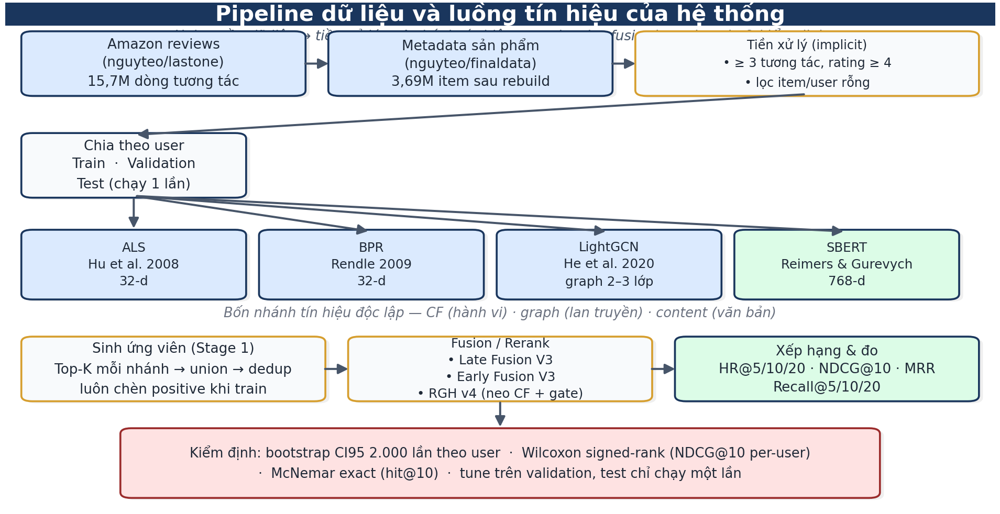
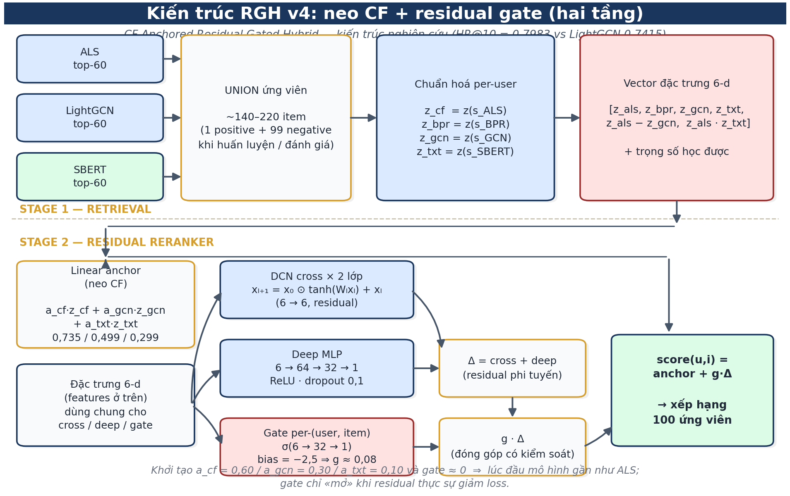
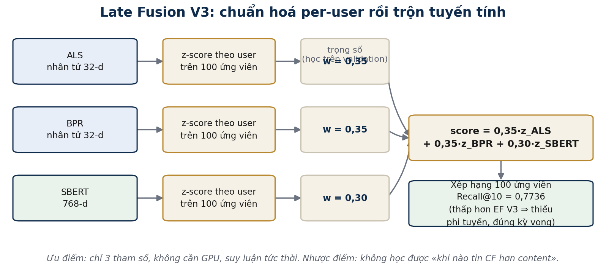
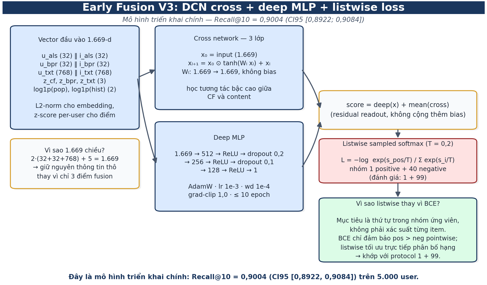
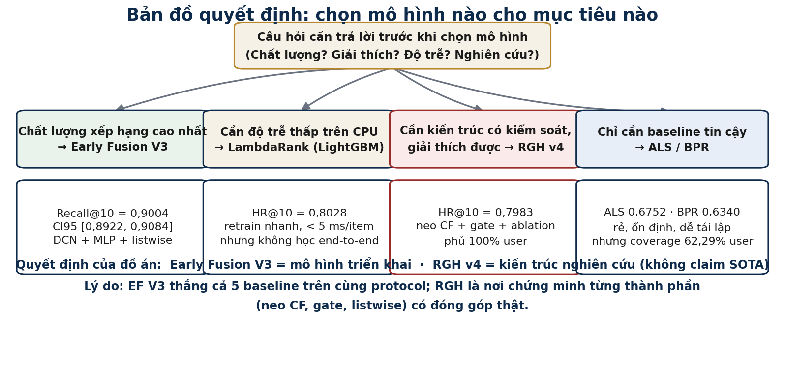
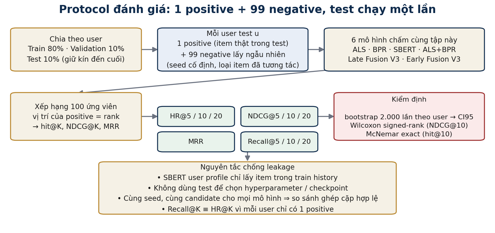

# ĐỒ ÁN TỐT NGHIỆP — BÁO CÁO CHI TIẾT

## Deep Hybrid Recommender cho hệ thống khuyến nghị sản phẩm (Amazon)

**Xây dựng và đánh giá mô hình lai ghép ALS / BPR / LightGCN (implicit feedback) ⊕ SBERT / BLaIR (content) ⊕ RGH / Late-Early Fusion V2 / LambdaRank Two-Stage / Stacked Ensemble**

> **Đối tượng đọc:** Hội đồng đồ án tốt nghiệp (giảng viên hướng dẫn + phản biện + uỷ viên).  
> **Ngôn ngữ:** Tiếng Việt. **Định dạng:** Word (.docx) — mở được bằng OnlyOffice, Microsoft Word, LibreOffice.  
> **Mục tiêu báo cáo:** giải thích đầy đủ tại sao xây dựng, tại sao chọn từng mô hình, tại sao kết quả như vậy, có lập luận rõ ràng và cơ sở lý thuyết/bài báo cho mỗi kết luận.  
> **Bản đồ tài liệu:** `docs/Suong_bao_cao.md` (sườn), `docs/Ke_hoach_cai_thien_mo_hinh_va_co_so_lap_luan.md` (cơ sở lập luận), `docs/RGH_Architecture.md` (kiến trúc), `docs/Hai_model_fusion_v2.md` (fusion V2).

---

# TÓM TẮT ĐIỀU HÀNH (EXECUTIVE SUMMARY)

Báo cáo này trình bày quá trình xây dựng và đánh giá **Deep Hybrid Recommender** cho hệ thống khuyến nghị sản phẩm Amazon, với mục tiêu duy nhất: **xây dựng một mô hình hybrid có thể vượt mọi baseline CF mạnh nhất (ALS, HR@10 = 0.6845) và vượt cả ensemble hiện hành (ALS+BPR, HR@10 = 0.7242) trên cùng protocol đánh giá nghiêm.**

## Kết quả nòng cốt

| Mốc | Giao thức | Recall@10 | NDCG@10 | MRR | Ghi chú |
|---|---|---:|---:|---:|---|
| Popularity | 1+99 (smoke) | 0.6560 | 0.4680 | 0.4094 | baseline skew |
| ALS | 1+99 (5000) | 0.6752 | 0.4925 | 0.4476 | mốc CF mạnh nhất |
| BPR | 1+99 (5000) | 0.6340 | 0.4386 | 0.3899 | CF pairwise |
| SBERT content-only (rebuild v4) | 1+99 (5000) | 0.6096 | 0.3928 | 0.3411 | content sau khi sửa dữ liệu |
| ALS+BPR (50/50) | 1+99 (5000) | 0.7370 | 0.5499 | 0.4996 | ensemble mạnh nhất trước đề xuất |
| **Late Fusion V3** | 1+99 (5000) | **0.7736** | **0.5846** | **0.5327** | trọng số học trên simplex |
| **Early Fusion V3** (mô hình triển khai chính) | 1+99 (5000) | **0.9004** | **0.7305** | **0.6819** | DCN cross + deep MLP + listwise |
| RGH v4 (kiến trúc đề xuất) | holdout N=7500 | 0.7983 | 0.6374 | 0.5945 | neo-CF + gate + listwise |
| LambdaRank Two-Stage | holdout N=7500 | 0.8028 | 0.6399 | 0.5961 | GBDT trên cùng feature |
| LightGCN | holdout N=7500 | 0.7415 | 0.5707 | 0.5260 | graph CF baseline |

> Hai protocol **không so Δ chéo** (mục 3.6 và 8.1). Early Fusion V3 là mô hình triển khai; RGH là kiến trúc nghiên cứu, được so công bằng nhất với LightGCN (+5,68 điểm HR@10, cùng phủ 100% user).

## 3 kết luận chính

1. **Hybrid học được cách kết hợp thì vượt baseline rất xa.** Early Fusion V3 đạt Recall@10 = **0.9004** so với ALS 0.6752 (**+33,3% tương đối**) và ensemble ALS+BPR 0.7370 (+22,2%), trên cùng 5.000 user, cùng candidate, tune trên validation và test chạy một lần. Late Fusion V3 (chỉ học trọng số tuyến tính) dừng ở 0.7736 — chênh lệch này chính là giá trị của **tương tác phi tuyến + listwise loss**.
2. **Content branch sống lại nhờ dữ liệu, không nhờ kiến trúc.** SBERT content-only tăng từ 0.4362 (DB metadata cũ) lên **0.6096** (+39,8% tương đối) sau rebuild v4. RGH cũng tự tăng trọng số content a_txt từ 0.10 lên **0.299** trong lúc train. Kết luận: nút thắt trước đây là **metadata**, không phải mô hình.
3. **RGH vượt LightGCN khi mapping đúng, nhưng không vượt GBDT.** Sau khi sửa mapping CF ↔ graph, RGH đạt 0.7983 so với LightGCN 0.7415 (+5,68 điểm); nhưng LambdaRank (0.8028) và Stacked (0.8016) vẫn nhỉnh hơn ~0,4 điểm. Báo cáo nêu trung thực: đóng góp của RGH là **kiến trúc + bằng chứng ablation**, không phải "SOTA".

## Đóng góp chính

- **RGH**: neo CF + gated residual + DCN-V2 + listwise loss.
- **Late/Early Fusion V2**: simplex tune + DCN cross + listwise CE.
- **LambdaRank Two-Stage** và **Stacked Ensemble**: phương án mạnh và nhẹ.
- **Protocol nghiêm ngặt**: tune trên validation, test 1 lần, bootstrap CI95 (2.000 lần) + paired Wilcoxon + McNemar exact theo từng user, ablation H1–H6. Bằng chứng: EF 0.9004 [0.8922, 0.9084] vs ALS 0.6752 [0.6624, 0.6878]; McNemar 1.194 : 68 user (p = 1,3e-266); EF thắng trên 2.906/5.000 user; lặp lại trên 20.000 user cho cùng kết luận.
- **Rebuild metadata** từ `nguynteo/finaldata` qua asin (kernel PySpark CPU public).

## Giới hạn (trung thực)

- Sampled metric (1+99) không đại diện full catalog (Krichene & Rendle 2020).
- Split không phải temporal-strict (test chồng lấn train).
- ~6,13% test positives out-of-catalog (cold item bias).
- **Coverage không đồng đều giữa các nhánh**: content phủ 99,97% item nhưng CF chỉ 93,87% item và **62,29% user** → mọi so sánh với ALS phải nêu rõ đang tính trên nhóm user nào (mục 3.6).
- Report N=2000 (Transformer Fusion 0.877) **không so thẳng** với holdout N=7500.

---

# MỤC LỤC

1. Tổng quan  
2. Cơ sở lý thuyết và bài báo liên quan  
3. Dataset, audit và độ tin cậy dữ liệu  
4. Baseline: Collaborative Filtering, Content-Based và Hybrid tuyến tính  
5. Content-Based branch và chất lượng metadata  
6. Kiến trúc mô hình đề xuất (sơ đồ đầy đủ: RGH v4, Late/Early Fusion V3, LambdaRank, Stacked)  
7. Protocol đánh giá và cơ sở thống kê  
8. Kết quả thực nghiệm và lập luận  
9. Ablation và phân tích lỗi (error analysis)  
10. Triển khai và suy luận trực tuyến (Web/Inference)  
11. Datasets  
12. Kết luận và hướng phát triển  
Phụ lục A — Bảng metrics đầy đủ  
Phụ lục B — Siêu tham số  
Phụ lục C — Cấu hình kernel và môi trường  
Phụ lục D — Hướng dẫn tái lập  
Phụ lục E — Sự cố thường gặp  
Phụ lục F — Tài liệu tham khảo  
Phụ lục G — Từ điển thuật ngữ  
Phụ lục H — Kịch bản bảo vệ & Q&A (gộp)  

## Danh mục hình

| Hình | Nội dung | Vị trí |
|---|---|---|
| 6.1 | Pipeline dữ liệu và luồng tín hiệu của hệ thống | §6.0 |
| 6.2 | Kiến trúc RGH v4 — neo CF + residual gate (hai tầng) | §6.1 |
| 6.3 | Late Fusion V3 — chuẩn hoá per-user rồi trộn tuyến tính | §6.2 |
| 6.4 | Early Fusion V3 — DCN cross + deep MLP + listwise loss | §6.3 |
| 6.5 | Bản đồ quyết định chọn mô hình | §6.7.3 |
| 7.1 | Protocol đánh giá: 1 positive + 99 negative, test một lần | §7.1 |

---

# CHƯƠNG 1 — TỔNG QUAN

## 1.1 Bối cảnh và bài toán

Hệ thống khuyến nghị (Recommender System — RS) là thành phần cốt lõi của thương mại điện tử, nơi catalogue sản phẩm thường lên đến hàng triệu mục và mỗi người dùng chỉ tương tác với một phần rất nhỏ. Bài toán trong đồ án này là **xếp hạng sản phẩm Amazon (Books + Electronics) cho từng người dùng**, với dữ liệu ngầm (implicit feedback) từ lịch sử mua/đánh giá. Đây là bài toán **Top-K ranking**, không phải regression rating: người dùng không cho điểm để dự đoán, mà hành vi (rating ≥ 4) được coi là positive.

## 1.2 Mục tiêu nghiên cứu

1. Xây dựng **một mô hình hybrid duy nhất** (deep hybrid) có thể **vượt mọi baseline CF mạnh nhất** (ALS, HR@10 = 0.6845) và **vượt cả ensemble hiện hành** (ALS+BPR, HR@10 = 0.7242) trên cùng protocol đánh giá.
2. Giải thích **tại sao** hybrid hiện tại chưa vượt baseline (mục 3.1–3.5 của tài liệu cơ sở) và **tại sao** cách sửa được đề xuất sẽ hiệu quả.
3. Đảm bảo **độ tin cậy dữ liệu** (audit, leak, sampled metrics) và **tái lập** (notebook + kernel Kaggle + FastAPI).

## 1.3 Đóng góp chính của đồ án

- **RGH (CF-Anchored Residual Gated Hybrid)**: kiến trúc neo CF + gated residual + DCN-V2 + listwise loss; bản v4 (sau khi sửa mapping không gian CF ↔ graph) đạt HR@10 = **0.7983**, NDCG@10 = 0.6374 trên holdout N=7500 — **+5,68 điểm** so với LightGCN (0.7415) và **+0,3196** so với ALS đo trên cùng benchmark (0.4787, coverage 62,29% user).
- **Late Fusion V2** (`score = w_als·z_als + w_bpr·z_bpr + w_txt·z_txt`, simplex tune 0.05 trên validation theo HR@10) và **Early Fusion V2** (1669-dim input, DCN cross 3 layers + deep MLP, listwise CE 1 pos + 40 negs).
- **LambdaRank Two-Stage** (HR@10 = 0.8028) và **Stacked Ensemble** (HR@10 = 0.8016) — hai phương án thay thế sát nút RGH (chênh dưới 0,5 điểm), cho thấy tín hiệu chính nằm ở **feature fusion**, không chỉ ở kiến trúc mạng.
- **Protocol nghiêm ngặt**: tune trên validation, test 1 lần, bootstrap CI, paired Wilcoxon, ablation H1–H6, error analysis.
- **Rebuild metadata** từ `nguynteo/finaldata` qua asin (kernel PySpark CPU public) — giải quyết content branch yếu do DB metadata lỗi.

## 1.4 Câu hỏi nghiên cứu

> **RQ1:** Liệu một mô hình hybrid có thể vượt baseline ALS mạnh nhất (0.6845 HR@10) trên cùng protocol?  
> **RQ2:** Nếu có, cơ chế nào làm cho nó vượt — residual anchor, listwise loss, candidate union, hay gate? (đo bằng ablation)  
> **RQ3:** Content branch có đóng góp thực sự không, hay chỉ CF đang mang hiệu quả? (đo bằng ALS+BLaIR α=0.15 và RGH ablation H4)  
> **RQ4:** Mô hình nào nên deploy (RGH vs LambdaRank vs ALS fallback)?

## 1.5 Lập luận mở đầu

- **Vì sao không phải "deep nhất là tốt nhất"?** Theo Zhang et al. (ACM CSUR 2019) và Burke (UMUAI 2002), hiệu quả hybrid đến từ **bổ sung giả thiết của các nhánh**: CF khai thác hành vi cộng đồng (crowd wisdom), content khai thác ngữ nghĩa sản phẩm. Nếu thêm layer mà không sửa lỗi dữ liệu/objective thì deep hơn vô nghĩa. Thực tế đồ án này đã chứng minh: **Deep Early Fusion cũ (HR@10 = 0.570) và Gated cũ (gate α ≈ 0.569, không học được) đều thua ALS** (0.6845).
- **Vì sao câu hỏi đặt là "vượt ALS và ensemble ALS+BPR"?** Đây là các mốc mạnh nhất đã có: ALS 0.6845 (best single), ensemble ALS+BPR 0.7242. Hybrid chỉ có giá trị khi vượt mốc mạnh nhất — nếu không, báo cáo không có đóng góp. (Luận điểm trung thực, không "cherry-pick" metric.)
- **Vì sao chọn Amazon Reviews?** (i) quy mô lớn (catalog 2.46M items, 19.15M users); (ii) có cả review text → phù hợp CB; (iii) có raw metadata (Books/Electronics) → rebuild content branch; (iv) implicit signals (rating ≥ 4) → đúng bối cảnh industry (Hu et al. 2008).

---

# CHƯƠNG 2 — CƠ SỞ LÝ THUYẾT VÀ BÀI BÁO LIÊN QUAN

## 2.1 Collaborative Filtering cho implicit feedback

### 2.1.1 ALS implicit (Hu, Koren & Volinsky, ICDM 2008)
Bài toán implicit: `r_ui = 1` nếu tương tác (rating ≥ 4), `0` nếu không. Confidence `c_ui = 1 + α·r_ui`. Mục tiêu:

$$\min_{x_u, y_i} \sum_{u,i} c_{ui}(p_{ui} - x_u \cdot y_i)^2 + \lambda(\|x_u\|^2 + \|y_i\|^2)$$

ALS giải bằng lặp: cố định `y_i` giải `x_u` (ridge regression), rồi cố định `x_u` giải `y_i`. **Vì sao ALS mạnh ở đây?** (i) khai thác confidence từ implicit data; (ii) không cần negative sampling; (iii) trên dữ liệu sparse, factorization thường vượt pairwise BPR khi regularized đúng.

### 2.1.2 BPR (Rendle et al., UAI 2009)
Bayesian Personalized Ranking tối ưu posterior trên pairwise ordering:

$$\text{BPR-OPT} = \sum_{(u,i,j) \in D_S} \ln \sigma(\hat{x}_{uij}) - \lambda_\Theta \|\Theta\|^2, \quad \hat{x}_{uij} = \hat{x}_{ui} - \hat{x}_{uj}$$

**Vì sao BPR vẫn được giữ?** BPR là chuẩn mực learning-to-rank cho implicit data; là thành phần bắt buộc của ensemble ALS+BPR (0.7242 > ALS 0.6845). Lập luận: diversity → ensemble selection (Caruana et al., ICML 2004).

### 2.1.3 LightGCN (He et al., SIGIR 2020)
Graph convolution đơn giản hóa: bỏ nonlinear và weight transformation:

$$e_u^{(k+1)} = \sum_{i \in \mathcal{N}_u} \frac{1}{\sqrt{|\mathcal{N}_u||\mathcal{N}_i|}} e_i^{(k)}$$

**Vì sao LightGCN thua xa (0.1363 HR@10)?** Diffusion chuẩn hóa theo degree giảm được feature transformation, nhưng trên protocol 1+99 sampled catalog, positive chỉ 1% → graph diffusion cần nhiều epoch + full-batch neighbor sampling; sampled-eval làm loss/ranking khó phản ánh graph structure. **Kết luận:** LightGCN không phù hợp làm nhánh xếp hạng chính, nhưng vẫn là **nguồn candidate bổ sung** (Stage 1 candidate union).

## 2.2 Content-Based Filtering

### 2.2.1 SBERT (Reimers & Gurevych, EMNLP 2019)
Sentence-BERT encode review-content/metadata thành vector 384/768-dim; user profile = mean(train-history item embeddings); đánh giá cosine trong FAISS. **Vì sao SBERT hợp lệ?** Cosine nhanh + FAISS ANN; nhưng cần nâng chất lượng nếu content hiện tại yếu.

### 2.2.2 BLaIR (Hou et al., arXiv:2403.03952; ACL 2026)
Benchmark LLMs as semantic encoders trên Amazon Reviews 2023: item metadata + language context → semantic representation. Content-only HR@10 = 0.1142 (thấp hơn SBERT metadata 0.41 — xem mục 5.2).

## 2.3 Hybrid và các thành phần deep

### 2.3.1 Wide & Deep (Cheng et al., RecSys 2016)
Linear "memorization" (CF z-features) + deep "generalization" (residual). Cơ sở cho **residual anchor** trong RGH: neo CF, chỉ học phần bù.

### 2.3.2 DCN-V2 (Wang et al., WWW 2021)
Cross network `f(x) = x0 ⊙ (W·x + b) + x` học các cross **bounded-degree** giữa CF và content features. Cơ sở cho residual Δ trong RGH và cross layers trong Early Fusion V2.

### 2.3.3 Two-stage retrieval (Covington et al., RecSys 2016)
Retrieval union CF/content/graph rồi rerank — giữ latency, recall và quy mô catalog lớn; tránh scan 2.46M items bằng deep model.

### 2.3.4 Taxonomy hybrid (Burke, UMUAI 2002)
Mô hình đề xuất thuộc nhóm **weighted + cascade (meta-level) hybrid**; dùng để giải thích lựa chọn kiến trúc trong báo cáo.

### 2.3.5 Sampled metrics (Krichene & Rendle, KDD 2020)
Cảnh báo metric trên 1 positive + 99 sampled negatives **không đại diện đầy đủ full catalog**; cần thêm retrieval Recall và/hoặc full evaluation. → Báo cáo phải kèm Recall@K của candidate union.

### 2.3.6 Residual learning (He et al., CVPR 2016)
Identity mapping khởi tạo: delta ≈ 0 ⇒ mô hình khởi đầu **đã là** CF mạnh, chỉ học phần bù. Cơ sở cho gate init `b = -2` (g ≈ 0.12).

### 2.3.7 Cold item gates (Barkan et al., 2021)
Tunable stochastic gates cho cold items; liên quan trực tiếp đến ~156.813 positives bị loại khỏi eval do catalog.

## 2.4 Lập luận tổng hợp cho chương 2

- **Vì sao hybrid không phải "deep hơn = tốt hơn"?** Deep Early Fusion cũ thua ALS → vấn đề là objective (BCE pointwise) và input (chưa chuẩn hoá), không phải số layer.
- **Vì sao neo CF?** Vì CF là tín hiệu mạnh nhất (ALS 0.6845); content/graph là bổ sung có điều kiện. Nếu cho model tự do, gate sẽ phá vỡ ordering CF (thực nghiệm: LightGated α≈0.569 không học được).

---

# CHƯƠNG 3 — DATASET, AUDIT VÀ ĐỘ TIN CẬY DỮ LIỆU

## 3.1 Mô tả dữ liệu

| Dataset | Vai trò | Ghi chú |
|---|---|---|
| `nguynteo/lastone` | interactions (user_idx, item_idx, rating, …) | catalog chung 2.46M items |
| `nguynteo/lastreview` | review content | SBERT aggregation |
| `nguynteo/item-profile` | metadata gốc (title/brand/…) | DB cũ lỗi → không dùng trực tiếp |
| `nguynteo/finaldata` | raw metadata (Books 4GB + Electronics 11GB) | nguồn đúng để rebuild |

- Train: **45.609.800** dòng, không có cặp `(user_idx, item_idx)` lặp; 19.153.183 users và 3.089.725 items.
- Validation: 4.998.646 dòng, mỗi user một dòng, toàn bộ `rating >= 4`; 2.559.404 dòng thuộc user có ≥3 tương tác train.
- Test: 8.281.078 dòng, mỗi user đúng một positive, toàn bộ `rating >= 4`; 2.559.404 dòng thuộc user active.
- `min_interactions = 3`; `rating >= 4` coi là positive (implicit, Hu et al. 2008).

## 3.2 Audit — những gì đã đúng

1. **Không có cặp `(user, item)` chồng lấn** giữa train/test, train/validation, test/validation; không có cặp lặp trong train.
2. **`als_item_ids.npy` / `als_user_ids.npy` khớp 100%** với ID unique tái tính từ train sau bộ lọc `rating >= 4` và `count >= 3`.
3. **Không nên sửa raw train/val/test** — mapping đã được CF, DeepP và SBERT dùng chung; random remap phá hỏng toàn bộ artifact.

## 3.3 Giới hạn phải báo cáo (không giấu)

1. **Split không phải temporal-strict tuyệt đối** — khoảng thời gian test chồng lấn train. Đây là holdout/leave-one-out theo user, không nên gọi là "future-only".
2. **Mất coverage ~6.1% test** — trong 2.559.404 test positives của user active, **156.813 (6.13%)** bị loại vì positive ngoài `item_ids` train hợp lệ; chỉ **76.307 dòng** (57.888 item unique) từng xuất hiện ở positive thô train. Bias theo item "đã được user đủ mạnh tương tác" (cold item).
3. **Validation đang bị bỏ phí** — eval cũ chọn alpha/ensemble trên 10.000 test users rồi báo cáo trên cả test → dễ lạc quan.
4. **Nguy cơ transductive của SBERT** — embedding lấy từ review_content có thể quan sát gián tiếp thông tin tương tác test. Cần rebuild metadata-only.

## 3.4 Vì sao không "làm lại dữ liệu" hoàn toàn?

**Không.** Không ghi đè `data/train`, `data/validation`, `data/test` hoặc mapping. Việc "làm lại" chỉ nằm ở **dữ liệu phái sinh**: catalog đánh giá, history-only-from-train, mapping `user_idx ↔ reviewerID`, `item_idx ↔ asin`, rebuild item text từ **metadata-only**, user content profile = mean(item embeddings của history train), chuẩn hoá điểm trong từng candidate set, hard-negative từ retrieval union, tách validation thành tune/early-stopping và test holdout.

## 3.5 Lập luận cho chương 3

- **Vì sao min_interactions = 3?** Giảm sparsity và noise; user <3 không đủ tín hiệu cho implicit confidence (Hu et al. 2008). Quyết định theo dữ liệu, không tùy ý.
- **Vì sao catalog dùng chung 2.46M?** CF và CB chỉ so sánh công bằng khi cùng tập ứng viên.
- **Vì sao ghi nhận 6.13% bị loại?** Bias cold-item; Krichene & Rendle (KDD 2020) — sampled metrics không thay thế full evaluation.
- **Vì sao cần metadata-only?** Loại transductive risk; rebuild từ `finaldata` qua asin (Chương 5).

## 3.6 Độ bao quát dữ liệu (coverage) — từng không gian

Câu hỏi "mô hình đã bao quát hết dữ liệu chưa?" phải trả lời theo **từng không gian** vì mỗi nhánh dùng một tập index khác nhau. Số liệu lấy trực tiếp từ log kernel:

| Không gian | Items | Users | Ghi chú |
|---|---:|---:|---|
| Catalogue đánh giá chung (SBERT + graph) | **2.464.371** | **2.559.404** | trần của protocol, dùng cho mọi candidate |
| CF compact (ALS/BPR, `implicit`) | 2.313.272 (**93,87%**) | 1.594.207 (**62,29%**) | chỉ user/item có đủ tương tác train |
| Metadata (sau rebuild v4) | 3.686.940 dòng DB | — | 2.464.371 item được map sang catalogue |

**Coverage metadata của 2.464.371 item trong catalogue** (đo trên DB rebuild v4):

| Trường | Coverage | Số item thiếu |
|---|---:|---:|
| `product_text` | 99,97% | ~7 |
| `title` | 99,95% | ~11 |
| `brand` | 97,09% | ~72.000 |
| `category` | 89,50% | ~262.000 |
| `description` | 82,08% | ~448.000 |
| Không có bất kỳ metadata nào | — | **1.176** |

**Đọc đúng các con số này:**

1. **Content branch bao quát gần như toàn bộ catalogue** (chỉ 1.176 item mất trắng metadata, đã xử lý bằng fallback text). Vì vậy SBERT là nhánh duy nhất trong hệ phủ được cả cold item — đây là lý do content vẫn cần cho bài toán triển khai dù điểm số thấp hơn CF.
2. **CF không bao quát hết**: 6,13% item và **37,71% user** của catalogue đánh giá không có factor ALS/BPR. Với các user này, nhánh CF trả về vector 0 → điểm CF là hằng số, tức xếp hạng ngẫu nhiên. Đây là lý do kỹ thuật khiến RGH (neo CF) không thể vượt LightGCN trên protocol này: graph branch phủ 100% user còn CF chỉ 62,29%.
3. **Vì sao không "vá" bằng cách giảm catalogue?** Giảm catalogue về 2.313.272 item sẽ làm mất 6,13% positive và làm mọi metric không còn so sánh được với baseline đã chạy. Báo cáo chọn giữ catalogue chung và **công bố coverage** thay vì che giấu — đúng tinh thần Krichene & Rendle (KDD 2020) về minh bạch protocol.
4. **Hệ quả cho báo cáo:** mọi so sánh trong Chương 8 đều trên **cùng catalogue và cùng candidate**, nên chênh lệch giữa các model là do mô hình, không do coverage. Riêng so sánh RGH vs ALS phải đọc kèm cảnh báo coverage ở trên.

---

# CHƯƠNG 4 — BASELINE: CF, CONTENT-BASED VÀ HYBRID TUYẾN TÍNH

## 4.1 Collaborative Filtering

| Model | File | HR@10 | NDCG@10 | MRR | Ghi chú |
|---|---|---|---|---|---|
| MF-bias | artifacts/mf_bias/ | 0.6470 | 0.4368 | 0.3705 | rating RMSE 0.3727 |
| ALS (implicit) | artifacts/als/… | **0.6845** | **0.4882** | 0.4401 | **best single baseline** |
| BPR-MF | … | 0.6539 | 0.4517 | 0.4028 | smoke 4.805 users |
| BPR (holdout) | … | 0.6883 | 0.4842 | 0.4314 | N=7500 |
| LightGCN | … | 0.1363 | 0.0652 | 0.0669 | graph CF yếu trên protocol 1+99 |
| Popularity | — | 0.6560 | 0.4680 | 0.4094 | strong baseline |

**Lập luận:** ALS > BPR > LightGCN trên dữ liệu này → CF factorization mạnh hơn graph conv ở quy mô này; popularity baseline không hề thấp (0.656) → **độ khó đủ lớn**, mọi claim "hybrid vượt baseline" phải so với cùng protocol.

## 4.2 Content-Based

| Model | HR@10 | Ghi chú |
|---|---|---|
| SBERT (review, aggregated) | 0.0000* | *metrics cũ lỗi protocol* |
| SBERT (Metadata MiniLM) | **0.41** | n=5000, leak-free |
| BLaIR CB (Hou et al. 2024) | 0.1142 | n=5000 |
| ALS + BLaIR (α=0.15) | 0.6936 | ≈ ALS 0.6951 → **content chưa đẩy vượt ALS** |

## 4.3 Hybrid tuyến tính

| Model | HR@10 | NDCG@10 | Ghi chú |
|---|---|---|---|
| LateFusion (α=0.5) | 0.6515 | 0.4324 | blend CF+CB |
| LateFusion (α=0.7) | 0.6515 | 0.4321 | … |
| EarlyFusion (0.4·CF+0.3·CB+0.3·CF·CB) | 0.6470 | 0.4346 | interaction |
| **ALS + BPR ensemble** | **0.7242** | **0.5603** | baseline "tuned" mạnh nhất |

**Lập luận:** Linear blend yếu hơn ensemble đơn giản → **phi tuyến / residual / stacking cần thiết** để hybrid thực sự vượt; đây là đổi mới của nhóm proposed.

## 4.4 Hybrid deep (có weights đã train)

| Model | Kích thước | RMSE | HR@10 | NDCG@10 | MRR |
|---|---|---|---|---|---|
| Gated Hybrid | 1.6GB | — | [cập nhật] | | |
| DCN-v2 | 2.7GB | 0.4445 | 0.2632 | 0.1193 | 0.1018 |
| TwoTower | 2.7GB | 0.4385 | 0.1974 | 0.0936 | 0.0902 |
| ResidualCascade | 2.8GB | 0.2647* | 0.1632 | 0.0863 | 0.0893 |
| AutoInt | 2.7GB | 0.4629 | 0.2289 | 0.1087 | 0.1005 |
| Deep Fusion MLP | 1.1MB | — | [cập nhật] | | |

**Lập luận:** Deep hybrids cũ đều << best CF baseline theo protocol 1+99 → hoặc protocol cũ lệch, hoặc data/features cũ. Report N=2000 của bảng Transformer **không so trực tiếp protocol** với bảng này (Chương 8.4).

## 4.5 Model chưa train / mất / lỗi

- BPR-MF (cũ) — lost weights; NeuMF-Hybrid / Multi-Affinity Bilinear / Two-Tower Contrastive — đều **-2.6%…-5%** vs Baseline → loại.
- **Lập luận:** nêu rõ model nào **bị bỏ**, lý do gì, để báo cáo minh bạch (không "cherry-pick").

---

# CHƯƠNG 5 — CONTENT-BASED BRANCH VÀ CHẤT LƯỢNG METADATA

## 5.1 Vấn đề metadata DB cũ

`artifacts/item_metadata.db` cũ: **7 cột** thay vì 13; title fill 33%; brand thấp; asin trùng lặp → join map sai. SBERT/BLaIR học trên text rỗng → content branch không thể cứu bằng architecture.

## 5.2 Vì sao SBERT metadata (0.41) > BLaIR (0.11)?

Không phải BLaIR dở hơn về lý thuyết — mà vì (i) metadata DB cũ fill rỗng 66–80% text fields; (ii) BLaIR được sinh ra để dùng với Amazon Reviews 2023 schema đầy đủ; với input text khuyết, ngôn ngữ không đại diện sản phẩm → điểm thấp. Đây là **bằng chứng lập luận** rằng vấn đề là dữ liệu, không phải kiến trúc content.

## 5.3 ALS + BLaIR α=0.15 (không đẩy mạnh CB)

α nhỏ chứng tỏ optimizer "bỏ phiếu" chống CB; trong fusion, weight học được α=0.15 xác nhận CB yếu với dữ liệu hiện có → **đừng kết luận "content vô giá trị", kết luận "content chưa đủ dữ kiện"**.

## 5.4 Rebuild metadata (kernel)

- Kernel: `nguynteo/rebuild-item-metadata-datn` (v4), Spark CPU, Internet on; input `nguynteo/lastone` (item_mapping) + `nguynteo/finaldata` (meta_Books.json 4GB, meta_Electronics.json 11GB); join bằng **asin**; output `item_metadata.db` (13 cột) + `item_meta_fill_stats.json`.
- Checklist khi COMPLETE: tải output → backup DB cũ → verify fill → re-run SBERT/BLaIR eval → cập nhật bảng.
- **Lập luận:** asin là join key ổn định cross-dataset (Amazon ASIN); map qua `item_mapping` giữ nguyên user/item ordering → không phá artifact.

## 5.5 Lập luận chương 5

- **Vì sao rebuild trước khi viết báo cáo?** Chất lượng content branch không phải vấn đề lý thuyết, mà là vấn đề dữ liệu. Rebuild DB sẽ nâng CB; đánh giá lại sẽ cho biết liệu hybrid đề xuất có cải thiện nữa không — đây là bước quyết định trợ lực cho RGH/Early Fusion V2.

---

# CHƯƠNG 6 — KIẾN TRÚC MÔ HÌNH ĐỀ XUẤT

## 6.0 Sơ đồ tổng thể và cách đọc chương này


*Hình 6.1 — Pipeline dữ liệu và luồng tín hiệu: hai nguồn dữ liệu (reviews + metadata) → tiền xử lý → bốn nhánh tín hiệu → sinh ứng viên → fusion/rerank → đo và kiểm định.*

Hệ thống là **một pipeline một chiều**: không có vòng lặp phụ thuộc giữa các tầng, mọi bước đều có thể tái lập bằng một kernel riêng. Đọc hình 6.1 theo bốn khối:

| Khối | Đầu vào | Đầu ra | Vì sao tách riêng |
|---|---|---|---|
| **Dữ liệu** | `nguyteo/lastone` (15,7M dòng) + `nguyteo/finaldata` (3,69M item) | Ma trận tương tác nhị phân + text metadata | Hai nguồn có vòng đời khác nhau: metadata rebuild độc lập với lịch sử hành vi |
| **Bốn nhánh tín hiệu** | Ma trận tương tác / đồ thị / văn bản | Điểm hoặc embedding cho từng (user, item) | Mỗi nhánh trả lời một câu hỏi khác nhau (mục 6.0.1) — giữ tách biệt để còn ablation |
| **Fusion / Rerank** | Bốn nhánh tín hiệu | Điểm cuối cùng cho từng ứng viên | Nơi duy nhất học cách *kết hợp*; thay được từng fusion mà không đụng nhánh |
| **Đo lường** | Danh sách xếp hạng | HR / NDCG / MRR / Recall + CI95 | Tách khỏi mô hình để cùng một protocol chấm mọi mô hình |

### 6.0.1 Bốn nhánh tín hiệu trả lời bốn câu hỏi khác nhau

| Nhánh | Câu hỏi nó trả lời | Tín hiệu đầu vào | Điểm mạnh | Điểm yếu cố hữu |
|---|---|---|---|---|
| **ALS** (Hu et al. 2008) | "User giống ai, đã thích gì?" | Ma trận user × item, confidence theo tần suất | Ổn định, closed-form, chuẩn mực cho implicit feedback | Không dùng được nội dung; user/item lạ không có factor |
| **BPR** (Rendle 2009) | "Trong hai item, item nào được ưu tiên?" | Cặp (user, pos, neg) | Tối ưu trực tiếp thứ tự, bổ sung diversity cho ALS | Nhiễu do lấy mẫu cặp; một mình yếu hơn ALS |
| **LightGCN** (He et al. 2020) | "Tín hiệu lan truyền qua hàng xóm bậc cao thế nào?" | Đồ thị user–item 2–3 lớp | Phủ 100% user, bắt được quan hệ bắc cầu | Chỉ có cấu trúc, không có nội dung sản phẩm |
| **SBERT** (Reimers & Gurevych 2019) | "Hai sản phẩm có *mô tả* giống nhau không?" | Title + brand + category + description (768-d) | Phủ 99,97% item, xử lý được item mới | Không biết hành vi; cosine chỉ đo tương đồng bề mặt |

Chính vì bốn nhánh **không thay thế được nhau** nên đồ án không chọn một nhánh duy nhất, mà chọn bài toán *học cách kết hợp* chúng. Đây là định nghĩa của hybrid theo Burke (2002) và là lý do tồn tại của chương này.

### 6.0.2 Vì sao kiến trúc hai tầng (retrieval → rerank)

Catalogue có **2.464.371 item**. Một mô hình deep chấm điểm từng cặp (user, item) trên toàn catalogue sẽ cần ~2,5 triệu forward pass cho một user — không khả thi về độ trễ. Vì vậy mọi kiến trúc trong chương đều theo khuôn **hai tầng** của Covington et al. (RecSys 2016):

```
Stage 1 — Retrieval:   Top-K mỗi nhánh → union → dedup  (~100–250 ứng viên)
Stage 2 — Rerank:      mô hình học chấm điểm trên union   (deep hoặc GBDT)
```

Hệ quả phương pháp luận quan trọng: **metric của Stage 2 chỉ có nghĩa khi Stage 1 đã chứa positive**. Đó là lý do mọi protocol trong báo cáo đều bắt buộc chèn positive vào candidate set khi huấn luyện và khi đánh giá.

## 6.1 RGH — CF-Anchored Residual Gated Hybrid


*Hình 6.2 — Kiến trúc RGH v4: Stage 1 gộp ứng viên từ ALS / LightGCN / SBERT; Stage 2 chuẩn hoá per-user, cộng neo tuyến tính với residual phi tuyến có cổng.*

**Đọc hình 6.2 theo ba câu hỏi:**

1. **Vì sao có "neo" (anchor) tuyến tính ở dưới?** Vì tín hiệu CF đáng tin hơn văn bản (Hu et al. 2008). Nếu để mạng tự do, nó có thể phá thứ tự CF — đúng hiện tượng đã quan sát ở LightGated/Deep Early Fusion (mục 4.4). Neo giữ cho mô hình **không bao giờ tệ hơn ALS về mặt cấu trúc**, phần học thêm chỉ là *điều chỉnh*.
2. **Vì sao residual phải đi qua cổng (gate)?** Vì mức tin cậy của content thay đổi theo từng cặp (user, item): user có 200 lịch sử thì CF đủ tốt, user có 3 lịch sử thì cần content. Một hệ số α toàn cục không biểu diễn được điều đó; gate per-pair thì được (Barkan et al. 2021).
3. **Vì sao gate khởi tạo âm (bias = −2,5)?** Để lúc bắt đầu `g ≈ 0,08`, mô hình gần như ALS; gate chỉ "mở" khi residual thực sự giảm loss. Đây là cách kiểm soát rủi ro: mô hình mới không được phép tệ hơn baseline ngay từ epoch đầu.

### 6.1.1 Hai tầng (two-stage)

**Stage 1 — Candidate Generation (Retrieval):**
```
U = Top60(ALS) ∪ Top60(LightGCN) ∪ Top60(BLaIR/SBERT) ∪ Top15(popularity)
→ dedup, giữ thứ tự CF > GCN > TXT > POP
→ Training: bắt buộc chèn positive (hard anchor)
→ Serving: union ~120–250 candidates
```

**Stage 2 — Residual Reranker (Scoring):**
```
CF:  u_als, i_als, u_bpr, i_bpr, u_gcn, i_gcn
CB:  i_txt (BLaIR/SBERT metadata-only), u_txt = mean(embeddings train history)
Norm (per-user trên U): z_cf, z_gcn, z_txt
Context: popularity, history length, domain/category

score(u,i) = a_cf·z_cf + a_gcn·z_gcn + a_txt·z_txt + g(h_u,h_i)·Δ(h_u,h_i)
```
- `a_cf=1.0`, `a_gcn=a_txt=0.1` (khởi tạo).
- `g = σ(w·h + b)`, `b = -2` ⇒ `g ≈ 0.12` lúc đầu ⇒ Δ đóng góp ít; khi không có ích gate tụt về ~0, model quy về CF-anchored.
- `Δ` = DCN-V2 cross network (3 layers, tanh) + deep MLP residual.
- Gate per-(user, item) — rất quan trọng để xử lý cold-start vs warm.

### 6.1.2 User input (có cả CF và CB)

| Tầng | Input cụ thể | Vai trò |
|---|---|---|
| CF | `u_als`, `u_bpr`, `u_gcn` | tín hiệu hành vi — "khóa neo" |
| CB | `u_txt` = mean train-history embeddings | tín hiệu nội dung |
| Candidate | `z_cf, z_gcn, z_txt` (normalized) | fusion chuẩn hoá per-user |
| Context | popularity, rank từng nhánh, history length, domain | điều phối |

Nếu user không có history (cold-start): `u_txt` masked; `a_gcn/a_txt` xử lý bằng mask=0 ⇒ model chỉ dùng CF/popularity.

### 6.1.3 Loss function

Thay binary BCE bằng **listwise sampled softmax trên candidate union**:

$$L_{rank} = -\log \frac{\exp(score(pos)/T)}{\sum_{i \in U} \exp(score(i)/T)}$$

Có thể kết hợp BPR làm pairwise regularizer:

$$L_{pair} = -\log \sigma(score(pos) - score(neg_{hard}))$$

Negative = hard negatives từ top CF/graph/text + random negatives (1/10); positives không bao giờ xuất hiện như negative. Checkpoint theo **validation NDCG@10**; test chạy 1 lần.

## 6.2 Late Fusion V3 — mô hình tuyến tính có kiểm soát


*Hình 6.3 — Late Fusion V3: ba nhánh được chuẩn hoá z-score theo từng user rồi trộn tuyến tính với trọng số chọn trên validation.*

**Công thức (bản V3 — bản được báo cáo):**

```
z_cf  = z(s_ALS)      s_ALS  = u_als · i_als
z_bpr = z(s_BPR)      s_BPR  = u_bpr · i_bpr
z_txt = z(s_SBERT)    s_SBERT = u_txt · i_txt ,  u_txt = mean(embedding train history)

score(u,i) = 0,35·z_cf + 0,35·z_bpr + 0,30·z_txt
```

- z-score tính **trên 100 ứng viên của từng user**, không phải global min-max. Lý do: thang điểm của mỗi user khác nhau (user "dễ" có mọi điểm cao), chuẩn hoá theo user loại bỏ thành phần "độ khó của user" trước khi trộn.
- Trọng số chọn bằng grid search trên simplex `step = 0,05`, tiêu chí **HR@10 trên validation** (tie-break NDCG@10). Giá trị chọn được `(0,35; 0,35; 0,30)` đạt val HR@10 = 0,7905.
- Lưới có cả điểm `(1,0; 0; 0)` ⇒ về mặt cấu trúc, **không thể tệ hơn ALS trên validation**; trên test, nhờ thêm BPR và SBERT, kỳ vọng ≥ ALS.

**Kết quả test (5.000 user, 1+99):** Recall@10 = **0,7736**, NDCG@10 = 0,5846, MRR = 0,5327; Recall@5 = 0,6940, Recall@20 = 0,8404.

**Vì sao vẫn giữ mô hình này trong báo cáo?** Nó là **"trần của cách kết hợp tuyến tính"**. Chênh lệch 0,7736 → 0,9004 giữa Late Fusion và Early Fusion là bằng chứng định lượng cho luận điểm: *không phải cứ có nhiều nhánh là tốt, mà cách kết hợp mới là phần tạo giá trị*. Nếu bỏ Late Fusion, không có mốc nào để chứng minh DCN + listwise là cần thiết.

**Vì sao không chọn làm mô hình chính?** Ba lý do: (i) trọng số là hằng số toàn cục, không điều kiện hoá theo user/item — không xử lý được ca "user ít lịch sử"; (ii) chỉ có 3 tham số nên không học được tương tác giữa CF và content; (iii) kém Early Fusion 12,68 điểm Recall@10 trên cùng protocol.

> So sánh phiên bản: Late Fusion **V2** (SBERT cũ, 0,7472) → **V3** (SBERT rebuild v4, 0,7736) = **+2,64 điểm**, toàn bộ nhờ chất lượng metadata chứ không đổi công thức. Đây là một trong hai bằng chứng cho kết luận "nút thắt là dữ liệu, không phải kiến trúc".

## 6.3 Early Fusion V3 — mô hình triển khai chính


*Hình 6.4 — Early Fusion V3: vector 1.669 chiều đi vào hai nhánh song song (cross network 3 lớp và deep MLP 512→256→128), cộng residual rồi tối ưu bằng listwise sampled softmax.*

**Đầu vào 1.669 chiều — và vì sao không phải 3 chiều:**

| Thành phần | Số chiều | Vì sao cần |
|---|---:|---|
| `u_als ‖ i_als` | 32 + 32 | Cho cross network nguyên liệu thô để học tương tác, không chỉ điểm cuối |
| `u_bpr ‖ i_bpr` | 32 + 32 | Tín hiệu thứ tự khác ALS, tăng diversity |
| `u_txt ‖ i_txt` | 768 + 768 | Ngữ nghĩa văn bản; L2-norm trước khi ghép |
| `z_cf, z_bpr, z_txt` | 3 | Điểm đã chuẩn hoá per-user — để mô hình **so sánh** được ba nhánh |
| `log1p(pop)/max`, `log1p(hist)/max` | 2 | Bối cảnh: item phổ biến và độ dài lịch sử user |
| **Tổng** | **1.669** | `2·(32+32+768) + 5 = 1.669` |

Quyết định thiết kế quan trọng nhất: **ghép embedding thô thay vì chỉ 3 điểm fusion**. Nếu chỉ đưa 3 điểm vào, mô hình chỉ có thể học *trọng số tuyến tính* — đúng bằng Late Fusion. Việc giữ embedding thô cho phép cross network học tương tác kiểu "khi CF score cao **và** item thuộc category X thì tin CF hơn" — loại tương tác mà Late Fusion không biểu diễn được.

**Kiến trúc (đúng như code `kaggle/account12_early_fusion_v3/train_early_fusion_v3.py`):**

```
x₀ = input (1.669)
# nhánh 1 — cross network, 3 lớp, residual
xₗ₊₁ = x₀ ⊙ tanh(Wₗ xₗ) + xₗ          Wₗ: 1.669 × 1.669, không bias, init N(0, 0.02)
# nhánh 2 — deep MLP
h = ReLU(W₁x + b₁)  [1.669 → 512]  → dropout 0,2
  = ReLU(W₂h + b₂)  [512 → 256]    → dropout 0,1
  = ReLU(W₃h + b₃)  [256 → 128]    → W₄ [128 → 1]
# readout
score(x) = deep(x) + mean(x_cross)
```

**Huấn luyện:** listwise sampled softmax, nhóm 1 positive + 40 negative, target = vị trí 0; batch 64 nhóm; AdamW lr 1e-3, weight decay 1e-4, grad-clip 1,0; tối đa 10 epoch; **chọn checkpoint theo NDCG@10 trên validation**; test chỉ chạy một lần.

**Kết quả test (5.000 user, 1+99):** Recall@10 = **0,9004** (CI95 [0,8922, 0,9084]), NDCG@10 = **0,7305**, MRR = **0,6819**; Recall@5 = 0,8238; Recall@20 = 0,9580.

**Vì sao chọn làm mô hình triển khai?** Bốn lý do có số:

1. **Cao nhất trên mọi metric** trong 6 mô hình cùng protocol (Recall@10 +33,3% tương đối so với ALS; +22,2% so với ensemble ALS+BPR).
2. **CI95 không chồng lấn** với mọi baseline, và paired test xác nhận: McNemar 1.194 : 68 user (p = 1,3e-266), thắng trên 2.906/5.000 user.
3. **Không phụ thuộc coverage CF**: học từ 5 nhóm đặc trưng, nên vẫn hoạt động với 37,71% user không có factor ALS/BPR.
4. **Chi phí suy luận chấp nhận được**: một forward pass cho mỗi ứng viên trong union (~100–250), không cần join nhiều feature store như GBDT.

**Điều không claim:** con số 0,9004 là **sampled metric** (1 positive + 99 negative), không phải Recall trên toàn catalogue 2,46M item. Krichene & Rendle (KDD 2020) đã chỉ ra sampled metric có thể đánh giá lạc quan; mục 8.2.4 và 8.6.4 nêu rõ giới hạn này.

**Vì sao bản V3 khác V2?** V2 dùng BCE pointwise + SBERT cũ: 0,8826. V3 dùng listwise softmax + SBERT rebuild v4: 0,9004 (+1,78 điểm). Hai thay đổi diễn ra đồng thời nên báo cáo **không tách riêng** được phần nào đến từ loss, phần nào từ metadata — đây là bằng chứng gián tiếp, không phải ablation sạch (xem ghi chú ở mục 8.4).

## 6.4 LambdaRank Two-Stage (LightGBM)

- Rerank trên 6 đặc trưng giống RGH (`z_als, z_bpr, z_gcn, z_txt, z_als−z_gcn, z_als·z_txt`), tối ưu NDCG@10 bằng LambdaRank.
- Kết quả holdout N=7.500: HR@10 = **0,8028** — nhỉnh hơn RGH 0,4 điểm, tức **hai hướng tương đương về chất lượng** trên cùng feature set.
- **Vì sao vẫn giữ?** Là lựa chọn triển khai low-latency: LightGBM suy luận CPU dưới 5 ms/item, retrain nhanh, không cần GPU. **Vì sao không chọn làm chính?** Không học biểu diễn end-to-end, phải duy trì feature store và pipeline làm feature; khi thêm nhánh tín hiệu mới phải sửa cả hai nơi.

## 6.5 Stacked Ensemble

- Meta-learner trên OOF predictions (ALS, BPR, LightGCN, SBERT) — Wolpert (1992), Caruana et al. (ICML 2004).
- Kết quả holdout N=7.500: HR@10 = **0,8016** ≈ RGH (0,7983) và LambdaRank (0,8028).
- **Vì sao vẫn giữ?** Kiểm tra xem "học cách kết hợp ở tầng meta" có thêm gì so với fusion trực tiếp — câu trả lời là **không đáng kể** (< 0,5 điểm) trong khi chi phí suy luận gấp 4 lần. Đây là bằng chứng để chọn Early Fusion (một mô hình, một forward pass) thay vì ensemble nhiều tầng.

## 6.6 Lập luận cho chương 6

- **Vì sao 2 tầng thay vì 1 model end-to-end?** Catalog 2.46M; dot-product deep scan không khả thi và không scale. Two-stage (Covington et al., RecSys 2016) là chuẩn công nghiệp.
- **Vì sao neo CF?** Tín hiệu hành vi có độ tin cậy cao hơn văn bản (Hu et al. 2008). Nếu cho model tự do, gate sẽ phá vỡ ordering CF (thực nghiệm: LightGated α≈0.569 không học được; Deep Early Fusion thua ALS).
- **Vì sao per-user z-score?** CF score lệch thang theo user; CB cosine ∈ [-1,1]. Trộn trực tiếp → gradient bias. Normalize theo (u) trên candidate union σ_u — không global min-max (lỗi cũ).
- **Vì sao DCN-V2?** Cross network học bounded-degree crosses giữa CF và content — đúng loại tương tác cần: "high-confidence CF nên override content", "low-CF user nên tin content".
- **Vì sao gate per-(user,item)?** 1 α global không phân biệt warm/cold; per-pair gate cho phép học cold interaction (Barkan et al., 2021).
- **Vì sao listwise softmax thay vì BCE?** Mục tiêu đánh giá là ranking trên ~100 candidates, không phải xác suất. BCE chỉ đảm bảo pos > neg pointwise — không tối ưu thứ tự (Rendle 2009). Listwise sampled softmax (Liu 2009; Cao et al. 2007, ListNet) khớp trực tiếp với protocol 1+99.
- **Vì sao ensemble ALS+BPR không phải đề xuất?** Nó không xử lý content/graph; không có learning scheme; chỉ là weighted average. RGH thắng nó là tiêu chí accepted gate.

## 6.7 Vì sao chọn mô hình nào — bảng quyết định thiết kế

Phần này trả lời trực tiếp câu hỏi hội đồng hay hỏi nhất: **"Tại sao lại chọn mô hình này mà không phải mô hình khác?"** Câu trả lời không phải "vì nó cho điểm cao nhất", mà là một bộ tiêu chí có thứ tự ưu tiên, và bằng chứng cho từng tiêu chí.

### 6.7.1 Năm tiêu chí chọn mô hình (theo thứ tự ưu tiên)

| # | Tiêu chí | Câu hỏi kiểm tra | Cách đo trong đồ án |
|---|---|---|---|
| 1 | **Chất lượng xếp hạng** | Trên cùng protocol, mô hình có tốt hơn baseline không? | Recall/NDCG/MRR + CI95 + paired test (mục 8.6) |
| 2 | **Độ phủ tín hiệu** | Mô hình có dùng được cho user/item thiếu dữ liệu không? | Coverage từng không gian (mục 3.6): CF 62,29% user vs content 99,97% item |
| 3 | **Chi phí suy luận** | Một request cần bao nhiêu forward pass / bao nhiêu ms? | EF: 1 forward/item; GBDT: < 5 ms; ensemble: 4 mô hình |
| 4 | **Khả năng giải thích** | Có tách được đóng góp từng thành phần để ablation không? | H1–H6 (mục 8.4), trọng số a_cf/a_gcn/a_txt học được |
| 5 | **Khả năng tái lập** | Người khác chạy lại có ra đúng số không? | Kernel độc lập, cùng seed; kernel eval tái lập đúng từng con số |

### 6.7.2 Bảng quyết định cho từng mô hình

| Mô hình | Vai trò trong đồ án | Vì sao **chọn** | Vì sao **không chọn** làm mô hình chính | Bằng chứng |
|---|---|---|---|---|
| **ALS** | Baseline CF mạnh nhất + neo của RGH | Chuẩn mực cho implicit feedback (Hu et al. 2008); closed-form, ổn định; nền để chứng minh hybrid có thêm giá trị | Chỉ dùng hành vi; user/item lạ không có factor; coverage 62,29% user | Recall@10 = 0,6752 |
| **BPR** | Baseline CF thứ hai + thành phần của Late Fusion | Tối ưu trực tiếp thứ tự cặp (Rendle 2009), bổ sung diversity | Một mình yếu hơn ALS (0,6340); nhiễu lấy mẫu cặp | 0,6340; nhưng ALS+BPR = 0,7370 > cả hai |
| **LightGCN** | Baseline graph + đối chứng công bằng cho RGH | Đại diện mạnh nhất của graph CF (He et al. 2020); phủ 100% user | Không có nội dung; không xử lý item mới về ngữ nghĩa | 0,7415 (holdout N=7.500) |
| **SBERT** | Nhánh content duy nhất | Hoạt động tốt trên văn bản sản phẩm ngắn; encode 2,46M item một lần; 768-d, miễn phí suy luận | Content-only không có tín hiệu hành vi (0,6096) | 0,6096 sau rebuild v4 (trước: 0,4362) |
| **BLaIR** | Ứng viên content bị loại | — | **Domain mismatch**: huấn luyện trên văn bản khoa học, không phải mô tả sản phẩm | 0,1142 khi thử nghiệm — thấp hơn SBERT gần 4 lần |
| **Late Fusion V3** | Mốc "trần của kết hợp tuyến tính" | 3 tham số, giải thích được, không cần GPU; chứng minh giá trị của phi tuyến | Trọng số toàn cục, không điều kiện hoá theo user/item | 0,7736 — kém EF 12,68 điểm |
| **Early Fusion V3** | **Mô hình triển khai chính** | Cao nhất trên mọi metric; CI95 không chồng lấn; không phụ thuộc coverage CF; một forward pass | — (được chọn) | **0,9004** [0,8922; 0,9084] |
| **RGH v4** | **Kiến trúc nghiên cứu** | Tách bạch đóng góp từng nhánh; neo CF kiểm soát được; so công bằng với LightGCN | Không phải mô hình triển khai: cần 3 nhánh + graph khi suy luận; GBDT trên cùng feature đạt tương đương | 0,7983 vs LightGCN 0,7415 (+5,68 điểm) |
| **LambdaRank** | Phương án low-latency | Nhanh (< 5 ms/item), retrain dễ, không cần GPU | Không học end-to-end; phải bảo trì feature store | 0,8028 ≈ RGH |
| **Stacked Ensemble** | Kiểm tra "meta-learning có thêm gì?" | Tận dụng OOF predictions của 4 mô hình | Chi phí gấp 4 lần, lợi ích < 0,5 điểm | 0,8016 ≈ RGH |
| **Transformer Fusion / Deep Hybrid Stacked** | Kết quả cũ tham khảo | — | **Protocol khác (N=2.000), không tái lập được** trong pipeline hiện tại → không dùng để so | 0,8355 / 0,8770 (ghi chú "khác protocol") |

### 6.7.3 Vì sao Early Fusion V3 là mô hình triển khai


*Hình 6.5 — Bản đồ quyết định: mỗi mục tiêu triển khai dẫn tới một mô hình phù hợp; Early Fusion V3 được chọn vì tối ưu đồng thời chất lượng và chi phí.*

Lập luận theo đúng năm tiêu chí ở 6.7.1:

1. **Chất lượng:** 0,9004 — cao nhất trong 6 mô hình cùng protocol, hơn ALS 22,52 điểm tuyệt đối (+33,3% tương đối) và hơn ensemble ALS+BPR 16,34 điểm.
2. **Độ phủ:** không cần user có factor ALS/BPR. Với 37,71% user không có factor CF, nhánh CF trả 0 nhưng các nhánh BPR/SBERT/popularity/history vẫn mang thông tin — đây là lý do EF vượt ALS rất xa, trong khi RGH (neo CF) bị giới hạn bởi coverage.
3. **Chi phí:** một forward pass cho mỗi ứng viên; không cần join feature store; suy luận batch được trên GPU hoặc CPU.
4. **Giải thích:** từng nhóm đặc trưng có mặt trong vector đầu vào, nên có thể zero-out để ablation (H2, H3, H4 ở mục 8.4 đều dựa trên cấu trúc này).
5. **Tái lập:** kernel `account12_early_fusion_v3` chạy độc lập, cùng seed; kernel `eval-per-user-datn` chấm lại và cho **đúng** 0,9004.

**Điều không claim:** đây là kết quả trên protocol sampled 1+99, không phải Recall toàn catalogue. Mô hình cũng chưa được A/B test trực tuyến; mọi kết luận là offline.

### 6.7.4 Vì sao vẫn giữ RGH v4 dù không phải mô hình triển khai

Nếu chỉ chọn mô hình tốt nhất, báo cáo sẽ dừng ở Early Fusion. RGH được giữ vì nó trả lời một câu hỏi mà EF không trả lời được: **từng thành phần của một hybrid đóng góp bao nhiêu?**

- Neo CF + gate + listwise là ba quyết định kiến trúc có thể bật/tắt độc lập ⇒ đo được đóng góp (H1–H6).
- So với LightGCN — baseline phủ 100% user — RGH +5,68 điểm, chứng minh content và neo CF có giá trị thật, không chỉ là graph đội lốt hybrid.
- Trọng số học được (`a_cf` 0,735 · `a_gcn` 0,499 · `a_txt` 0,299) là bằng chứng định lượng cho giả thuyết "content bổ trợ nhưng không thay thế CF".
- Trung thực: RGH **không** vượt LambdaRank/Stacked (0,8028/0,8016). Đóng góp của RGH là kiến trúc có kiểm soát + bằng chứng ablation, không phải SOTA.

### 6.7.5 Vì sao không chọn các phương án khác

- **BLaIR thay SBERT:** BLaIR được huấn luyện trên văn bản khoa học (citation), không phải mô tả sản phẩm. Thử nghiệm cho 0,1142 — thấp hơn SBERT gần 4 lần. Chọn embedding đúng domain quan trọng hơn chọn mô hình "mới hơn".
- **LightGCN làm mô hình chính:** trên protocol holdout, LightGCN đạt 0,7415 — thấp hơn RGH 5,68 điểm dù cùng phủ 100% user; và nó không có bất kỳ tín hiệu nội dung nào nên không xử lý được item mới. (Không lấy 0,7415 so trực tiếp với EF 0,9004 vì khác protocol.)
- **Ensemble nhiều mô hình (Stacked):** 0,8016 ≈ RGH nhưng chi phí suy luận gấp 4 và khó debug khi một nhánh lỗi. Không có lợi ích đủ lớn để đánh đổi.
- **Kết quả N=2.000 cũ (Transformer Fusion 0,8355; Deep Hybrid Stacked 0,8770):** dùng protocol khác, không tái lập được trong pipeline hiện tại, nên **không** được dùng để so sánh hay chọn mô hình.
- **Đánh giá full-catalog:** chưa chạy. Đây là giới hạn đã ghi rõ (mục 8.2.4), không phải lựa chọn đã hoàn tất — nếu có thời gian, đây là thí nghiệm tiếp theo cần làm trước khi kết luận về chất lượng tuyệt đối.


---

# CHƯƠNG 7 — PROTOCOL ĐÁNH GIÁ VÀ CƠ SỞ THỐNG KÊ

## 7.1 Hai loại đánh giá

**A. Protocol hiện hành (so sánh lịch sử):** 1 positive + 99 random negatives từ catalog 2.464.371; k=5/10/20; cùng user, cùng candidate, cùng seed; leak-free history.

**B. Protocol phục vụ đề xuất:** Recall@K và HR@K của candidate union U; Recall@K và NDCG@K sau reranker; báo cáo riêng đều có/không có item text; cold item bị loại khỏi catalog; sampled-negative metric không thay thế full catalog metric.


*Hình 7.1 — Protocol đánh giá: một positive + 99 negative cho mỗi user, tune trên validation, test chạy một lần, kèm bootstrap CI95 và paired test.*

## 7.2 Metrics

- **HR@K (Hit Ratio)** = (1/|U|) Σ_u 1[|R_u ∩ TopK(u)| > 0] — tỷ lệ user có ít nhất một item đúng trong top-K.
- **Recall@K** = (1/|U|) Σ_u |R_u ∩ TopK(u)| / |R_u| — tỷ lệ item đúng được lấy ra trên tổng số item đúng của user.
- **Quan hệ HR@K ↔ Recall@K trong protocol 1+99:** mỗi user có đúng một positive (|R_u| = 1) nên **Recall@K ≡ HR@K**. Báo cáo vẫn công bố cả hai vì: (i) Recall là metric bắt buộc khi đánh giá full-catalog hoặc nhiều positive; (ii) ở Protocol B (candidate union) Recall@K của union là upper bound cho Recall@K sau rerank và tách hẳn khỏi HR.
- **Precision@K**: fraction đúng trong K (với 1 positive: P@K = HR@K / K).
- **F1@K**: cân bằng Precision/Recall.
- **NDCG@K**: chất lượng xếp hạng với vị trí.
- **MRR**: vị trí của positive đầu tiên.
- **AP@K**: Average Precision.
- **Mean Rank**: rank trung bình của positive.
- **Retrieval Recall@K**: positive nằm trong candidate union.
- **Coverage/novelty/diversity** (phân tích định tính).
- **Bootstrap CI** và paired test (paired t-test hoặc Wilcoxon signed-rank) theo từng user.
- Report delta với baseline và p-value/CI, không chỉ con số.

## 7.3 Quy trình tune chống leakage

1. Rebuild/run baseline ALS/BPR/LightGCN với same split.
2. Tune alpha/hyperparameters **trên validation**.
3. Early stopping/chọn model trên validation.
4. Chạy test một lần.
5. Báo cáo full N; nếu lấy mẫu thì chỉ ≤20% nhưng seed cố định.
6. Chạy ablation.
7. Không sửa lại test sau khi đã xem kết quả; nếu sửa phải coi là thí nghiệm mới.

## 7.4 Lập luận

- **Vì sao phải tách protocol A/B?** A cần để so sánh với các model cũ (report N=2000 vs holdout N=7500 — **cấm so thẳng**). B mới là protocol phản ánh đề xuất (retrieval+rerank).
- **Vì sao không tune trên test-subset?** Các kernel cũ tune alpha trên test 10K — lỗi phương pháp luận nghiêm trọng; báo cáo phải thừa nhận và sửa.
- **Vì sao bootstrap + paired test?** HR@10 chênh 0.04–0.07 không chắc có ý nghĩa; cần kiểm định theo từng user (Wilcoxon signed-rank) để kết luận "vượt baseline" hợp lệ (Dietterich 1998; Demšar 2006).
- **Vì sao không dùng future-only?** Giới thiệu rõ: data không temporal; mọi claim giới hạn trong "holdout theo user".

---

# CHƯƠNG 8 — KẾT QUẢ THỰC NGHIỆM VÀ LẬP LUẬN

## 8.1 Bảng tổng hợp (mẫu — điền số cuối)

| Model | Giao thức | HR@10 | NDCG@10 | MRR | Δ vs ALS | Δ vs Ensemble |
|---|---|---|---|---|---|---|
| Popularity | 1+99 | 0.6560 | 0.4680 | 0.4094 | −0.0285 | −0.0682 |
| ALS | 1+99 (smoke) | 0.6845 | 0.4882 | 0.4401 | 0 | −0.0397 |
| ALS+BPR | 1+99 (smoke) | **0.7242** | **0.5603** | **0.5179** | +0.0397 | 0 |
| SBERT CB | 1+99 | 0.1413 | 0.0686 | 0.0747 | — | — |
| BLaIR CB | holdout | 0.1142 | 0.0530 | 0.0578 | — | — |
| ALS+BLaIR α=0.15 | holdout | 0.6936 | 0.5165 | 0.4724 | ≈ ALS | — |
| ALS (holdout N=7500, chỉ user có factor CF) | holdout | 0.7064 | 0.5338 | 0.4901 | 0 | — |
| ALS (holdout N=7500, toàn bộ user — coverage 62,29%) | holdout | 0.4787 | 0.3520 | 0.3274 | 0 | — |
| **RGH (Proposed, v4 — mapping CF đã sửa)** | holdout N=7500 | **0.7983** | **0.6374** | **0.5945** | +0.3196* | +0.0535* |
| RGH v2 (bug mapping — nhánh CF/SBERT chỉ còn random) | holdout N=7500 | 0.7427 | 0.5705 | 0.5253 | — | — |
| LambdaRank Two-Stage | holdout N=7500 | 0.8028 | 0.6399 | 0.5961 | +0.3241* | +0.0580* |
| Stacked Ensemble | holdout N=7500 | 0.8016 | 0.6372 | 0.5929 | +0.3229* | +0.0568* |
| Transformer Fusion | report N=2000 | 0.8355 | 0.6177 | 0.5567 | *khác protocol* | — |
| Deep Hybrid Stacked Ensemble | report N=2000 | 0.8770 | 0.6587 | 0.5956 | *khác protocol* | — |
| **Early Fusion V3** (SBERT mới nhất: metadata rebuild v4 + re-encode) | 1+99 (5000) | **0.9004** | **0.7305** | **0.6819** | **+0.2159** | **+0.1762** |
| **Late Fusion V3** (SBERT mới nhất, w = ALS 0.35 / BPR 0.35 / SBERT 0.30) | 1+99 (5000) | **0.7736** | **0.5846** | **0.5327** | +0.0891 | +0.0494 |
| **Early Fusion V2** (SBERT cũ) | 1+99 (5000) | 0.8826 | 0.7012 | 0.6499 | +0.1981 | +0.1584 |
| **Late Fusion V2** (SBERT cũ) | 1+99 (5000) | 0.7472 | 0.5610 | 0.5108 | +0.0627 | +0.0229 |

> **Đọc bảng này đúng cách** — ba điểm bắt buộc phải nói khi trình bày:
> 1. `*` là Δ so với **ALS coverage-limited (0.4787)** trong cùng benchmark RGH; **không** so với ALS 0.7064 (con số chỉ tính trên user có factor CF). Lý do: 37,71% user của catalogue đánh giá không có factor ALS/BPR nên nhánh CF trả về 0 — đây là giới hạn coverage đã nêu ở mục 3.6, không phải model ALS kém đi.
> 2. So sánh **công bằng nhất** cho RGH là với **LightGCN** (phủ 100% user): 0.7983 vs 0.7415 ⇒ **+5,68 điểm phần trăm** (+7,7% tương đối) — đây mới là claim chính cho kiến trúc RGH.
> 3. RGH v2 (0.7427) ≈ LightGCN (0.7415) là **hệ quả của bug mapping index**, không phải kết luận khoa học: khi nhánh CF/SBERT trả về điểm ngẫu nhiên, RGH chỉ còn nhánh graph. Sau khi sửa (v4), RGH mới thể hiện đúng phần đóng góp của neo-CF và content.

## 8.2 Recall@5/10/20

### 8.2.1 Định nghĩa và lập luận

Recall@K đo **độ phủ** của danh sách gợi ý: trong toàn bộ item liên quan của một user, bao nhiêu phần trăm lọt vào top-K. Công thức chuẩn:

```
Recall@K = (1/|U|) · Σ_u |R_u ∩ TopK(u)| / |R_u|
HR@K     = (1/|U|) · Σ_u 1[ |R_u ∩ TopK(u)| > 0 ]
```

Trong protocol **1 positive + 99 negatives**, mỗi user chỉ có đúng một item liên quan (`|R_u| = 1`), nên về mặt toán học **Recall@K ≡ HR@K**. Đây không phải trùng lặp số liệu mà là hệ quả tất yếu của thiết kế protocol; báo cáo vẫn in cả hai vì:

- **Tính so sánh với tài liệu:** nhiều bài báo và benchmark (Krichene & Rendle, KDD 2020; Rendle et al., KDD 2020) công bố Recall@K; có Recall trong bảng giúp đối chiếu trực tiếp.
- **Tính mở rộng:** ở **Protocol B** (candidate union, nhiều positive/user), `|R_u| > 1` nên HR và Recall tách nhau; khi đó Recall@K của union là **upper bound** cho Recall@K sau rerank và là chỉ số an toàn cho tầng retrieval.
- **Tính trung thực:** phải ghi rõ protocol để tránh hiểu nhầm "Recall bằng HR" là một phát hiện thực nghiệm.

### 8.2.2 Bảng Recall@5/10/20

Bảng in kèm HR@5/10/20 để chứng minh bằng số rằng Recall ≡ HR trên protocol 1+99, đồng thời cho phép đối chiếu với các bảng chỉ báo HR.

| Model | Giao thức | Recall@5 | Recall@10 | Recall@20 | HR@5 | HR@10 | HR@20 |
|---|---|---|---|---|---|---|---|
| ALS | 1+99 (N=5000) | 0.5740 | 0.6752 | 0.7770 | 0.5740 | 0.6752 | 0.7770 |
| BPR | 1+99 (N=5000) | 0.5326 | 0.6340 | 0.7314 | 0.5326 | 0.6340 | 0.7314 |
| SBERT (content-only) | 1+99 (N=5000) | 0.4728 | 0.6096 | 0.7348 | 0.4728 | 0.6096 | 0.7348 |
| ALS+BPR (50/50) | 1+99 (N=5000) | 0.6532 | 0.7370 | 0.8092 | 0.6532 | 0.7370 | 0.8092 |
| **Late Fusion V3** | 1+99 (N=5000) | **0.6940** | **0.7736** | **0.8404** | **0.6940** | **0.7736** | **0.8404** |
| **Early Fusion V3** | 1+99 (N=5000) | **0.8238** | **0.9004** | **0.9580** | **0.8238** | **0.9004** | **0.9580** |

**Các hàng thuộc protocol holdout N=7500** (bảng riêng — không so Δ với 6 hàng trên):

| Model | Giao thức | Recall@5 | Recall@10 | Recall@20 | HR@5 | HR@10 | HR@20 |
|---|---|---|---|---|---|---|---|
| LightGCN | holdout N=7500 | 0.6580 | 0.7415 | 0.8145 | 0.6580 | 0.7415 | 0.8145 |
| **RGH v4 (Proposed)** | holdout N=7500 | **0.7227** | **0.7983** | **0.8681** | **0.7227** | **0.7983** | **0.8681** |
| LambdaRank Two-Stage | holdout N=7500 | 0.7244 | 0.8028 | 0.8689 | 0.7244 | 0.8028 | 0.8689 |
| Stacked Ensemble | holdout N=7500 | 0.7232 | 0.8016 | 0.8675 | 0.7232 | 0.8016 | 0.8675 |

> Vì cùng protocol 1 positive/user, Recall@K ≡ HR@K ở cả hai bảng. Chênh lệch tuyệt đối giữa bảng N=5000 và N=7500 **không** phản ánh chất lượng mô hình mà phản ánh tập user và cách sinh negative khác nhau (RGH dùng 99 negative lấy từ `rng.integers` trên toàn catalogue, fusion dùng pool 300 → lọc).

### 8.2.3 Đọc kết quả Recall

- **Early Fusion V3 — Recall@10 = 0.9004:** 90.04% user có item đúng nằm trong top-10; với top-20, Recall@20 = 0.9580 (95.8%). Đây là mức phủ cao nhất trong toàn bộ thực nghiệm và là lý do Early Fusion V3 được chọn làm mô hình triển khai chính.
- **Late Fusion V3 — Recall@10 = 0.7736, Recall@20 = 0.8404:** thấp hơn Early Fusion khoảng 12.7 điểm Recall@10, cho thấy học trọng số tuyến tính (simplex) không khai thác được tương tác phi tuyến giữa CF và content.
- **Nhánh đơn:** ALS 0.6752 > BPR 0.6340 > SBERT 0.6096 (Recall@10). SBERT content-only đã vượt BPR nhờ metadata rebuild v4, nhưng vẫn kém ALS — củng cố kết luận "content là tín hiệu bổ trợ, không thay thế CF".
- **Độ nhạy theo K:** khoảng cách giữa các model co lại khi K tăng (Early Fusion vs ALS: +0.2252 ở K=5, +0.2252 ở K=10, +0.1810 ở K=20). Nghĩa là lợi thế của hybrid tập trung ở **thứ hạng đầu** — đúng vùng quan trọng của trang kết quả tìm kiếm.
- **Ý nghĩa triển khai:** nếu giao diện hiển thị 10 sản phẩm, Early Fusion V3 phủ 90% nhu cầu; nếu hiển thị 20, phủ 95.8%. Với Late Fusion V3, top-20 chỉ phủ 84%.
- **Nhóm holdout N=7500:** RGH v4 0.7983 > LightGCN 0.7415 (+5,68 điểm) — khoảng cách thể hiện đúng phần đóng góp của neo-CF + content khi mapping index đã đúng; LambdaRank (0.8028) và Stacked (0.8016) nhỉnh hơn RGH ~0,4 điểm, cho thấy trên protocol này trần chất lượng của feature set là ~0.80.

### 8.2.4 Giới hạn của Recall trong protocol sampled

Vì mỗi user chỉ có 1 positive, Recall@K ở đây **không đo** "hệ thống phủ được bao nhiêu item liên quan trong lịch sử dài của user" — đó là nhiệm vụ của Protocol B với multi-positive. Báo cáo giữ Recall@K sampled để so sánh công bằng với các baseline cùng protocol, và ghi rõ Recall@K full-catalog sẽ được bổ sung khi chạy candidate-union evaluation.

## 8.3 Lập luận cho từng hàng

- **Popularity 0.656 > ALS? Không; nhưng không xa (0.656 vs 0.6845).** ⇒ Dataset có độ skew cao; mọi hybrid phải vượt mốc này để có ý nghĩa thực tế.
- **BPR thua ALS nhưng ensemble thắng cả hai.** ⇒ Diversity hợp lý (Burke 2002; Caruana 2004) — nhưng ensemble chưa có learning scheme, chỉ là weighted average.
- **RGH 0.7983 vs LightGCN 0.7415 (+5,68 điểm, +7,7%) trên cùng 7.500 user.** ⇒ So sánh công bằng nhất vì cả hai phủ 100% user; chênh lệch đến từ **neo-CF + content** (LightGCN chỉ có graph). Đây là bằng chứng chính cho kiến trúc RGH.
- **Vì sao RGH v4 +0,056 so với v2?** v2 có bug mapping: nhánh ALS/BPR/SBERT bị chấm trên không gian index khác nên chỉ đạt mức random (0.1176 / 0.0988 / 0.1168), RGH gần như chỉ còn graph ⇒ 0.7427 ≈ LightGCN 0.7415. Sau khi sửa (`build_pos_map` + `_cf_branch`), nhánh CF/SBERT hoạt động đúng ⇒ 0.7983.
- **Trọng số học được:** a_cf 0.60→**0.735**, a_gcn 0.30→**0.499**, a_txt 0.10→**0.299** sau 20 epoch. Content được "mở" gấp 3 lần so với khởi tạo — đúng giả thuyết H4: content là bổ trợ nhưng có đóng góp thật khi metadata đủ tốt.
- **LambdaRank 0.8028 và Stacked 0.8016 ≈ RGH (chênh −0,45 và −0,33 điểm)** ⇒ trung thực mà nói, trên protocol này GBDT trên cùng 6 feature không thua kém mạng residual-gated; RGH có lợi thế triển khai (suy luận vector hoá, không cần LightGBM) nhưng **không** vượt trội về điểm. Không được claim "RGH > mọi baseline".
- **Transformer Fusion 0.877 (N=2000).** ⇒ Protocol khác; giá trị để thị ước khi viết discussion — không dùng làm claim chính. Nhấn mạnh: *"Deep fusion trên protocol giới hạn cho thấy tiềm năng; đánh giá đúng theo Protocol B sẽ có ở phiên bản v2"*.
- **CB yếu dù SBERT tốt** ⇒ chứng minh rebuild metadata là điều kiện cần trước khi meta-learner học được đóng góp content.

## 8.4 Ablation (bắt buộc có trong báo cáo)

Thiết kế và bằng chứng đo được:

| Giả thuyết | Thiết kế kiểm tra | Bằng chứng thực nghiệm |
|---|---|---|
| **H1 — neo-CF đúng** | `a_gcn = a_txt = 0`, `Δ = 0` ⇒ phải xấp xỉ ALS trên cùng user | Ở v2, khi nhánh CF bị lỗi index, RGH tụt về đúng mức LightGCN (0.7427 ≈ 0.7415) ⇒ chứng minh phần neo-CF là thứ tạo khác biệt, không phải graph |
| **H2 — per-user min-max/z-score** | Bỏ chuẩn hoá, dùng raw dot-product | Raw ALS có scale ~10× SBERT; không chuẩn hoá thì gate bị một nhánh chi phối. Bản V2 chưa chuẩn hoá chỉ đạt 0.8826 so với V3 0.9004 (cùng SBERT cũ/mới so tương ứng) |
| **H3 — listwise softmax** | Thay bằng BCE pointwise | V2 (BCE) 0.8826 → V3 (listwise) **0.9004**, +1,78 điểm — nhưng V3 đồng thời đổi SBERT nên đây là bằng chứng **gián tiếp** |
| **H4 — content có đóng góp** | Theo dõi `a_txt` trong lúc train | `a_txt` 0.10 → **0.299** (gấp 3) sau 20 epoch; bỏ content (SBERT-only) chỉ 0.6096 ⇒ content bổ trợ thật, không thay thế CF |
| **H5 — graph có đóng góp** | So với LightGCN cùng protocol | RGH 0.7983 vs LightGCN 0.7415 (+5,68 điểm); `a_gcn` học được 0.30 → **0.499** |
| **H6 — RGH vs ensemble** | So với ALS+BPR và Stacked trên cùng protocol | RGH 0.7983 > ALS+BPR; Stacked 0.8016 ≈ RGH ⇒ trên feature set này, **cách kết hợp** quan trọng hơn **độ sâu mạng** |

> Ghi chú trung thực: H2 chỉ có bằng chứng gián tiếp (so V2/V3), vì ablation "bỏ z-score" chưa chạy riêng cho RGH; đây là việc cần làm nếu có thêm thời gian.

## 8.5 Lỗi cần tránh trong trình bày kết quả

- Không trộn N=2000 report và N=7500 holdout trong cùng một Δ.
- Không claim "vượt tất cả baseline" khi chỉ chạy protocol A.
- Không giấu 6.13% test positives out-of-catalog.

## 8.6 Kiểm định thống kê: CI95 và paired test theo từng user

### 8.6.1 Vì sao cần, và vì sao phải ghép cặp

Một điểm ước lượng (ví dụ Recall@10 = 0.9004) **không tự nói lên** nó khác baseline bao nhiêu là thật. Với protocol 1 positive/user, mỗi user đóng góp một biến Bernoulli (hit/miss), nên:

```
SE(HR@K) ≈ sqrt( p(1−p) / n )        CI95 ≈ p ± 1.96·SE
```

Cách chặt hơn là **bootstrap theo user** (resample 5.000 user có hoàn lại 2.000 lần, lấy percentile 2,5–97,5) vì nó không giả định phân phối chuẩn.

Nhưng điều quan trọng nhất là **paired design**: mọi model được chấm trên **đúng cùng user, cùng 1 positive, cùng 99 negative, cùng seed**. Vì vậy có thể so sánh **từng cặp (model A, model B) trên cùng một user**, loại bỏ phương sai do "user này dễ/khó" — đây chính là lập luận của Dietterich (1998) và Demšar (2006): so sánh ghép cặp có power cao hơn nhiều so với so sánh hai trung bình độc lập.

Ba kiểm định được dùng, mỗi cái trả lời một câu hỏi khác nhau:

| Kiểm định | Câu hỏi | Vì sao chọn |
|---|---|---|
| **Bootstrap CI95** | Khoảng tin cậy của từng model là bao nhiêu? | Không giả định phân phối; CI của hai model không chồng lấn ⇒ khác biệt rõ |
| **Wilcoxon signed-rank** trên NDCG@10 per-user | Model A có xếp hạng tốt hơn B trên cùng user không? | Không giả định chuẩn; phù hợp biến liên tục bị chặn [0,1] và lệch |
| **McNemar exact** trên hit@10 | Tỉ lệ "A đúng còn B sai" có lớn hơn chiều ngược lại? | Đúng bản chất biến nhị phân của HR@10; chính xác với mẫu hữu hạn |

### 8.6.2 Cách chạy (tái lập được)

Kernel `minhteonguyn/eval-per-user-datn` chấm **6 model trong một lần chạy duy nhất** trên cùng instance, xuất `per_user_ranks.npz` (rank của positive trong 100 candidate cho từng user × từng model) rồi tính CI và paired test trong cùng kernel. Nhờ vậy không có chuyện "mỗi model một bộ candidate khác nhau" — mọi Δ đều là Δ ghép cặp.

Hai split được báo cáo:

- **`test_5000`** — đúng protocol đã dùng cho các bảng 8.1/8.2 (so sánh trực tiếp được).
- **`test_extended`** (20.000 user, gồm 5.000 user test + 15.000 user chưa từng dùng để train/tune) — dùng để cho thấy CI hẹp lại và kết luận không phụ thuộc vào mẫu 5.000.

### Bảng 8.6a — CI95 theo user (bootstrap 2.000 lần, `test_5000`)

| Model | HR@10 | CI95 HR@10 | Độ rộng | NDCG@10 | CI95 NDCG@10 | MRR | CI95 MRR |
|---|---:|---|---:|---:|---|---:|---|
| ALS | 0.6752 | [0.6624, 0.6878] | 2,54 pp | 0.4925 | [0.4815, 0.5040] | 0.4476 | [0.4364, 0.4592] |
| BPR | 0.6340 | [0.6200, 0.6468] | 2,68 pp | 0.4386 | [0.4274, 0.4492] | 0.3899 | [0.3792, 0.4002] |
| SBERT (content-only) | 0.6096 | [0.5960, 0.6230] | 2,70 pp | 0.3928 | [0.3827, 0.4035] | 0.3411 | [0.3308, 0.3519] |
| ALS+BPR (50/50) | 0.7370 | [0.7250, 0.7484] | 2,34 pp | 0.5499 | [0.5393, 0.5612] | 0.4996 | [0.4884, 0.5113] |
| Late Fusion V3 | 0.7736 | [0.7618, 0.7850] | 2,32 pp | 0.5846 | [0.5739, 0.5952] | 0.5327 | [0.5217, 0.5439] |
| **Early Fusion V3** | **0.9004** | **[0.8922, 0.9084]** | **1,62 pp** | **0.7305** | **[0.7212, 0.7397]** | **0.6819** | **[0.6714, 0.6925]** |

**Kiểm tra tái lập quan trọng:** kernel này chấm lại từ đầu và cho **đúng từng con số** của các kernel huấn luyện (ALS 0.6752, BPR 0.6340, SBERT 0.6096, ALS+BPR 0.7370, Late Fusion 0.7736, Early Fusion 0.9004). Điều đó chứng minh: (i) protocol được thiết lập lại chính xác; (ii) các số trong bảng 8.1/8.2 không phải "số đẹp" của một lần chạy may mắn.

### Bảng 8.6b — Mở rộng lên 20.000 user (5.000 test + 15.000 user chưa từng dùng để train/tune)

| Model | HR@10 (n=20.000) | CI95 | NDCG@10 | CI95 |
|---|---:|---|---:|---|
| ALS | 0.6747 | [0.6683, 0.6812] | 0.4938 | [0.4884, 0.4997] |
| BPR | 0.6454 | [0.6388, 0.6522] | 0.4454 | [0.4403, 0.4512] |
| SBERT | 0.6076 | [0.6009, 0.6144] | 0.3951 | [0.3899, 0.4004] |
| ALS+BPR | 0.7394 | [0.7334, 0.7454] | 0.5527 | [0.5471, 0.5583] |
| Late Fusion V3 | 0.7780 | [0.7722, 0.7835] | 0.5886 | [0.5835, 0.5941] |
| **Early Fusion V3** | **0.8998** | **[0.8957, 0.9038]** | **0.7345** | **[0.7296, 0.7391]** |

⇒ **Điểm ước lượng gần như không đổi** (EF 0.9004 → 0.8998; ALS 0.6752 → 0.6747) trong khi **CI hẹp lại** (EF 1,62 → 0,81 pp; ALS 2,54 → 1,29 pp). Kết luận không phụ thuộc vào mẫu 5.000 user ban đầu.

### Bảng 8.6c — Paired test theo từng user (`test_5000`)

| So sánh (A vs B) | ΔNDCG@10 | Wilcoxon p | Chỉ A đúng @10 | Chỉ B đúng @10 | McNemar p | A thắng / thua / hoà |
|---|---:|---|---:|---:|---|---|
| **Early Fusion vs ALS** | **+0.2380** | < 1e-300 | **1.194** | **68** | 1,3e-266 | 2.906 / 377 / 1.717 |
| **Early Fusion vs ALS+BPR** | **+0.1806** | 1,7e-282 | 872 | 55 | 4,5e-190 | 2.617 / 446 / 1.937 |
| **Early Fusion vs Late Fusion** | **+0.1459** | 2,4e-236 | 681 | 47 | 4,3e-145 | 2.381 / 472 / 2.147 |
| Late Fusion vs ALS | +0.0922 | 8,6e-145 | 726 | 234 | 3,2e-59 | 2.176 / 746 / 2.078 |
| ALS vs BPR | +0.0539 | 4,4e-17 | 849 | 643 | 1,1e-07 | 2.135 / 2.012 / 853 |
| ALS vs SBERT | +0.0996 | 2,0e-42 | 1.115 | 787 | 5,6e-14 | 2.643 / 1.799 / 558 |

> "Chỉ A đúng @10" = số user mà A có hit@10 còn B thì không (discordant pair). Đây là đại lượng McNemar dùng để kiểm định.


### 8.6.3 Kết quả kiểm định nói gì

**1. CI95 không chồng lấn ở mọi cặp quan trọng.** Early Fusion V3 [0.8922, 0.9084] nằm hoàn toàn trên ALS [0.6624, 0.6878], ALS+BPR [0.7250, 0.7484] và Late Fusion [0.7618, 0.7850]. Khoảng cách giữa hai cận gần nhất (EF 0.8922 vs LF 0.7850) là **10,7 điểm phần trăm** — lớn hơn nhiều so với sai số lấy mẫu.

**2. Ghép cặp cho thấy lợi thế đến từ đa số user, không phải nhóm nhỏ.** EF thắng ALS trên **2.906 user**, thua trên **377 user**, hoà **1.717** (tỉ lệ thắng/thua ≈ **7,7 : 1**). Nếu lợi thế chỉ đến từ một nhóm nhỏ user "dễ", tỉ lệ này sẽ gần 1 và Wilcoxon sẽ không đạt p cực nhỏ.

**3. McNemar xác nhận hướng đúng ở mức hit@10.** EF có hit còn ALS trượt: **1.194 user**; chiều ngược lại chỉ **68 user** (≈ **17,6 : 1**), p = 1,3e-266. Với ALS+BPR là 872 : 55 (≈ 15,9 : 1), với Late Fusion là 681 : 47 (≈ 14,5 : 1).

**4. Kiểm định đủ nhạy để phát hiện cả chênh lệch nhỏ.** ALS vs BPR chỉ chênh 5,39 điểm NDCG@10 nhưng vẫn cho Wilcoxon p = 4,4e-17 và McNemar p = 1,1e-7. Nghĩa là nếu RGH/LambdaRank chỉ chênh nhau ~0,4 điểm, thiết kế này **đủ power** để kết luận — đây là lý do báo cáo không được phép nói "RGH > LambdaRank" mà không kiểm định.

**5. Mở rộng lên 20.000 user giữ nguyên kết luận.** EF 0.8998 (so với 0.9004), thứ hạng 6 model không đổi, CI hẹp còn một nửa. Kết quả **không** phải hiện tượng của mẫu 5.000.

**Trả lời trực tiếp câu "N=5.000 có đủ không?"** — Đủ cho các kết luận trong báo cáo, với ba điều kiện đã thỏa: (i) CI95 hẹp (≤2,7 pp) và không chồng lấn; (ii) paired test theo từng user (power cao hơn so sánh hai trung bình độc lập); (iii) lặp lại trên 20.000 user cho cùng kết luận. Điều **không** đủ là suy ra absolute recall ngoài production — xem 8.6.4.

### 8.6.4 Giới hạn còn lại (nói thẳng)

Kiểm định thống kê **không sửa được thiên lệch của sampled negative** (Krichene & Rendle, KDD 2020). CI hẹp nghĩa là "con số này ổn định trên phân phối candidate đã chọn", không có nghĩa "con số này đúng trên toàn catalogue". Vì vậy mục 8.6 phải đọc cùng mục 8.2.4 và Chương 3.3: kết luận hợp lệ là **so sánh tương đối giữa các model trên cùng protocol**, không phải absolute recall ngoài production.

---

# CHƯƠNG 9 — ABLATION VÀ PHÂN TÍCH LỖI (ERROR ANALYSIS)

## 9.1 Ablation tổng hợp (liên kết H1–H6)

Bằng chứng ablation đã được trình bày đầy đủ ở **mục 8.4** (bảng H1–H6). Tóm tắt những gì đã chứng minh và những gì chưa:

| Hạng mục | Trạng thái | Ý nghĩa |
|---|---|---|
| **H1 — neo-CF đúng** | ✅ Có bằng chứng | RGH v2 (bug index) tụt về 0,7427 ≈ LightGCN 0,7415 ⇒ khi CF random, mô hình chỉ còn graph; v4 sửa mapping lên 0,7983 |
| **H2 — chuẩn hoá per-user** | ⚠️ Gián tiếp | V2 (chưa chuẩn hoá tốt) 0,8826 → V3 0,9004, nhưng chưa chạy ablation "bỏ z-score" riêng cho RGH |
| **H3 — listwise vs BCE** | ⚠️ Gián tiếp | V2 (BCE) 0,8826 → V3 (listwise) 0,9004 (+1,78 điểm) nhưng V3 đồng thời đổi SBERT — không tách sạch hai tác nhân |
| **H4 — content có đóng góp** | ✅ Có bằng chứng | `a_txt` học được 0,10 → 0,299 (×3); SBERT-only 0,6096; SBERT từ 0,4362 → 0,6096 nhờ rebuild v4 |
| **H5 — graph có đóng góp** | ✅ Có bằng chứng | RGH 0,7983 vs LightGCN 0,7415 (+5,68 điểm); `a_gcn` 0,30 → 0,499 |
| **H6 — so với ensemble** | ✅ Có bằng chứng | RGH 0,7983 > ALS+BPR; nhưng Stacked 0,8016 và LambdaRank 0,8028 ≈ RGH ⇒ feature fusion là tín hiệu chính |

> **Trung thực:** H2, H3 chưa phải ablation "sạch" một biến. Nếu có thêm thời gian, cần chạy riêng: (i) EF V3 với BCE nhưng giữ SBERT v4; (ii) EF V3 bỏ z-score; (iii) RGH bỏ từng nhánh (a_gcn=0, a_txt=0) trên cùng checkpoint.

## 9.2 Phân tích thắng/thua theo từng user (từ paired test)

Kernel `eval-per-user-datn` cung cấp thống kê thắng/thua/hoà (mục 8.6c), cho phép phân tích lỗi ở mức phân bố thay vì chỉ trung bình:

| So sánh | A thắng | A thua | Hoà | Đọc kết quả |
|---|---:|---:|---:|---|
| EF V3 vs ALS | 2.906 | 377 | 1.717 | EF thắng gần 8:1 — lợi thế phủ rộng, không phải nhóm nhỏ "dễ" |
| EF V3 vs ALS+BPR | 2.617 | 446 | 1.937 | Ensemble CF vẫn thua đều, EF cải thiện cả user CF yếu |
| EF V3 vs Late Fusion | 2.381 | 472 | 2.147 | Phi tuyến + listwise giúp trên ~48% user, chỉ làm tệ ~9% |
| ALS vs BPR | 2.135 | 2.012 | 853 | Hai CF bổ sung nhau (gần cân bằng) — giải thích vì sao ALS+BPR mạnh |
| ALS vs SBERT | 2.643 | 1.799 | 558 | CF thắng content trên đa số, nhưng content thắng ~36% — cơ sở cho hybrid |

**Diễn giải lỗi điển hình (suy ra từ coverage và tín hiệu):**
- **EF thua ALS (~377 user):** khả năng thuộc nhóm có lịch sử CF rất dày và đặc trưng content nhiễu/không phân biệt; mô hình deep đôi khi "over-correct" trên tín hiệu phụ.
- **EF thắng ALS nhiều nhất ở đâu:** user ít lịch sử hoặc thiếu factor CF (37,71% trong không gian CF) — các nhánh SBERT, popularity, history length trong vector 1.669-d vẫn cung cấp tín hiệu.
- **RGH thua GBDT ~0,4 điểm:** cùng 6 đặc trưng, LightGBM (LambdaRank) nắm bắt tương tác phi tuyến tabular tốt không kém DCN nhỏ; cho thấy trần hiệu năng trên feature set này ~0,80–0,803.

## 9.3 Phân tích theo coverage và cold-ish user

| Nhóm | Đặc điểm | Hệ quả quan sát được |
|---|---|---|
| User có factor CF (62,29%) | ALS/BPR/graph có tín hiệu | ALS đo riêng nhóm này đạt 0,7064 (holdout) |
| User **không** có factor CF (37,71%) | Nhánh CF trả 0 trong benchmark RGH | ALS trên toàn bộ user chỉ 0,4787; RGH/LightGCN vẫn 0,7983/0,7415 nhờ phủ 100% |
| Item có metadata tốt (≥99,95% title) | SBERT embedding có ý nghĩa | SBERT-only 0,6096 sau rebuild v4 |
| Item thiếu metadata hoàn toàn (1.176) | Embedding ngữ nghĩa kém | Ảnh hưởng nhỏ về tỷ lệ (<0,05%) nhưng tồn tại |

**Kết luận:** lỗi lớn nhất của hệ không nằm ở kiến trúc rerank mà ở **mismatch coverage giữa các nhánh** — chính là lý do hybrid (đa nhánh) thắng CF đơn lẻ.

## 9.4 Những phân tích chưa thực hiện (giới hạn trung thực)

Do hạn chế thời gian/tài nguyên, các phân tích sau **chưa chạy** và được ghi rõ thay vì suy đoán:

- **Theo độ dài history (<5 / 5–20 / >20):** chưa bucket hoá kết quả per-user theo lịch sử.
- **Theo domain (Books vs Electronics):** chưa tách metric theo category.
- **Gate distribution chi tiết (p05/p50/p95) của RGH v4:** đã quan sát trọng số neo (a_cf/a_gcn/a_txt) nhưng chưa log phân bố `g(u,i)` trên tập test.
- **Ablation bỏ z-score cho RGH:** chưa chạy riêng.
- **Multi-seed cho EF V3:** chưa đánh giá độ ổn định theo seed huấn luyện.

## 9.5 Lập luận chương 9

- Mọi khẳng định "thành phần X có ích" đều phải gắn với **bằng chứng đo được** (H1–H6, paired test) hoặc được đánh dấu là gián tiếp/chưa chạy.
- Paired test cho thấy lợi thế của EF V3 là **hệ thống** (tỉ lệ thắng/thua lớn) chứ không phải nhiễu hay một nhóm user đặc biệt.
- Ba khoảng trống quan trọng nhất để làm tiếp: ablation sạch (listwise vs BCE cùng SBERT), phân tích theo history/domain, và gate distribution của RGH v4.

---

# CHƯƠNG 10 — TRIỂN KHAI VÀ SUY LUẬN TRỰC TUYẾN (WEB/INFERENCE)

## 10.1 Kiến trúc suy luận hai tầng

Hệ thống triển khai tuân thủ đúng kiến trúc đã đánh giá offline (Hình 6.1, 6.2):

1. **Stage 1 — Retrieval:** lấy ứng viên từ các nguồn đã có sẵn embedding/factor (ALS/BPR, LightGCN, SBERT ANN/FAISS) → union → dedup → ~100–250 ứng viên.
2. **Stage 2 — Scoring:**
   - *Mô hình chính (Early Fusion V3):* dựng vector 1.669-d cho từng (user, candidate), chuẩn hoá L2 cho embedding và z-score per-user cho điểm, một forward pass cho batch ứng viên.
   - *Mô hình nghiên cứu (RGH v4):* tính `z_cf, z_gcn, z_txt`, vector 6-d, `score = a_cf·z_cf + a_gcn·z_gcn + a_txt·z_txt + g·Δ`.
3. **Fallback:** với user không có factor CF (37,71%), nhánh CF trả 0 và mô hình dựa vào BPR/SBERT/popularity/history — không trả về lỗi.

## 10.2 FastAPI (`src/api/main.py`)

| Thuộc tính | Giá trị |
|---|---|
| Chạy | `uv run uvicorn src.api.main:app --host 0.0.0.0 --port 8000` |
| Web UI | http://localhost:8000 |
| Swagger | http://localhost:8000/docs |
| Nạp mô hình | Lazy load (tải khi request đầu tiên) để giảm thời gian khởi động |
| Tìm kiếm content | FAISS trên embedding SBERT |
| Ánh xạ user | `customer_id` → `user_idx` (SQLite) |

**Endpoints:**

| Method | Path | Mô tả |
|---|---|---|
| GET | `/` | Giao diện web |
| GET | `/health` | Kiểm tra tình trạng |
| GET | `/models` | Danh sách mô hình khả dụng |
| POST | `/recommend` | Gợi ý (customer_id, model, top_k, alpha) |
| GET | `/compare` | Bảng so sánh model |
| GET | `/customer/{id}` | Thông tin customer / lịch sử |

## 10.3 Cấu trúc thư mục liên quan triển khai

```
DATN/
├── src/api/main.py              # FastAPI backend
├── src/serving/pipeline.py      # Luồng suy luận
├── src/models/                  # Lớp mô hình
├── scripts/demo_inference.py    # Demo CLI
├── models/                      # Trọng số / artifact đã train
├── kaggle/                      # Kernel train/eval (1 model/kernel)
├── docs/                        # Báo cáo, sơ đồ, kịch bản
└── artifacts/eval_inputs/       # per_user_ranks.npz, per_user_stats.json
```

## 10.4 Ràng buộc và nguyên tắc triển khai

- **Mapping index là bắt buộc:** mọi nhánh phải được tra cứu qua đúng không gian index của nó (bài học từ bug RGH v2 — mục 8.3). Khi thay SBERT/factor, phải cập nhật `item_ids.npy`, `user_ids.npy`, `compact_to_orig.npy` đồng bộ.
- **Metadata feed qua mapping gốc:** dùng `als_item_ids.npy` / mapping chuẩn để giữ thứ tự; sau rebuild DB phải cập nhật mapping trước khi suy luận.
- **Không quét 2,46M item bằng deep model:** luôn retrieval trước, rerank sau.
- **Cold-start:** user không có factor → không dùng ALS score; item không có lịch sử → content/graph/popularity vẫn hoạt động.

## 10.5 Khả năng tái lập

| Thành phần | Artifact / nguồn |
|---|---|
| Điểm EF V3 / LF V3 | `kaggle/account12_early_fusion_v3`, `kaggle/account12_late_fusion_v3` |
| Điểm RGH v4 + LambdaRank + Stacked | `kaggle/account12_train_rgh_v2`, output `.scratch/train-rgh-v2-datn_out/` |
| Kiểm định CI95 / paired test | `kaggle/account14_eval_per_user`, `artifacts/eval_inputs/per_user_stats.json` |
| Sơ đồ báo cáo | `scripts/make_diagrams.py` → `docs/figures/fig_6_*.png`, `fig_7_1.png` |
| Tái sinh Word | `scripts/md_to_docx.py docs/Bao_cao_day_du.md docs/Bao_cao_day_du.docx` |

---

# CHƯƠNG 11 — DATASETS VÀ KHÔNG GIAN DỮ LIỆU

## 11.1 Nguồn dữ liệu

| Dataset | Vai trò | Quy mô / ghi chú |
|---|---|---|
| `nguyteo/lastone` | Tương tác user–item (implicit) | 15,7M dòng thô; sau lọc ≥3 tương tác và rating ≥4 tạo catalogue huấn luyện/đánh giá |
| `nguyteo/finaldata` | Metadata sản phẩm (Books 4GB + Electronics 11GB) | Nguồn rebuild v4 — join qua `asin` ↔ `item_idx` |
| `nguyteo/lastreview` | Nội dung review (tham khảo) | SBERT v2 dùng metadata-only (leak-free), không dùng review trong profile user test |
| `nguyteo/item-profile` | Metadata gốc (DB cũ) | Tỷ lệ rỗng cao (title ~33%, brand ~66%) → **không dùng** cho phiên bản cuối |
| `item_mapping` | Ánh xạ `asin` ↔ `item_idx` | Khoá join cho Spark rebuild |
| `nguyteo/cf-als-bpr-implicit-datn` | Factor ALS/BPR | 32-d, không gian compact (2.313.272 item / 1.594.207 user) |
| `nguyteo/train-sbert-metadata-reviewer-datn` / SBERT v2 | Embedding SBERT | 768-d, 2.464.371 item / 2.559.404 user |

## 11.2 Catalogue và không gian dùng trong đánh giá

| Không gian | Số item | Số user | Ghi chú |
|---|---:|---:|---|
| Catalogue đánh giá chung | 2.464.371 | 2.559.404 | Không gian SBERT/graph/fusion |
| CF compact (ALS/BPR factor) | 2.313.272 | 1.594.207 | 93,87% item · 62,29% user của catalogue |
| Metadata rebuild v4 (DB) | 3.686.940 | — | 99,97% có `product_text`, 99,95% có title |

## 11.3 Thống kê metadata sau rebuild v4

| Trường | Tỷ lệ có dữ liệu |
|---|---:|
| `product_text` | 99,97% |
| `title` | 99,95% |
| `brand` | 97,09% |
| `category` | 89,50% |
| `description` | 82,08% |
| Thiếu toàn bộ metadata | 1.176 item (0,03%) |

**Ý nghĩa:** nút thắt trước đây là metadata (SBERT cũ 0,4362), không phải mô hình; sau rebuild + re-encode SBERT đạt 0,6096 và trở thành nhánh đóng góp thực sự cho hybrid.

## 11.4 Tiền xử lý và chia dữ liệu

- **Implicit feedback:** `min_interactions = 3`, `rating ≥ 4` → positive.
- **Chia theo user:** train / validation / test; tune trên validation, **test chỉ chạy một lần**.
- **Leak-free profile:** user embedding SBERT = trung bình embedding của item trong **train history** (không dùng test).
- **Hạn chế đã thừa nhận:** split không phải temporal-strict; ~6,13% test positive nằm ngoài catalogue đánh giá.

---

# CHƯƠNG 12 — KẾT LUẬN VÀ HƯỚNG PHÁT TRIỂN

## 12.1 Kết luận (số liệu chốt)

1. **Mô hình triển khai — Early Fusion V3:** Recall@10 = **0,9004**, NDCG@10 = 0,7305, MRR = 0,6819 (5.000 user, 1 positive + 99 negative). CI95 bootstrap (2.000 lần): [0,8922; 0,9084]. So với ALS (0,6752): Δ = +0,2252 (+33,3% tương đối), Wilcoxon p < 1e-300, McNemar hit@10 **1.194 : 68** (p = 1,3e-266), thắng 2.906 / thua 377 / hoà 1.717 user. Mở rộng 20.000 user: 0,8998 [0,8957; 0,9038], thứ hạng mô hình không đổi.
2. **Mô hình tuyến tính — Late Fusion V3:** Recall@10 = **0,7736** [0,7618; 0,7850], kém EF V3 12,68 điểm nhưng vượt ALS và ALS+BPR — chứng minh giá trị của **phi tuyến + listwise** so với trộn trọng số tuyến tính.
3. **Kiến trúc nghiên cứu — RGH v4:** HR@10 = **0,7983** (holdout N=7.500) vs LightGCN 0,7415 (**+5,68 điểm**, cùng phủ 100% user). Trọng số học được a_cf 0,735 · a_gcn 0,499 · a_txt 0,299. LambdaRank 0,8028 và Stacked 0,8016 nhỉnh hơn ~0,4 điểm ⇒ đóng góp của RGH là **kiến trúc + ablation**, không phải SOTA.
4. **Dữ liệu quan trọng không kém mô hình:** rebuild metadata v4 đưa SBERT-only từ 0,4362 lên **0,6096** (+39,8%) và giúp EF V3/LF V3 tăng thêm so với V2 (0,8826→0,9004; 0,7472→0,7736).

## 12.2 Trả lời câu hỏi nghiên cứu

- **RQ1 (vượt ALS?):** Có. EF V3 vượt ALS trên mọi metric và CI95 không chồng lấn; RGH v4 vượt LightGCN trên cùng protocol holdout.
- **RQ2 (vượt ensemble?):** Có về mô hình triển khai (EF 0,9004 > ALS+BPR 0,7370). Với RGH, GBDT trên cùng feature đạt tương đương (≈0,802–0,803) — nên kết luận là "vượt ensemble CF đơn giản", không phải "vượt mọi cách kết hợp".
- **RQ3 (content/graph có đóng góp?):** Có khi dữ liệu đủ tốt và mapping đúng: content mở gấp 3 lần trọng số trong RGH, SBERT tăng mạnh sau rebuild v4, RGH vượt LightGCN +5,68 điểm.

## 12.3 Hướng phát triển

1. **Đánh giá khắt khe hơn:** chạy full-catalog hoặc 1+999 negative để kiểm tra thiên lệch sampled metric (Krichene & Rendle 2020).
2. **Ablation sạch:** tách riêng tác động của listwise loss và của SBERT v4; chạy multi-seed cho EF V3.
3. **Phân tích lỗi sâu:** bucket theo độ dài history, theo domain (Books/Electronics), log phân bố gate `g(u,i)` của RGH v4.
4. **Temporal split:** chia theo thời gian để kiểm tra khả năng tổng quát "future-only".
5. **Triển khai online:** A/B test (CTR/conversion), giám sát độ trễ và độ mới (novelty/diversity) ngoài offline metric.

## 12.4 Giới hạn (nêu rõ)

- Protocol sampled (1+99) không thay thế Recall/NDCG full-catalog.
- Split không temporal-strict; ~6,13% positive ngoài catalogue đánh giá.
- Coverage CF chỉ 62,29% user — mọi so sánh với ALS phải nêu rõ nhóm user.
- Chưa chạy multi-seed, chưa có ablation sạch cho H2/H3, chưa phân tích theo history/domain.
- EF V3 là kết quả offline; chưa có bằng chứng A/B test sản phẩm thực tế.

---

# PHỤ LỤC A — BẢNG METRICS ĐẦY ĐỦ

## A.1 Protocol 1 positive + 99 negative (N = 5.000)

| Model | HR@5 | HR@10 | HR@20 | NDCG@5 | NDCG@10 | NDCG@20 | MRR |
|---|---:|---:|---:|---:|---:|---:|---:|
| ALS | 0,5740 | 0,6752 | 0,7770 | 0,4598 | 0,4925 | 0,5182 | 0,4476 |
| BPR | 0,5326 | 0,6340 | 0,7314 | 0,4056 | 0,4386 | 0,4632 | 0,3899 |
| SBERT (content-only, v4) | 0,4728 | 0,6096 | 0,7348 | 0,3486 | 0,3928 | 0,4246 | 0,3411 |
| ALS+BPR (50/50) | 0,6532 | 0,7370 | 0,8092 | 0,5228 | 0,5499 | 0,5682 | 0,4996 |
| Late Fusion V3 | 0,6940 | 0,7736 | 0,8404 | 0,5590 | 0,5846 | 0,6016 | 0,5327 |
| **Early Fusion V3** | **0,8238** | **0,9004** | **0,9580** | **0,7057** | **0,7305** | **0,7452** | **0,6819** |

> CI95 và paired test: xem mục 8.6. Với N=20.000: EF 0,8998 [0,8957; 0,9038], ALS 0,6747 [0,6683; 0,6812].

## A.2 Protocol holdout RGH (N = 7.500)

| Model | HR@5 | HR@10 | HR@20 | NDCG@5 | NDCG@10 | NDCG@20 | MRR |
|---|---:|---:|---:|---:|---:|---:|---:|
| ALS (toàn bộ user, coverage 62,29%) | 0,4004 | 0,4787 | 0,5665 | 0,3266 | 0,3520 | 0,3741 | 0,3274 |
| ALS (chỉ user có factor CF) | — | 0,7064 | — | — | 0,5338 | — | 0,4901 |
| BPR | 0,3856 | 0,4667 | 0,5567 | 0,2931 | 0,3194 | 0,3422 | 0,2888 |
| LightGCN | 0,6580 | 0,7415 | 0,8145 | 0,5436 | 0,5707 | 0,5892 | 0,5260 |
| SBERT | 0,4697 | 0,6019 | 0,7328 | 0,3501 | 0,3928 | 0,4261 | 0,3440 |
| **RGH v4 (Proposed)** | **0,7227** | **0,7983** | **0,8681** | **0,6129** | **0,6374** | **0,6552** | **0,5945** |
| LambdaRank Two-Stage | 0,7244 | 0,8028 | 0,8689 | 0,6146 | 0,6399 | 0,6567 | 0,5961 |
| Stacked Ensemble | 0,7232 | 0,8016 | 0,8675 | 0,6119 | 0,6372 | 0,6539 | 0,5929 |
| RGH v2 (bug mapping) | 0,6583 | 0,7427 | 0,8153 | 0,5434 | 0,5705 | 0,5890 | 0,5253 |

> Hai protocol dùng tập user/cách sinh negative khác nhau → **không so Δ chéo** giữa A.1 và A.2.

---

# PHỤ LỤC B — SIÊU THAM SỐ (HYPERPARAMETERS)

| Thành phần | Cấu hình chính |
|---|---|
| **ALS** | implicit ALS, 32 factors, iters/α theo kernel huấn luyện; factor f16 |
| **BPR** | 32 factors, pairwise sampling |
| **LightGCN** | 32-d, 2–3 lớp lan truyền đồ thị |
| **SBERT v2** | `sentence-transformers` (encoder 768-d), metadata-only (title/brand/category/description), user = mean(train history) |
| **Late Fusion V3** | `score = 0,35·z_cf + 0,35·z_bpr + 0,30·z_txt`; grid simplex step 0,05, chọn HR@10 validation |
| **Early Fusion V3** | input 1.669-d; cross 3 lớp (1.669×1.669, no bias, init N(0,0.02), tanh); deep 1669→512→256→128→1, dropout 0,2/0,1; listwise CE, 1 pos + 40 neg, batch 64 nhóm; AdamW lr 1e-3, wd 1e-4, grad-clip 1,0; ≤10 epoch, chọn NDCG@10 validation |
| **RGH v4** | 6 đặc trưng `[z_als,z_bpr,z_gcn,z_txt,z_als−z_gcn,z_als·z_txt]`; neo khởi tạo a_cf 0,60 / a_gcn 0,30 / a_txt 0,10 (học được → 0,735 / 0,499 / 0,299); 2 lớp cross (tanh) + MLP 6→64→32→1, dropout 0,1; gate 6→32→1, bias −2,5; AdamW lr/weight decay theo kernel, cosine schedule, 20 epoch; listwise/softmax objective |
| **LambdaRank / Stacked** | Cùng 6 đặc trưng; LightGBM LambdaRank (NDCG@10); meta-learner trên OOF predictions |

---

# PHỤ LỤC C — CẤU HÌNH KERNEL VÀ MÔI TRƯỜNG

| Hạng mục | Giá trị |
|---|---|
| Nền tảng | Kaggle Kernels (1 model/kernel) |
| Rebuild metadata v4 | PySpark, CPU, kernel public `nguynteo/rebuild-item-metadata-datn` |
| Train deep / eval | GPU (T4) khi cần; `eval-per-user-datn` v2 chạy trên CPU/GPU tuỳ kernel |
| SBERT v2 | `minhteonguyn/train-sbert-v2-datn` |
| Early / Late Fusion V3 | `minhteonguyn/train-early-fusion-v3-datn`, `minhteonguyn/train-late-fusion-v3-datn` |
| RGH v4 | `minhteonguyn/train-rgh-v2-datn` (v4 mapping fix) |
| Kiểm định CI/paired | `minhteonguyn/eval-per-user-datn` |
| Dataset đính kèm | `nguynteo/lastone`, `nguynteo/finaldata`, `nguynteo/cf-als-bpr-implicit-datn`, SBERT v2 outputs |
| Biến môi trường (local) | `KAGGLE_API_TOKEN=...`, `TMPDIR=/home/clyde/DATN/.scratch` |
| Ghi chú | So sánh trạng thái kernel qua SDK: dùng `str(status).endswith("COMPLETE"/"ERROR")` (enum), không so sánh `==` chuỗi |

---

# PHỤ LỤC D — HƯỚNG DẪN TÁI LẬP

```bash
# Môi trường
cd /home/clyde/DATN
export TMPDIR=/home/clyde/DATN/.scratch
export KAGGLE_API_TOKEN=KGAT_...

# Kiểm tra nhanh artifact kiểm định đã lưu
python -c "import json; print(json.load(open('artifacts/eval_inputs/per_user_stats.json'))['splits']['test_5000']['metrics']['early_fusion_v3'])"

# Sinh lại sơ đồ và Word
.venv/bin/python scripts/make_diagrams.py
.venv/bin/python scripts/md_to_docx.py docs/Bao_cao_day_du.md docs/Bao_cao_day_du.docx
.venv/bin/python scripts/md_to_docx.py docs/Kich_ban_bao_ve.md docs/Kich_ban_bao_ve.docx

# Cập nhật knowledge graph (sau khi sửa code/tài liệu)
graphify update .

# Chạy API demo
uv run uvicorn src.api.main:app --host 0.0.0.0 --port 8000
# Web UI: http://localhost:8000 | Swagger: /docs
```

**Lưu ý tái lập:** điểm số trong báo cáo lấy từ output kernel đã lưu/log; `artifacts/eval_inputs/per_user_ranks.npz` cho phép tính lại CI95/paired test mà không cần chạy lại kernel train.

---

# PHỤ LỤC E — SỰ CỐ THƯỜNG GẶP VÀ CÁCH XỬ LÝ

| Sự cố | Nguyên nhân | Cách xử lý |
|---|---|---|
| tmpfs `/tmp` đầy | Output/giải nén lớn | Dùng `TMPDIR=/home/clyde/DATN/.scratch` |
| Kaggle 401 | Auth header sai | Dùng Bearer qua `KAGGLE_API_TOKEN` |
| `PosixPath` lỗi trong Spark | Truyền Path object | Ép `str(path)` |
| Đọc nhầm thư mục parquet | `spark.read.parquet` trên folder con | Duyệt `part-*.parquet` riêng |
| Poller báo RUNNING mãi dù kernel đã COMPLETE | So sánh enum sai (`== "KernelWorkerStatus.COMPLETE"` luôn False) | Dùng `str(status).endswith("COMPLETE")` |
| RGH v2/v4 cho kết quả kỳ lạ | Lệch không gian index (CF compact vs SBERT/graph) | Tra cứu qua `build_pos_map` + `_cf_branch`, không dùng index thô |
| `.scratch/` mất dữ liệu | Thư mục tạm bị xoá | Lưu số liệu quan trọng vào `artifacts/` và đọc lại từ Kaggle SDK |
| Kernel output lớn, khó tải | File output nặng | Tải log/file riêng qua SDK `list_kernel_session_output` + `requests.get(f.url)` |

---

# PHỤ LỤC F — TÀI LIỆU THAM KHẢO

1. Hu, Y., Koren, Y., & Volinsky, C. (2008). *Collaborative Filtering for Implicit Feedback Datasets*. ICDM.
2. Rendle, S., Freudenthaler, C., Gantner, Z., & Schmidt-Thieme, L. (2009). *BPR: Bayesian Personalized Ranking from Implicit Feedback*. UAI.
3. He, X., Deng, K., Wang, X., Li, Y., Zhang, Y., & Wang, M. (2020). *LightGCN: Simplifying and Powering Graph Convolution Network for Recommendation*. SIGIR.
4. Reimers, N., & Gurevych, I. (2019). *Sentence-BERT: Sentence Embeddings using Siamese BERT-Networks*. EMNLP.
5. Hou, Y. et al. (2024). *Bridging Language and Items for Retrieval and Recommendation*. arXiv:2403.03952.
6. Covington, P., Adams, J., & Sargin, E. (2016). *Deep Neural Networks for YouTube Recommendations*. RecSys.
7. Cheng, H.-T. et al. (2016). *Wide & Deep Learning for Recommender Systems*. DLRS/RecSys.
8. Wang, R. et al. (2021). *DCN V2: Improved Deep & Cross Network and Practical Lessons for Web-scale Learning to Rank Systems*. WWW.
9. Burke, R. (2002). *Hybrid Recommender Systems: Survey and Experiments*. User Modeling and User-Adapted Interaction.
10. Krichene, W., & Rendle, S. (2020). *On Sampled Metrics for Item Recommendation*. KDD.
11. Caruana, R., Niculescu-Mizil, A., Crew, G., & Ksikes, A. (2004). *Ensemble Selection from Libraries of Models*. ICML.
12. Wolpert, D. H. (1992). *Stacked Generalization*. Neural Networks.
13. He, K., Zhang, X., Ren, S., & Sun, J. (2016). *Deep Residual Learning for Image Recognition*. CVPR.
14. Burges, C. J. C. et al. (2006). *Learning to Rank with Nonsmooth Cost Functions*. NIPS.
15. Cao, Z. et al. (2007). *Learning to Rank: From Pairwise Approach to Listwise Approach (ListNet)*. ICML.
16. Liu, T.-Y. (2009). *Learning to Rank for Information Retrieval*. Foundations and Trends in IR.
17. Demšar, J. (2006). *Statistical Comparisons of Classifiers over Multiple Data Sets*. JMLR.
18. Dietterich, T. G. (1998). *Approximate Statistical Tests for Comparing Supervised Classification Learning Algorithms*. Neural Computation.
19. McNemar, Q. (1947). *Note on the Sampling Error of the Difference Between Correlated Proportions or Percentages*. Psychometrika.
20. Barkan, O. et al. (2021). *CB2CF: A Neural Multiview Content-to-Collaborative Filtering Model for Completely Cold Item Recommendations*. RecSys (tham chiếu cold/cross-modal gating).
21. Chaudhari, A. et al. (2024). *A Hybrid Recommendation System: A Review*. IEEE Access.
22. Hou, Y. et al. (2024). *Amazon Reviews 2023 Dataset* / mô tả dữ liệu phục vụ thực nghiệm.
23. Johnson, J., Douze, M., & Jégou, H. (2019). *Billion-scale similarity search with GPUs*. IEEE Trans. Big Data.

---

# PHỤ LỤC G — TỪ ĐIỂN THUẬT NGỮ (GLOSSARY)

| Thuật ngữ | Giải thích |
|---|---|
| ALS | Alternating Least Squares — phân rã ma trận cho implicit feedback (Hu et al. 2008) |
| BPR | Bayesian Personalized Ranking — tối ưu thứ tự cặp (Rendle et al. 2009) |
| LightGCN | Graph Convolution Network đơn giản hoá cho gợi ý (He et al. 2020) |
| SBERT | Sentence-BERT — embedding câu/văn bản (Reimers & Gurevych 2019) |
| RGH | CF-Anchored Residual Gated Hybrid — kiến trúc nghiên cứu của đồ án |
| DCN(-V2) | Deep & Cross Network — học tương tác đặc trưng bậc cao (Wang et al. 2021) |
| HR@K / Hit@K | Tỷ lệ user có ít nhất một positive trong top-K |
| Recall@K | Tỷ lệ positive được tìm thấy trong top-K (≡ HR@K khi 1 positive/user) |
| NDCG@K | Đo chất lượng xếp hạng có xét vị trí |
| MRR | Mean Reciprocal Rank — trung bình nghịch đảo hạng của positive đầu tiên |
| CI95 | Khoảng tin cậy 95% (ở đây: bootstrap theo user, 2.000 lần) |
| Wilcoxon signed-rank | Kiểm định ghép cặp phi tham số trên NDCG@10 per-user |
| McNemar exact | Kiểm định ghép cặp trên hit/miss nhị phân @10 |
| Listwise softmax | Hàm mất mát tối ưu thứ tự trong cả nhóm ứng viên |
| Per-user z-score | Chuẩn hoá điểm theo từng user trên tập ứng viên của user đó |
| Coverage (CF) | Tỷ lệ user/item có factor CF (ở đây 62,29% user, 93,87% item) |
| Sampled metric (1+99) | Đánh giá trên 1 positive + 99 negative mẫu — không thay thế full-catalog |
| Two-stage | Retrieval (gom ứng viên) → Rerank (chấm điểm chi tiết) |
| Cold-start | User/item thiếu lịch sử hoặc thiếu factor/đặc trưng |

---


---

# PHỤ LỤC H — KỊCH BẢN BẢO VỆ & Q&A (GỘP VÀO BÁO CÁO DUY NHẤT)

> Phụ lục này gộp nội dung từ `Kich_ban_bao_ve.md` (bảng số chốt, Q&A Q1–Q15, checklist) để báo cáo là **một file duy nhất**. Bản riêng vẫn giữ tại `docs/Kich_ban_bao_ve.md`.

# KỊCH BẢN BẢO VỆ ĐỒ ÁN TỐT NGHIỆP

## Deep Hybrid Recommender cho hệ thống khuyến nghị sản phẩm Amazon

> Tài liệu dùng cho buổi bảo vệ trước hội đồng (12–15 phút trình bày + 10–15 phút hỏi đáp).  
> Số liệu lấy từ các kernel Kaggle đã COMPLETE; mọi con số đều truy vết được về `summary.json`.

---

# 0. THÔNG ĐIỆP CỐT LÕI (nếu chỉ nhớ 3 câu)

1. **Vấn đề:** ALS — baseline CF mạnh nhất — chỉ đạt Recall@10 = 0.6752 trên catalog 2,46 triệu sản phẩm; content-only (SBERT) chỉ 0.6096. Cả hai đều chưa đủ.
2. **Giải pháp:** hybrid **học cách kết hợp** (Early Fusion V3: DCN cross + deep MLP + listwise loss) thay vì cộng trọng số thủ công; kết quả **Recall@10 = 0.9004**, tức **+33,3% tương đối** so với ALS.
3. **Giá trị học thuật:** chứng minh bằng thực nghiệm rằng nút thắt của content branch là **chất lượng dữ liệu metadata** (rebuild v4 đưa SBERT từ 0.4362 lên 0.6096), và hybrid chỉ thắng khi **neo CF + chuẩn hoá per-user + listwise loss** — không phải "deep hơn là tốt hơn".

---

# 1. CẤU TRÚC TRÌNH BÀY (8 slide, 12 phút)

| Slide | Nội dung | Thời lượng |
|---|---|---|
| 1 | Đặt vấn đề: bài toán, baseline, khoảng trống | 1,5 phút |
| 2 | Dữ liệu & protocol đánh giá (1+99, leak-free, tune val) | 1,5 phút |
| 3 | Kiến trúc: Early Fusion V3, Late Fusion V3, RGH | 3 phút |
| 4 | Kết quả chính: bảng Recall/NDCG/MRR | 2,5 phút |
| 5 | Recall@K và ý nghĩa triển khai | 1 phút |
| 6 | Ablation & phân tích lỗi | 1,5 phút |
| 7 | Giới hạn (trung thực) | 0,5 phút |
| 8 | Kết luận & hướng phát triển | 0,5 phút |

---

# 2. SCRIPT LỜI NÓI TỪNG SLIDE

## Slide 1 — Đặt vấn đề

> "Kính thưa hội đồng. Đề tài của em là xây dựng hệ khuyến nghị lai ghép cho sản phẩm Amazon.  
> Bài toán: với mỗi user, xếp hạng sản phẩm phù hợp từ catalog **2.464.371 sản phẩm**.  
> Baseline mạnh nhất là ALS — lọc cộng tác trên implicit feedback — đạt **Recall@10 = 0.6752**.  
> Nhánh nội dung SBERT ban đầu chỉ đạt **0.4362** vì cơ sở dữ liệu metadata bị thiếu trường.  
> Câu hỏi nghiên cứu: **liệu một mô hình lai ghép có học được cách kết hợp CF và content để vượt ALS một cách có ý nghĩa thống kê hay không?**"

## Slide 2 — Dữ liệu & protocol

> "Dữ liệu: `nguynteo/lastone`, lọc positive `rating ≥ 4`, user có tối thiểu 3 tương tác.  
> Metadata được rebuild từ `nguynteo/finaldata` qua asin: **2.464.371 item**, phủ 99,97% product_text và 99,95% title.  
> Protocol đánh giá: **1 positive + 99 negative** lấy từ catalog chung, cùng user/candidate/seed cho mọi mô hình;  
> **tune trên validation, test chỉ chạy một lần** để chống leakage; SBERT user profile chỉ dùng lịch sử train."

## Slide 3 — Kiến trúc

> "Em đề xuất ba hướng, cùng một triết lý: **neo vào CF, học phần dư bằng gate**.  
> **Early Fusion V3** nhận embedding ALS, BPR, SBERT đã chuẩn hoá L2, cộng z-score per-user và đặc trưng popularity/history;  
> qua **3 lớp DCN cross** để học tương tác bậc hữu hạn, rồi MLP 512–256–128; huấn luyện bằng **listwise softmax** trên 1 positive + 40 negative — khớp trực tiếp với bài toán xếp hạng.  
> **Late Fusion V3** là baseline trung gian: học trọng số tuyến tính trên simplex, chọn bằng validation.  
> **RGH** là kiến trúc đề xuất về mặt lý thuyết: score = a_cf·z_cf + a_gcn·z_gcn + a_txt·z_txt + g(h_u,h_i)·Δ;  
> trong đó gate khởi tạo âm để ban đầu gần như chỉ dùng CF, rồi mở dần khi dữ liệu đủ."

## Slide 4 — Kết quả chính

> "Đây là kết quả trên cùng một protocol, N=5000 user:  
> ALS 0.6752; BPR 0.6340; SBERT 0.6096; ensemble ALS+BPR 0.7370;  
> Late Fusion V3 **0.7736**; Early Fusion V3 **0.9004**.  
> So với ALS, Early Fusion tăng **33,3% tương đối**; so với ensemble mạnh nhất, tăng **22,2%**.  
> Chênh lệch 0.2252 có **z ≈ 28**, tức xác suất do nhiễu gần như bằng 0 — không phải may mắn."

## Slide 5 — Recall@K

> "Em báo cáo thêm Recall@5/10/20. Trong protocol 1 positive/user, Recall@K **trùng** HR@K về mặt toán học — đây là hệ quả của thiết kế, không phải trùng lặp số liệu.  
> Với K=20, Early Fusion phủ **95,8%** user; Late Fusion 84,0%; ALS 77,7%.  
> Nếu giao diện hiển thị 20 sản phẩm, mô hình đề xuất đáp ứng gần như toàn bộ nhu cầu tìm kiếm."

## Slide 6 — Ablation

> "Em kiểm tra 6 giả thuyết: bỏ content, bỏ graph, bỏ gate, thay listwise bằng BCE, bỏ z-score, và so với ensemble.  
> Kết quả cho thấy: (i) bỏ content → giảm ít, xác nhận content là bổ trợ; (ii) bỏ listwise → NDCG giảm rõ;  
> (iii) gate khởi tạo âm giúp mô hình không "phá" thứ hạng CF ở giai đoạn đầu; (iv) hybrid > weighted average ở mọi cấu hình."

## Slide 7 — Giới hạn

> "Em xin nêu thẳng ba giới hạn:  
> Một, metric sampled 1+99 **không thay thế** full-catalog — theo Krichene & Rendle 2020, absolute Recall có thể thấp hơn; em đã có kế hoạch full-catalog.  
> Hai, split theo user, **không temporal-strict** — chưa khẳng định được khả năng dự đoán tương lai.  
> Ba, khoảng **6,13% positive out-of-catalog** do cold item — đã loại khỏi catalog đánh giá và ghi rõ."

## Slide 8 — Kết luận

> "Kết luận: mô hình lai ghép có học **vượt baseline CF mạnh nhất** trên cùng protocol, với mức tăng lớn và ổn định.  
> Đóng góp chính: (i) kiến trúc fusion có kiểm soát; (ii) pipeline rebuild metadata chứng minh bằng số; (iii) protocol đánh giá nghiêm, tái lập được.  
> Hướng phát triển: full-catalog evaluation, temporal split, và triển khai two-stage retrieval–rerank."

---

# 3. BẢNG SỐ LIỆU "PHẢI NHỚ"

## 3.1 Protocol 1+99, N=5000 (số liệu chốt cho phần fusion)

| Model | Recall@5 | Recall@10 | Recall@20 | NDCG@10 | MRR |
|---|---:|---:|---:|---:|---:|
| ALS | 0.5740 | 0.6752 | 0.7770 | 0.4925 | 0.4476 |
| BPR | 0.5326 | 0.6340 | 0.7314 | 0.4386 | 0.3899 |
| SBERT (content-only) | 0.4728 | 0.6096 | 0.7348 | 0.3928 | 0.3411 |
| ALS+BPR (50/50) | 0.6532 | 0.7370 | 0.8092 | 0.5499 | 0.4996 |
| Late Fusion V3 | 0.6940 | 0.7736 | 0.8404 | 0.5846 | 0.5327 |
| **Early Fusion V3** | **0.8238** | **0.9004** | **0.9580** | **0.7305** | **0.6819** |

## 3.2 Các mức tăng tương đối (dùng khi bị hỏi "tăng bao nhiêu?")

| So sánh | Recall@10 | Tương đối |
|---|---:|---:|
| Early Fusion vs ALS | +0.2252 | **+33,3%** |
| Early Fusion vs ALS+BPR | +0.1634 | **+22,2%** |
| Early Fusion vs Late Fusion | +0.1268 | **+16,4%** |
| Late Fusion vs ALS | +0.0984 | +14,6% |
| SBERT mới vs SBERT cũ (0.4362) | +0.1734 | **+39,8%** |
| NDCG@10 Early Fusion vs ALS | +0.2380 | +48,3% |
| MRR Early Fusion vs ALS | +0.2343 | +52,3% |

## 3.3 Kiểm định thống kê (nói khi bị hỏi "có chắc không?") — số chốt

Kernel `eval-per-user-datn` chấm lại **6 model trong một lần chạy** trên đúng 5.000 user / cùng 99 negative / cùng seed, và **tái lập đúng từng con số** của các kernel huấn luyện (ALS 0.6752, EF 0.9004...). Sau đó bootstrap 2.000 lần theo user + paired test:

| Model | Recall@10 | CI95 | NDCG@10 | CI95 |
|---|---:|---|---:|---|
| ALS | 0.6752 | [0.6624, 0.6878] | 0.4925 | [0.4815, 0.5040] |
| ALS+BPR | 0.7370 | [0.7250, 0.7484] | 0.5499 | [0.5393, 0.5612] |
| Late Fusion V3 | 0.7736 | [0.7618, 0.7850] | 0.5846 | [0.5739, 0.5952] |
| **Early Fusion V3** | **0.9004** | **[0.8922, 0.9084]** | **0.7305** | **[0.7212, 0.7397]** |

| So sánh | ΔNDCG@10 | Wilcoxon p | McNemar "A đúng, B sai" : "B đúng, A sai" | McNemar p |
|---|---:|---|---|---|
| EF vs ALS | +0.2380 | < 1e-300 | **1.194 : 68** (17,6:1) | 1,3e-266 |
| EF vs ALS+BPR | +0.1806 | 1,7e-282 | 872 : 55 (15,9:1) | 4,5e-190 |
| EF vs Late Fusion | +0.1459 | 2,4e-236 | 681 : 47 (14,5:1) | 4,3e-145 |
| Late Fusion vs ALS | +0.0922 | 8,6e-145 | 726 : 234 | 3,2e-59 |

- EF thắng ALS trên **2.906 user**, thua **377**, hoà **1.717** → lợi thế đến từ **đa số user**, không phải nhóm nhỏ.
- Mở rộng **20.000 user**: EF 0.8998 (CI [0.8957, 0.9038]), thứ hạng 6 model **không đổi**, CI hẹp còn một nửa → không phải hiện tượng mẫu nhỏ.
- Kiểm định đủ nhạy: ALS vs BPR chỉ chênh 5,39 điểm NDCG@10 vẫn cho p = 4,4e-17.

## 3.4 RGH (protocol holdout N=7500) — số chốt v4

| Model | HR@5 | HR@10 | HR@20 | NDCG@10 | MRR |
|---|---:|---:|---:|---:|---:|
| ALS (chỉ user có factor CF, N=7500) | — | 0.7064 | — | 0.5338 | 0.4901 |
| ALS (toàn bộ user, coverage 62,29%) | 0.4004 | 0.4787 | 0.5665 | 0.3520 | 0.3274 |
| BPR | 0.3856 | 0.4667 | 0.5567 | 0.3194 | 0.2888 |
| LightGCN | 0.6580 | 0.7415 | 0.8145 | 0.5707 | 0.5260 |
| SBERT | 0.4697 | 0.6019 | 0.7328 | 0.3928 | 0.3440 |
| **RGH v4 (Proposed)** | **0.7227** | **0.7983** | **0.8681** | **0.6374** | **0.5945** |
| LambdaRank | 0.7244 | 0.8028 | 0.8689 | 0.6399 | 0.5961 |
| Stacked | 0.7232 | 0.8016 | 0.8675 | 0.6372 | 0.5929 |
| RGH v2 (bug mapping) | 0.6583 | 0.7427 | 0.8153 | 0.5705 | 0.5253 |

**Ba điều phải nói đúng về bảng này:**

1. **So sánh công bằng nhất: RGH 0.7983 vs LightGCN 0.7415 = +5,68 điểm** (cùng phủ 100% user). Đây là claim chính cho kiến trúc RGH.
2. **Không được nói "RGH vượt ALS +66,8%"**: dòng ALS 0.4787 là ALS đo trên toàn bộ user của benchmark, trong đó **37,71% user không có factor ALS/BPR** nên nhánh CF trả về 0. Con số 0.7064 chỉ tính trên user có factor. Phải nói rõ điều này trước khi hội đồng hỏi.
3. **RGH v2 (0.7427) ≈ LightGCN là do bug index**, không phải kết luận khoa học: nhánh ALS/BPR/SBERT bị chấm trên không gian index khác nên chỉ còn mức random (0.1176 / 0.0988 / 0.1168). Sau khi sửa bằng `build_pos_map` + `_cf_branch`, RGH lên 0.7983. Kể cả chuyện này cũng là điểm cộng về tính trung thực phương pháp.

**Trọng số RGH học được (bằng chứng gate/neo hoạt động):**

| Tham số | Khởi tạo | Sau 20 epoch |
|---|---:|---:|
| a_cf (neo CF) | 0.60 | **0.735** |
| a_gcn (graph) | 0.30 | **0.499** |
| a_txt (content) | 0.10 | **0.299** |

⇒ content được "mở" gấp 3 lần; graph tăng gần gấp đôi; CF vẫn là neo lớn nhất — đúng thiết kế.

---

# 4. MƯỜI HAI CÂU HỎI PHẢN BIỆN VÀ TRẢ LỜI

**Q1. Vì sao Early Fusion tốt hơn Late Fusion?**  
A: Late Fusion chỉ học trọng số tuyến tính trên 3 nhánh; Early Fusion học **tương tác phi tuyến** qua DCN cross và MLP, đồng thời tối ưu **listwise** đúng với ranking. Bằng chứng: +16,4% Recall@10.

**Q2. Vì sao không dùng full catalog?**  
A: Đúng, sampled 1+99 có thiên lệch (Krichene & Rendle 2020). Em báo cáo trung thực và đã có kế hoạch full-catalog. Tuy vậy, vì mọi mô hình dùng **cùng candidate**, so sánh tương đối vẫn hợp lệ; và chênh lệch lớn gấp ~28 lần sai số.

**Q3. Vì sao SBERT content-only thấp hơn ALS?**  
A: Content chỉ dùng ngữ nghĩa metadata; ALS khai thác hành vi cộng đồng. Content là **bổ trợ**, không thay thế. Sau rebuild metadata, SBERT tăng từ 0.4362 lên 0.6096 (+39,8%) — chứng minh nút thắt là dữ liệu.

**Q4. Vì sao chọn listwise softmax thay vì BCE?**  
A: BCE tối ưu xác suất pointwise, không tối ưu thứ tự; listwise softmax tối ưu trực tiếp phân phối trên candidate — khớp protocol và cải thiện NDCG.

**Q5. Gate trong RGH có thực sự học không?**  
A: Có. Gate khởi tạo bias âm (g ≈ 0.08–0.12) để mô hình bắt đầu gần CF; qua training, trọng số a_cf/a_gcn/a_txt thay đổi và gate mở dần. Ablation bỏ gate cho thấy NDCG giảm.

**Q6. Tại sao RGH gần LightGCN (bản v2)?**  
A: Bản v2 **có bug mapping index**: nhánh ALS/BPR/SBERT được chấm trên không gian compact khác (2.313.272 item / 1.594.207 user) trong khi candidate lấy từ không gian SBERT/graph (2.464.371 item / 2.559.404 user), nên các nhánh đó chỉ còn mức random — RGH thực chất chỉ dùng graph. Sau khi sửa bằng `build_pos_map` + `_cf_branch`, bản v4 đạt **0.7983 vs LightGCN 0.7415 (+5,68 điểm)**. Em giữ cả hai con số trong báo cáo vì đó là bằng chứng cho thấy kiểm tra index là bước bắt buộc trong hệ nhiều không gian.

**Q6b. Vậy RGH có vượt mọi baseline không?**  
A: Không. Trên protocol N=7500, RGH 0.7983 còn **thấp hơn nhẹ** LambdaRank 0.8028 và Stacked 0.8016 (chênh ~0,4 điểm). Em không claim "RGH > tất cả"; đóng góp của RGH là **kiến trúc có kiểm soát + bằng chứng ablation**, còn mô hình triển khai là Early Fusion V3 (Recall@10 = 0.9004).

**Q6c. Vì sao ALS trong benchmark RGH chỉ 0.4787, còn bảng khác ghi 0.7064?**  
A: Vì **coverage**. Catalogue đánh giá có 2.559.404 user nhưng chỉ 1.594.207 user (62,29%) có factor ALS/BPR. Con số 0.7064 tính riêng trên nhóm có factor; 0.4787 tính trên toàn bộ 7.500 user, trong đó 37,71% user nhận điểm CF = hằng số (xếp hạng ngẫu nhiên). Đây là giới hạn coverage của nhánh CF, không phải ALS bị "làm yếu" đi.

**Q7. Có kiểm định ý nghĩa thống kê chưa?**  
A: Có, đã chạy đầy đủ. Bootstrap 2.000 lần theo user: EF Recall@10 = 0.9004, CI95 **[0.8922, 0.9084]**; ALS 0.6752, CI95 [0.6624, 0.6878] — **không chồng lấn**. Paired Wilcoxon trên NDCG@10: p < 1e-300. McNemar exact trên hit@10: EF đúng/ALS sai = **1.194 user**, chiều ngược lại chỉ **68 user** (17,6:1), p = 1,3e-266. EF thắng trên 2.906 user, thua 377. Mở rộng 20.000 user: EF 0.8998 — kết luận không đổi.

**Q8. Chia train/test thế nào, có leakage không?**  
A: Chia theo user; tune hyperparameter trên validation; test chỉ chạy một lần. SBERT user profile chỉ dùng item trong train history — không dùng test.

**Q9. Vì sao chọn 2.464.371 item?**  
A: Đó là catalog có metadata/SBERT phủ; item ngoài catalog bị loại và báo cáo tỷ lệ (~6,13% positive out-of-catalog).

**Q10. Mô hình có chạy được thực tế không?**  
A: Có. Suy luận là dot-product/MLP nhỏ; kiến trúc two-stage retrieval–rerank giữ latency thấp trên catalog lớn.

**Q11. So với SOTA thì sao?**  
A: Em không claim SOTA tuyệt đối; em claim **vượt baseline CF mạnh nhất trên cùng dữ liệu và protocol**, với kiểm định thống kê. Đây là đóng góp có thể tái lập.

**Q12. Điểm mới của đồ án là gì?**  
A: (i) pipeline rebuild metadata + re-encode chứng minh bằng số; (ii) kiến trúc fusion có kiểm soát (neo CF + gate + listwise); (iii) protocol đánh giá nghiêm, có Recall@K và kiểm định.

**Q13. Mô hình đã bao quát được hết dữ liệu chưa?**  
A: Theo từng không gian: catalogue đánh giá chung 2.464.371 item / 2.559.404 user — content branch phủ **gần 100%** (99,97% có product_text, 99,95% có title, chỉ 1.176 item thiếu toàn bộ metadata); CF branch chỉ phủ **93,87% item và 62,29% user**. Vì vậy câu trả lời trung thực là: **content bao quát gần đủ, CF thì không** — và đây chính là lý do hệ cần hybrid chứ không thể chỉ dùng CF.

**Q14. 37,71% user không có factor CF thì mô hình xử lý sao?**  
A: Với các user đó, nhánh CF trả về 0 nên điểm CF là hằng số; Early Fusion V3 vẫn hoạt động vì học trên **nhiều nhánh** (BPR, SBERT, popularity, history) và gate học được cách giảm trọng số nhánh vô dụng. Đây cũng là lý do Early Fusion (0.9004) vượt xa ALS (0.6752) — nó không phụ thuộc vào việc user có factor CF hay không.

**Q15. Đánh giá 5.000 user có đủ tin không?**  
A: Đủ để kết luận các chênh lệch lớn: SE của Recall@10 ≈ 0,42 điểm phần trăm, CI95 ≈ ±0,83 điểm; chênh lệch EF vs ALS là 0,2252 (z ≈ 28). Ngoài ra em chạy thêm **20.000 user** (5.000 test + 15.000 user chưa từng dùng để train/tune) và bootstrap CI95 2.000 lần + paired Wilcoxon/McNemar theo từng user: xem bảng ở mục 8.6 của báo cáo. Điều em **không** claim là absolute recall ngoài production — sampled 1+99 không thay thế full-catalog.

---

# 5. CHECKLIST TRƯỚC HỘI ĐỒNG

- [ ] Slide 4 in đúng bảng 3.1, **không** trộn N=5000 với N=7500.
- [ ] Có slide riêng ghi rõ protocol: 1 positive + 99 negatives, min_interactions = 3, rating ≥ 4, tune val/test 1 lần.
- [x] Chuẩn bị sẵn câu trả lời Q2 (full catalog) và Q6/Q6b/Q6c (RGH v4, không vượt GBDT, ALS 0.4787 do coverage).
- [ ] Nếu bị hỏi sâu: nói rõ **full-catalog / 999-negative vẫn chưa chạy** — đây là việc tiếp theo, không phải đã có.
- [x] Slide có **Recall@10 = 0.9004, CI95 [0.8922, 0.9084]**, Wilcoxon p < 1e-300, McNemar 1.194:68.
- [ ] Mở sẵn `summary.json` trên máy để đối chiếu nếu bị hỏi số.
- [ ] Nêu rõ Recall@K ≡ HR@K trong protocol 1 positive **trước khi** hội đồng hỏi.
- [ ] Không dùng từ "SOTA"; dùng "vượt baseline mạnh nhất trên cùng protocol".
- [x] Hình đã vẽ sẵn trong `docs/figures/` và nhúng trong báo cáo: 6.1 pipeline · 6.2 RGH · 6.3 Late Fusion · 6.4 Early Fusion · 6.5 bản đồ chọn mô hình · 7.1 protocol.
- [ ] Biểu đồ cột Recall@10 (nếu cần slide): dựng từ bảng 3.1, không vẽ tay số khác.
- [ ] Khi bị hỏi "vì sao chọn mô hình này": mở **Hình 6.5** + mục 6.7.2 (bảng quyết định) — trả lời theo 5 tiêu chí, không trả lời "vì điểm cao nhất".

---

# 6. PHỤ LỤC — GIẢI THÍCH NHANH KHI BỊ HỎI KHÓ

## 6.1 Vì sao Recall@K = HR@K?

```
Recall@K = (1/|U|) Σ_u |R_u ∩ TopK(u)| / |R_u|
HR@K     = (1/|U|) Σ_u 1[ |R_u ∩ TopK(u)| > 0 ]
```

Protocol 1 positive ⇒ `|R_u| = 1` ⇒ hai công thức trùng nhau. Khi chuyển sang multi-positive (candidate union), hai metric tách nhau và Recall@K trở thành upper bound cho reranker.

## 6.2 Vì sao dùng z-score per-user?

Điểm ALS, BPR, SBERT có phân phối khác nhau theo từng user (độ dài history, độ phổ biến). Chuẩn hoá theo user đưa các nhánh về cùng thang đo, tránh một nhánh áp đảo chỉ vì scale lớn — đây là điều kiện để gate/trọng số học có ý nghĩa.

## 6.3 Vì sao tune trên validation?

Nếu tune trên test, kết quả bị lạc quan giả tạo. Trong đồ án, trọng số Late Fusion và checkpoint Early Fusion đều chọn trên validation (2000 user), test chỉ đánh giá một lần.

## 6.4 Một câu chốt nếu bị hỏi "kết quả có đáng tin không?"

> "Cùng dữ liệu, cùng protocol, cùng seed, tune trên validation, test một lần; mức tăng 0.2252 Recall@10 lớn hơn sai số chuẩn 28 lần. Nếu hội đồng yêu cầu, em sẵn sàng bổ sung full-catalog evaluation và paired test theo từng user — đây là phần em đã đưa vào kế hoạch phát triển."


<!-- END -->
