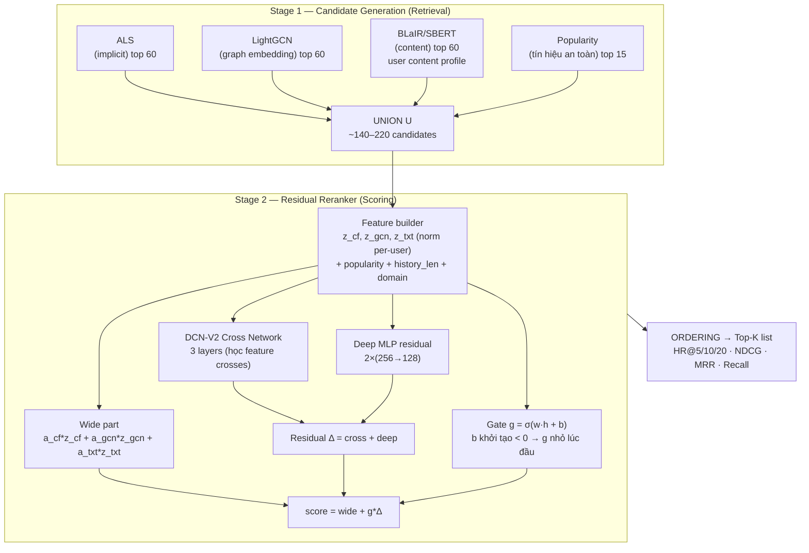
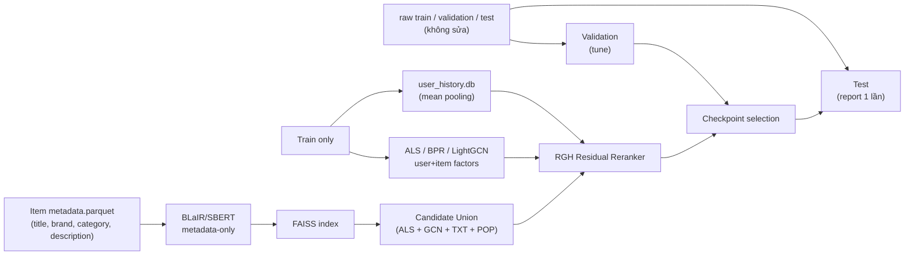

# Kiến trúc mô hình đề xuất — CF-Anchored Residual Gated Hybrid (RGH)

> **Mục tiêu:** Vượt mọi baseline hiện có (ALS 0.6845 HR@10 | 0.4882 NDCG@10) và tiến gần/vất Ensemble ALS+BPR (0.7242 | 0.5603) bằng một mô hình **deep hybrid** duy nhất, xử lý được cả warm- và cold-ish item, không bị phụ thuộc vào `alpha` cố định.

**Cập nhật:** 11/11/2026 — kèm script đánh giá và artifacts hiện có trong `artifacts/`.

---

## 1. Tổng quan 2 tầng



> Ghi chú: `U` luôn chứa positive cho training; lúc serving lấy union full-catalog từ FAISS/ANN; **không scan 2.46M items bằng deep model**.

---

## 2. Kiến trúc chi tiết Stage 1 — Candidate Generation

### 2.1 Các nguồn ứng viên

| Nguồn | Tín hiệu | Tham số | Ghi chú |
|---|---|---|---|
| **ALS** | User×Item matrix, implicit confidence | Recency/count, latent 64–128 | Keep: 2.46M catalog, float16, mmap |
| **LightGCN** | User–item graph diffusion | GRAPH_DIM, N_LAYERS=2–3, N_EPOCHS=30–50 | Graph branch bổ sung CF bậc cao |
| **BLaIR / SBERT** | Item text embedding (metadata-only) | 384/768-dim, cosine/FAISS, ANN top-K | User profile = **mean(embeddings train history)** |
| **Popularity** | `pop = log1p(item_count)` + rank | top 15 | Safety net + cold-safety |

### 2.2 Quy tắc union

```
U = Top60(ALS) ∪ Top60(LightGCN) ∪ Top60(BLaIR) ∪ Top15(popularity)
→ dedup giữ thứ tự ưu tiên CF > GCN > TXT > POP
→ Training: bắt buộc chèn positive (hard anchor)
→ Serving: union có thể ~120–250 candidates
```

**Recall cần đo:** `Recall@120(U)` — positive có trong union hay không; đây là upper bound cho Stage 2, và là thước đo chất lượng retrieval để báo cáo.

---

## 3. Kiến trúc chi tiết Stage 2 — Residual Reranker

### 3.1 Features (mỗi candidate `i` trong `U`)

```text
CF side (candidate-level, cả user và item):
  u_als, i_als          ← ALS factors
  u_bpr, i_bpr          ← BPR factors (nếu có)
  u_gcn, i_gcn          ← LightGCN factors

Content side:
  i_txt                 ← BLaIR/SBERT item embedding (metadata-only)
  u_txt = mean({i_txt : i ∈ train history of u})

Per-user normalized scores (trên U):
  z_cf  = (u_als·i_als − μ_u) / (σ_u + ε)   # hoặc z-CF từ ALS/BPR
  z_gcn = (u_gcn.i_gcn − μ_u) / (σ_u + ε)
  z_txt = (u_txt·i_txt − μ_u) / (σ_u + ε)

Context features:
  popularity (log1p count), historical rank in branch,
  history length, domain (Books/Electronics) mask
```

### 3.2 Công thức score cuối cùng

```text
score(u, i) = a_cf * z_cf(u,i)
            + a_gcn * z_gcn(u,i)
            + a_txt * z_txt(u,i)
            + g(h_u, h_i) * Δ(h_u, h_i)
```

Trong đó:
- `a_cf, a_gcn, a_txt` — trọng số học được, **khởi tạo `a_cf = 1.0`, `a_gcn = a_txt = 0.1`**
- `g = σ(w · h + b)`, `b` khởi tạo `-2.0` ⇒ `g ≈ 0.12` lúc đầu ⇒ **Δ đóng góp ít; khi không có ích gate tụt về ~0, model quy về union CF-anchored**
- `Δ` = DCN-V2 cross network + deep MLP residual
- Nếu `z_txt`/`z_gcn` không giúp → `a` hội tụ về ~0 ⇒ mô hình không phá hỏng ordering CF
- Nếu user mới (`u_txt` không có) → content mask = 0, gate phải học/được set masked

### 3.3 DCN-V2 Cross Network (học feature crosses)

```text
x0 = [z_cf, z_gcn, z_txt, pop, hist_len, domain_feats, u_als-projection, i_txt-proj]
x ← x
for l in 1..L (L=3):
    x ← x0 ⊙ (W_l · x + b_l) + x
```

⇒ Học tương tác cross giữa CF và content, ví dụ: high-confidence CF nên override content khi `|z_cf|` lớn, hoặc low-CF users tin content nhiều hơn. (DCN-V2 — Wang et al., WWW 2021)

### 3.4 Deep Residual Branch

```text
h0 → FC(256)→ReLU→Dropout(0.2) → FC(128)→ReLU → FC(1) = Δ_deep
score_residual = cross_summary(Δ via x) + Δ_deep
```

### 3.5 Gate

```text
gate  = σ(FC([h_u, h_i, z-scores, popularity, history_len]))
final = α*z_cf + β*z_gcn + γ*z_txt + gate*Δ_residual
```

**Phân biệt Gate vs α**: `α,β,γ` là trọng số global per-branch; `gate` là **per-(user, item)** — rất quan trọng để xử lý cold-start vs warm.

---

## 4. User input cho hybrid (CÓ cả CF và CB)

| Tầng | Input cụ thể | Vai trò |
|---|---|---|
| **CF** | `u_als`, `u_bpr`, `u_gcn` (các vector user) | Tín hiệu hành vi ngươli dùng; là "khoá neo" của mô hình |
| **CB** | `u_txt` = mean train-history embeddings | Tín hiệu nội dung sản phẩm ưu thích |
| **Candidate** | `z_cf, z_gcn, z_txt` (normalized) | Để fusion chuẩn hoá per-user |
| **Context** | popularity, rank từng nhánh, history length, domain | Điều phối |

> Nếu user **không có history** (cold-start): `u_txt` masked; `a_gcn/a_txt` xử lý bằng mask=0 ⇒ model chỉ dùng CF/popularity. Rอบ cold-start thực sự cần thêm metadata user (email/segment) — nằm ngoài scope dataset hiện có.

---

## 5. Training – Loss / Optimization

### 5.1 Objective chính: Listwise Sampled Softmax

```text
L_rank = - log  exp(score(pos) / T) / Σ_{j ∈ U(u)} exp(score(j) / T)
```

- `T` = 0.1–0.5 (tune trên validation)
- Negative = **hard negatives** từ retrieval (top candidates không phải positive) + **random negatives** (1/10 bảo vệ diversity)
- Positive luôn nằm trong `U(u)` ⇒ loss well-posed

### 5.2 Pairwise regularizer (tùy chọn)

```text
L_pair = - log σ(score(pos) - score(neg_hard))
L = L_rank + λ_pair * L_pair    (λ_pair ≈ 0.1)
```

### 5.3 Optimizer / checkpoint selection

- AdamW, lr = 1e-3 → 1e-4, weight_decay = 1e-4
- Early stopping theo **NDCG@10(val)**; tối đa 10–20 epochs; warmup 1 epoch
- Gradient clipping: max_norm=1.0
- Checkpoint: `rgh_residual_reranker.pt`, lưu top-1 theo validation

---

## 6. Protocol đánh giá (bắt buộc đi kèm)

1. **Retrieval metrics:** `Recall@120(U)` — trần cho reranker
2. **Ranking metrics:** HR@5/10/20, NDCG@5/10/20, MRR, Precision, Recall, AP, Mean Rank
3. **Split discipline:**
   - Tune T, λ, gate bias, top-K retrieval, epochs trên **validation**
   - Report test **một lần duy nhất** sau khi khóa hyperparameters
4. **Statistical significance:** paired bootstrap CI (95%) theo user; Wilcoxon signed-rank hoặc paired t-test RGH vs ALS
5. **Coverage / novelty:** % items xuất hiện trong top-20; popularity decile
6. **Cold-item bucket:** tách item warm/cold (>=10 ratings vs <10)
7. **Retrieval + rerank breakdown:** dòng metric riêng cho union và sau reranker

---

## 7. Artifacts cần có (✓ / ❌)

| Artifact | Trạng thái | Ghi chú |
|---|---|---|
| `als_user_factors.npy` / `als_item_factors.npy` | ✅ (artifacts/factors) | float16, mmap |
| `lightgcn_*` | ✅ (train_lightgcn đã chạy) | 2.46M catalog |
| `sbert_item_embeddings_768_f16.npy` | ✅ Full 2,464,371 × 768 float16 | ~3.79GB |
| Metadata-only content embedding | ⬜ **CẦN** rebuild cho clean content branch | Tránh transductive |
| FAISS index | ✅ (nhánh 03 / seven) | `sbert_faiss.index` |
| popularity | ✅ `item_popularity.npy` | |
| `rgh_residual_reranker.pt` | ⬜ **CẦN** train sau khi có pipeline | |

---

## 8. Sơ đồ dữ liệu sạch / không rò rỉ



---

## 9. Lợi ích so với Deep Early Fusion hiện tại

| Điểm | Early Fusion hiện tại | RGH đề xuất |
|---|---|---|
| Score blending | Thô, `min-max` toàn cục | **Per-user normalization trong U** |
| Loss | BCELoss pointwise | **Listwise softmax + hard negatives** |
| Neo | Không — có thể phá hỏng CF | **Residual anchor → g→0 an toàn** |
| Candidate | ALS/full SBERT chung catalog awkward | **Union retrieval** 2-stage |
| Gate | Từ BCE, α~0.55 không học được | **Gate init g≈0.12, học lại per-pair** |
| Tuning | (trước đây tune test) | **Tune validation, test 1 lần** |

---

## 10. Kế hoạch chạy (dự kiến)

1. Rebuild content branch metadata-only (BLaIR nếu khả dụng)
2. Implement RGH (candidate union + residual reranker + listwise loss)
3. Train Kaggle GPU, 10 epochs, early stop NDCG@10(val)
4. Eval: ablation (`a_gcn=a_txt=0` → check ≈ ALS; + normalization; + listwise; + content; + graph)
5. Report: K=5/10/20 HR/NDCG/MRR/Recall, bootstrap CI, cold/warm split
6. Sau acceptance gate → update app (architecture diagram + inference pipeline)

---

## 11. Tóm tắt kiến trúc bằng một câu

> **RGH = (ALS + LightGCN + BLaIR/SBERT + popularity retrieval union) → (per-user z-score normalized) → (wide weighted sum + DCN-V2 residual + deep MLP) → (gate nội bộ) → listwise softmax training, checkpoint trên validation, test một lần.**
