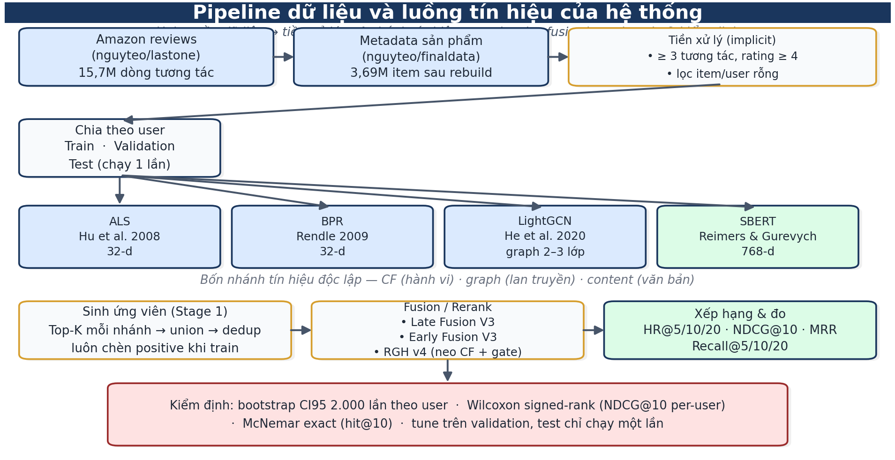
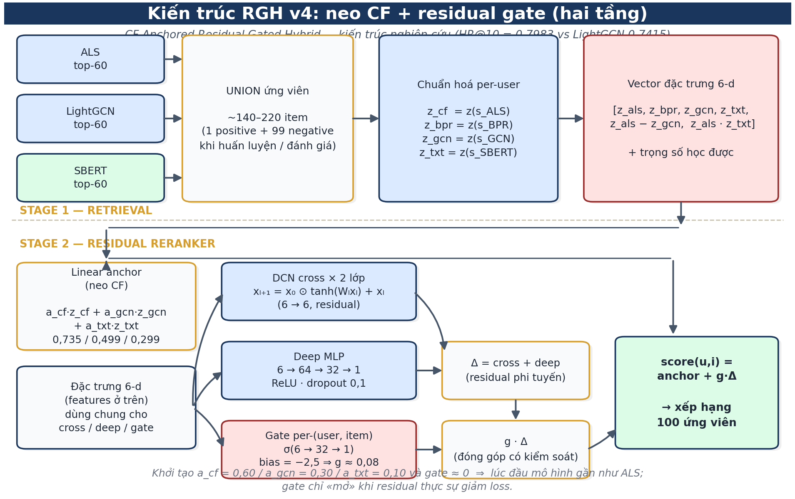
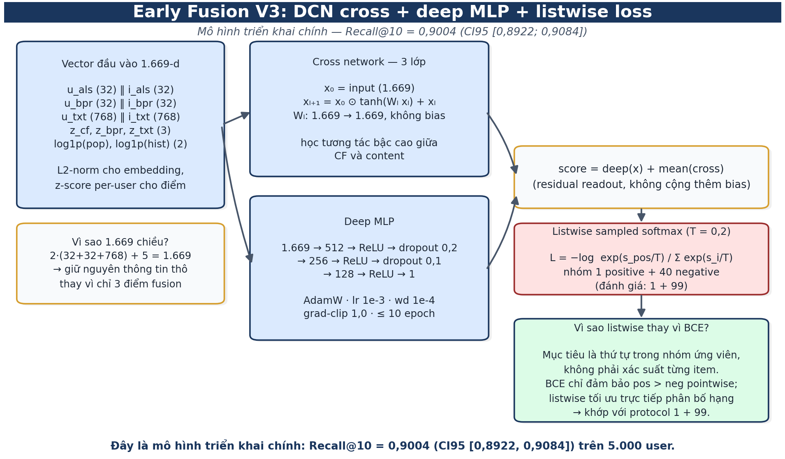
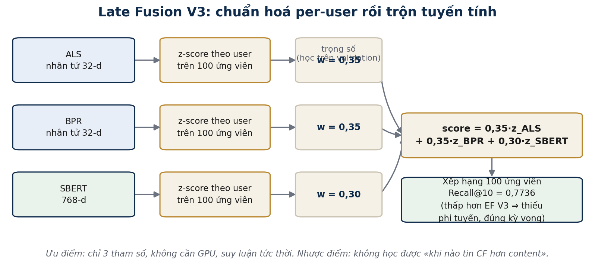
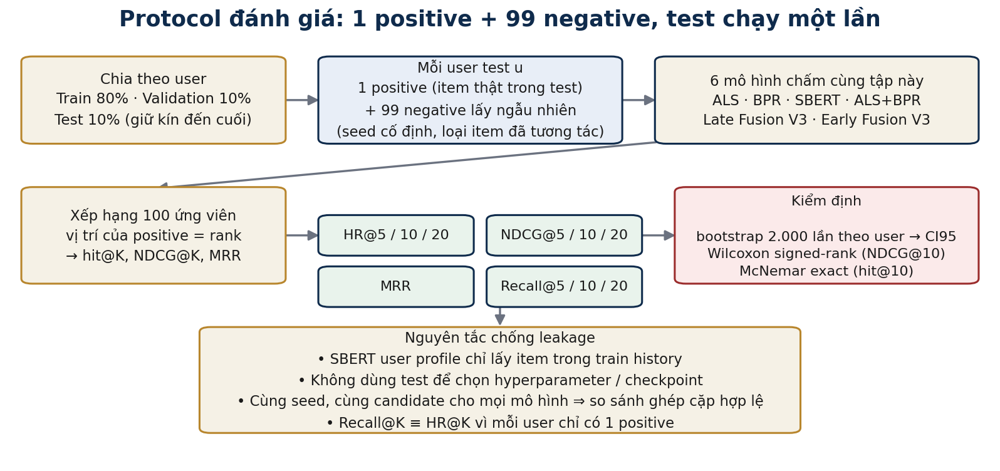
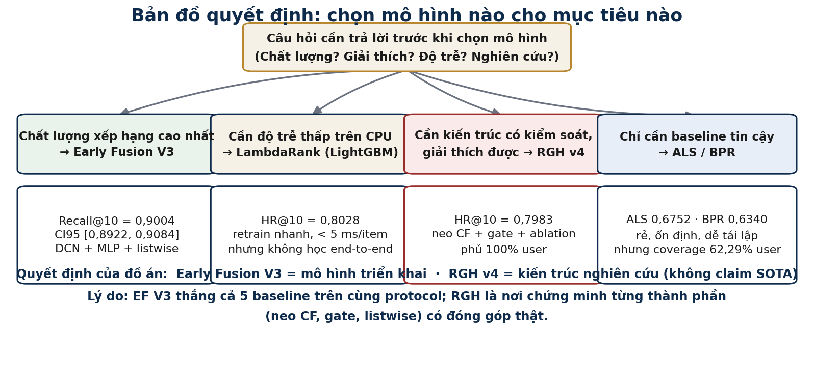

# TÓM GỌN ĐỒ ÁN — Deep Hybrid Recommender

> Một file duy nhất: cơ sở lý thuyết + kết quả thực nghiệm + kết luận.  
> Chi tiết đầy đủ: `docs/Bao_cao_day_du.md` (Chương 1–12 + Phụ lục A–H).

---

## 1. Bài toán & Dữ liệu
- **Gợi ý sản phẩm Amazon** (implicit feedback), catalog **2.464.371 item / 2.559.404 user**.
- **Tiền xử lý:** `min_interactions = 3`, `rating ≥ 4` → positive; chia theo user (train/val/test), test chạy 1 lần, leak-free (SBERT profile chỉ dùng train history).
- **Metadata rebuild v4:** 3.686.940 item; product_text 99,97%, title 99,95%, brand 97,09%, category 89,5%, description 82,08% (chỉ 1.176 item thiếu toàn bộ metadata).
- **SBERT v2:** 768-dim, 2.464.371 item × 768, leak-free (metadata-only).

*Hình 1 — Pipeline dữ liệu và luồng tín hiệu: 4 nhánh → retrieval → fusion → đo & kiểm định.*

## 2. Cơ sở lý thuyết (bài báo nền)

| Lĩnh vực | Bài báo | Vai trò trong đồ án |
|---|---|---|
| CF implicit | ALS (Hu et al., ICDM 2008) | Baseline mạnh nhất + neo của RGH; HR@10 = 0,6752 |
| CF pairwise | BPR (Rendle et al., UAI 2009) | Baseline thứ hai + thành phần Late Fusion; HR@10 = 0,6340 |
| Graph CF | LightGCN (He et al., SIGIR 2020) | Baseline graph + đối chứng công bằng RGH (phủ 100% user); HR@10 = 0,7415 |
| Content | SBERT (Reimers & Gurevych, EMNLP 2019) | Nhánh content duy nhất (768-d); HR@10 = 0,6096 sau rebuild v4 |
| Content | BLaIR (Hou et al., arXiv:2403.03952) | Bị loại (domain mismatch): 0,1142 |
| Hybrid | Wide & Deep (Cheng et al., RecSys 2016) | Cơ sở residual anchor trong RGH |
| Deep | DCN-V2 (Wang et al., WWW 2021) | Cross network trong Early Fusion & RGH |
| System | Two-stage retrieval (Covington et al., RecSys 2016) | Retrieval → rerank |
| Hybrid | Taxonomy hybrid (Burke, UMUAI 2002) | Phân loại hybrid (weighted + cascade) |
| Metrics | Sampled metrics (Krichene & Rendle, KDD 2020) | Cảnh báo 1+99 không đại diện full catalog |
| Deep | Residual learning (He et al., CVPR 2016) | Gate init b=−2, identity mapping |
| Cold-start | Cold item gates (Barkan et al., 2021) | Gate per-pair cho cold item |
| Ensemble | Caruana et al. (ICML 2004), Wolpert (1992) | Cơ sở Stacked Ensemble (0,8016) |
| Thống kê | Dietterich (1998), Demšar (2006) | Bootstrap CI, Wilcoxon, McNemar |

## 3. Mô hình

### Bốn nhánh tín hiệu
| Nhánh | Công thức | Vai trò |
|---|---|---|
| ALS | `u_als · i_als` (32-d) | Tín hiệu hành vi — "khóa neo" |
| BPR | `u_bpr · i_bpr` (32-d) | Tối ưu thứ tự, bổ sung diversity |
| LightGCN | lan truyền đồ thị 2–3 lớp | Phủ 100% user, bắt quan hệ bắc cầu |
| SBERT | `u_txt · i_txt` (768-d) | Phủ 99,97% item, xử lý item mới |

### Kiến trúc đề xuất

*Hình 2 — Kiến trúc RGH v4: neo CF + gate + residual (hai tầng).*

*Hình 3 — Early Fusion V3: vector 1.669-d → DCN cross 3 lớp + MLP → listwise softmax.*

*Hình 4 — Late Fusion V3: z-score per-user, trộn 0,35/0,35/0,30.*

- **Late Fusion V3 (tuyến tính):** `score = 0,35·z_cf + 0,35·z_bpr + 0,30·z_txt` (trọng số tune trên validation).
- **Early Fusion V3 (triển khai chính):** vector 1.669-d (embeddings L2-norm + z-scores + pop/hist) → DCN cross 3 lớp + MLP 512→256→128→1 → `deep + mean(cross)` → listwise sampled softmax (1 pos + 40 neg).
- **RGH v4 (nghiên cứu):** `score = a_cf·z_cf + a_gcn·z_gcn + a_txt·z_txt + g(h_u,h_i)·Δ` — neo CF + gate per-(user,item) (bias −2,5) + residual DCN/MLP; listwise loss.
- **LambdaRank Two-Stage** (LightGBM) và **Stacked Ensemble** — phương án thay thế low-latency.

*Hình 6 — Protocol: 1 positive + 99 negative, tune val/test 1 lần, bootstrap + paired test.*

## 4. Protocol đánh giá
- **Protocol A:** 1 positive + 99 random negatives, cùng user, cùng candidate, cùng seed; leak-free history.
- **Metrics:** HR@K, Recall@K, NDCG@K, MRR, Precision@K, F1@K, AP@K, Mean Rank.
- **Lưu ý:** trên protocol 1 positive/user, **Recall@K ≡ HR@K** (hệ quả toán học). Hai protocol (1+99 N=5.000 vs holdout N=7.500) **không so Δ chéo**.
- **Kiểm định:** bootstrap CI95 (2.000 lần theo user) + Wilcoxon signed-rank (NDCG@10 per-user) + McNemar exact (hit@10); tune trên validation, test chạy 1 lần.

## 5. Kết quả thực nghiệm

### Protocol 1+99 (N=5.000)
| Mô hình | Recall@10 | NDCG@10 | MRR |
|---|---:|---:|---:|
| ALS | 0.6752 | 0.4925 | 0.4476 |
| BPR | 0.6340 | 0.4386 | 0.3899 |
| SBERT (rebuild v4) | 0.6096 | 0.3928 | 0.3411 |
| ALS+BPR (50/50) | 0.7370 | 0.5499 | 0.4996 |
| **Late Fusion V3** | **0.7736** | **0.5846** | **0.5327** |
| **Early Fusion V3** (triển khai) | **0.9004** | **0.7305** | **0.6819** |

- EF V3 CI95: **[0.8922; 0.9084]**; ALS [0.6624; 0.6878] — **không chồng lænd**.
- Paired: EF thắng ALS **2.906/5.000 user** (thua 377, hoà 1.717); McNemar **1.194:68** (p=1,3e-266); Wilcoxon p < 1e-300; ΔNDCG@10 = **+0,2380**.
- Mở rộng 20.000 user: EF 0,8998 [0,8957; 0,9038] — kết luận ổn định.

### Protocol holdout RGH (N=7.500)
| Mô hình | HR@5 | HR@10 | HR@20 | NDCG@10 | MRR |
|---|---:|---:|---:|---:|---:|
| ALS (toàn bộ user, coverage 62,29%) | 0.4004 | 0.4787 | 0.5665 | 0.3520 | 0.3274 |
| LightGCN | 0.6580 | 0.7415 | 0.8145 | 0.5707 | 0.5260 |
| **RGH v4** (Proposed) | **0.7227** | **0.7983** | **0.8681** | **0.6374** | **0.5945** |
| LambdaRank | 0.7244 | 0.8028 | 0.8689 | 0.6399 | 0.5961 |
| Stacked | 0.7232 | 0.8016 | 0.8675 | 0.6372 | 0.5929 |

- RGH v4 **vượt LightGCN +5,68 điểm** (cùng phủ 100% user); trọng số học được: a_cf 0,60→**0,735**, a_gcn 0,30→**0,499**, a_txt 0,10→**0,299** (content mở gấp 3 lần).
- RGH **không** vượt LambdaRank (0,8028) / Stacked (0,8016) — đóng góp là kiến trúc + ablation, không phải SOTA.

### Ablation (H1–H6)
- **H1** (neo-CF đúng): RGH v2 (bug index) tụt về 0,7427 ≈ LightGCN 0,7415; v4 sửa mapping lên 0,7983.
- **H2** (chuẩn hoá per-user): V2 0,8826 → V3 0,9004 (bằng chứng gián tiếp).
- **H3** (listwise vs BCE): +1,78 điểm (gián tiếp, vì V3 đồng thời đổi SBERT).
- **H4** (content có đóng góp): `a_txt` 0,10→0,299; SBERT-only 0,6096 (tăng từ 0,4362 sau rebuild v4).
- **H5** (graph có đóng góp): RGH 0,7983 vs LightGCN 0,7415 (+5,68); `a_gcn` 0,30→0,499.
- **H6** (so ensemble): RGH > ALS+BPR; nhưng Stacked/LambdaRank ≈ RGH ⇒ feature fusion là tín hiệu chính.

## 6. Lý do chọn mô hình (5 tiêu chí)
1. **Chất lượng xếp hạng** → EF V3 cao nhất mọi metric, CI95 không chồng lænd.
2. **Độ phủ tín hiệu** → EF V3 không phụ thuộc coverage CF (37,71% user thiếu factor); RGH/LightGCN phủ 100%.
3. **Chi phí suy luận** → EF V3: 1 forward pass/ứng viên; GBDT: <5 ms/item; ensemble: 4× chi phí.
4. **Khả năng giải thích** → ablation H1–H6, trọng số a_cf/a_gcn/a_txt học được.
5. **Khả năng tái lập** → kernel độc lập, cùng seed; kernel eval tái lập đúng từng con số.

| Mô hình | Vai trò | Vì sao chọn | Vì sao không chọn làm chính |
|---|---|---|---|
| ALS | Baseline CF mạnh nhất + neo RGH | Chuẩn mực implicit feedback (Hu 2008); closed-form; ổn định | Chỉ hành vi; user/item lạ không có factor; coverage 62,29% |
| BPR | Baseline CF thứ hai | Tối ưu thứ tự cặp (Rendle 2009); bổ sung diversity | Một mình yếu hơn ALS; ALS+BPR = 0,7370 > cả hai |
| LightGCN | Baseline graph + đối chứng RGH | Đại diện graph CF (He 2020); phủ 100% user | Không có nội dung; 0,7415 < EF |
| SBERT | Nhánh content duy nhất | Tốt trên văn bản ngắn; encode 1 lần; 768-d | Content-only 0,6096; không biết hành vi |
| BLaIR | Ứng viên content bị loại | — | Domain mismatch (khoa học vs sản phẩm): 0,1142 |
| Late Fusion V3 | Mốc "trần tuyến tính" | 3 tham số, giải thích được, không GPU | Trọng số toàn cục; kém EF 12,68 điểm |
| **Early Fusion V3** | **Triển khai chính** | Cao nhất mọi metric; CI95 không chồng lænd; không phụ thuộc coverage CF | — (được chọn) |
| **RGH v4** | **Kiến trúc nghiên cứu** | Tách đóng góp từng nhánh; neo CF kiểm soát; +5,68 vs LightGCN | Cần 3 nhánh + graph khi suy luận; GBDT tương đương |
| LambdaRank | Low-latency | <5 ms/item, retrain nhanh, CPU | Không học end-to-end; phải bảo trì feature store |
| Stacked | Kiểm tra meta-learning | OOF predictions của 4 mô hình | Đắt gấp 4×, lợi ích <0,5 điểm |
| Transformer/Deep Hybrid (N=2000) | Tham khảo | — | Protocol khác, không tái lập |

*Hình 5 — Bản đồ quyết định: mục tiêu nào → mô hình nào.*

## 7. Kết luận
1. **Early Fusion V3** là mô hình triển khai: Recall@10 0,9004, vượt ALS +33,3% tương đối, CI95 không chồng lænd, McNemar 1.194:68.
2. **RGH v4** là kiến trúc nghiên cứu: +5,68 điểm vs LightGCN (cùng phủ 100% user), trọng số content mở gấp 3 lần — nhưng không vượt GBDT (~0,802–0,803).
3. **Dữ liệu quan trọng không kém mô hình:** rebuild metadata v4 đưa SBERT-only từ 0,4362 → 0,6096 (+39,8%); EF V3/LF V3 tăng so với V2 (0,8826→0,9004; 0,7472→0,7736).
4. **Giới hạn nêu trung thực:** sampled metric 1+99 không thay thế full-catalog; split không temporal-strict; ~6,13% positive ngoài catalogue; coverage CF 62,29% user; chưa full-catalog/1+999; chưa ablation sạch H2/H3; chưa multi-seed.

## 8. Hướng phát triển
1. Chạy full-catalog hoặc 1+999 negative để kiểm tra thiên lệch sampled metric (Krichene & Rendle 2020).
2. Ablation sạch: tách listwise vs BCE cùng SBERT; multi-seed EF V3.
3. Phân tích lỗi sâu: bucket theo history/domain; log phân bố gate RGH v4.
4. Temporal split; A/B test online.

---
*Báo cáo đầy đủ: `docs/Bao_cao_day_du.md` (Chương 1–12 + Phụ lục A–H, 6 sơ đồ, ~17.9k từ). Kịch bản bảo vệ: `docs/Kich_ban_bao_ve.md` (Q1–Q15). Cơ sở nền: `docs/Co_so_nen.md`.*