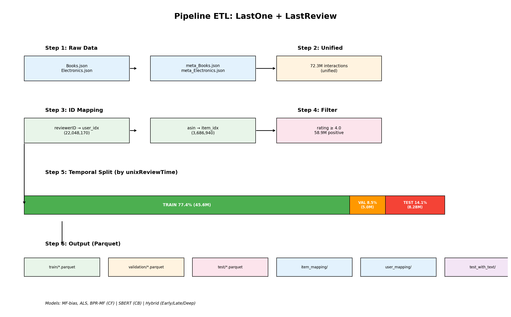

# Phân chia dữ liệu: LastOne + LastReview

## 1. Tổng quan dữ liệu

### 1.1 Nguồn dữ liệu
- **Books.json** + **Electronics.json**: Raw interactions từ Amazon
- **meta_Books.json** + **meta_Electronics.json**: Metadata sản phẩm (title, brand, category, ...)

### 1.2 Thống kê tổng

| Thông số | Giá trị |
|---|---|
| Tổng raw interactions | 72,305,974 |
| Positive pairs (rating ≥ 4.0) | 58,889,524 |
| Tổng Unique Users | 22,048,170 |
| Tổng Unique Items | 3,686,940 |
| Domains | Books, Electronics |

## 2. Pipeline ETL (finalcfdata kernel)

```
┌─────────────────────────────────────────────────────────────────────┐
│                    PIPELINE ETL (Spark)                             │
├─────────────────────────────────────────────────────────────────────┤
│                                                                     │
│  Step 1: Load raw data                                             │
│  ├── Books.json + Electronics.json → unified interactions          │
│  └── meta_Books.json + meta_Electronics.json → item metadata       │
│                                                                     │
│  Step 2: Build global ID mappings                                  │
│  ├── reviewerID → user_idx (22,048,170 users)                      │
│  └── asin → item_idx (3,686,940 items)                             │
│                                                                     │
│  Step 3: Filter positive pairs (rating ≥ 4.0)                      │
│  └── 58,889,524 positive interactions                             │
│                                                                     │
│  Step 4: Temporal split (by unixReviewTime)                        │
│  ├── Train: oldest interactions                                     │
│  ├── Validation: middle interactions                               │
│  └── Test: newest interactions                                     │
│                                                                     │
│  Step 5: Save mappings + splits to Parquet                        │
│  └── amazon_recs_output/{train,validation,test,item_mapping,user_mapping} │
└─────────────────────────────────────────────────────────────────────┘
```

## 3. Phân chia dữ liệu (Temporal Split)

### 3.1 Phương pháp
Phân chia theo **thời gian (Temporal Split)** dựa trên `unixReviewTime`:
- **Train**: Tương tác cũ nhất → học pattern
- **Validation**: Tương tác trung gian → tuning hyperparameters
- **Test**: Tương tác mới nhất → đánh giá cuối cùng

### 3.2 Tỷ lệ phân chia

```
┌─────────────────────────────────────────────────────────────────────┐
│                    TOÀN BỘ DỮ LIỆU (58.9M)                       │
├──────────────────────────────────────┬──────────┬───────────────────┤
│            TRAIN (77.4%)              │ VAL (8.5%)│   TEST (14.1%)   │
│         45,609,800 interactions       │ 4,998,646 │  8,281,078       │
│                                      │           │                   │
│  • Huấn luyện CF/CB/Hybrid          │ • Tune    │ • Đánh giá cuối  │
│  • Build user profiles (SBERT)      │   hyper   │ • RMSE, MAE,     │
│  • Tính popularity                  │   params  │   HR, NDCG, MRR  │
└──────────────────────────────────────┴──────────┴───────────────────┘
         Thời gian → (unixReviewTime tăng dần)
```

### 3.3 Chi tiết

| Tập | Số lượng | Tỷ lệ | Mục đích |
|---|---|---|---|
| **Train** | 45,609,800 | 77.4% | Huấn luyện model (CF, CB, Hybrid) |
| **Validation** | 4,998,646 | 8.5% | Tuning hyperparameters, early stopping |
| **Test** | 8,281,078 | 14.1% | Đánh giá cuối cùng |

### 3.4 Mapping

| Mapping | Mô tả | Kích thước |
|---|---|---|
| `user_mapping` | reviewerID → user_idx | 22,048,170 users |
| `item_mapping` | asin → item_idx | 3,686,940 items |

### 3.5 Positive Threshold

- **positive_threshold = 4.0**: Rating ≥ 4.0 → positive interaction
- Dùng cho BPR-MF training (implicit feedback) và ranking evaluation

## 4. Pipeline Review Data (finalreviewdata kernel)

```
┌─────────────────────────────────────────────────────────────────────┐
│                    PIPELINE REVIEW DATA (Spark)                    │
├─────────────────────────────────────────────────────────────────────┤
│                                                                     │
│  Step 1: Load raw data                                             │
│  ├── Books.json + Electronics.json → unified interactions          │
│  └── meta_Books.json + meta_Electronics.json → item metadata       │
│                                                                     │
│  Step 2: Build global ID mappings (same as finalcfdata)            │
│  ├── reviewerID → user_idx                                         │
│  └── asin → item_idx                                               │
│                                                                     │
│  Step 3: Temporal split (same as finalcfdata)                     │
│  ├── Train: oldest interactions                                    │
│  ├── Validation: middle interactions                               │
│  └── Test: newest interactions                                     │
│                                                                     │
│  Step 4: Join review_content to each split                        │
│  ├── test_with_text: test set + review_content + title/brand/etc   │
│  └── Saved to amazon_recs_output/test_with_text/                   │
│                                                                     │
│  Output: test_with_text/*.parquet (for SBERT encoding)             │
└─────────────────────────────────────────────────────────────────────┘
```

## 5. Sơ đồ tổng quan pipeline

```
┌─────────────┐     ┌──────────────┐
│  LastOne     │     │  LastReview   │
│  (interactions)│     │  (reviews)    │
└──────┬──────┘     └──────┬───────┘
       │                   │
       ▼                   ▼
┌─────────────┐     ┌──────────────┐
│  ETL (Spark) │     │  ETL (Spark)  │
│  - ID mapping│     │  - ID mapping │
│  - Temporal  │     │  - Temporal   │
│    split     │     │    split      │
│  - train/    │     │  - test_with_ │
│    val/test  │     │    text       │
└──────┬──────┘     └──────┬───────┘
       │                   │
       ▼                   ▼
┌─────────────┐     ┌──────────────┐
│  CF Models   │     │  SBERT       │
│  (MF-bias,   │     │  (Content    │
│   ALS, BPR)  │     │   embeddings)│
└──────┬──────┘     └──────┬───────┘
       │                   │
       └────────┬──────────┘
                ▼
        ┌──────────────┐
        │  Hybrid      │
        │  (Early/Late │
        │   /Deep)     │
        └──────┬───────┘
               │
               ▼
        ┌──────────────┐
        │  Evaluation  │
        │  (RMSE, MAE, │
        │   HR, NDCG,  │
        │   MRR)       │
        └──────────────┘
```

## 6. Phân chia trong code (Kaggle notebooks)

### finalcfdata kernel (ETL)
- Load Books.json + Electronics.json → unified interactions
- Build global ID mappings (reviewerID → user_idx, asin → item_idx)
- Filter positive pairs (rating ≥ 4.0)
- Temporal split by unixReviewTime
- Save to amazon_recs_output/{train, validation, test, item_mapping, user_mapping}

### finalreviewdata kernel (ETL + Text)
- Load raw data + metadata (same as finalcfdata)
- Build global ID mappings (same)
- Temporal split (same)
- Join review_content to test set → test_with_text
- Save to amazon_recs_output/test_with_text/

### Model training kernels
- Sử dụng `train/*.parquet` để train
- Sử dụng `test/*.parquet` để evaluate
- Sử dụng `test_with_text/*.parquet` để encode SBERT
- Sử dụng `item_mapping` và `user_mapping` cho ID lookup

## 7. Dữ liệu cho từng model

| Model | Train data | Content data | Eval data |
|---|---|---|---|
| MF-bias | train/*.parquet | — | test/*.parquet |
| ALS | train/*.parquet | — | test/*.parquet |
| BPR-MF | train/*.parquet | — | test/*.parquet |
| SBERT | — | test_with_text/*.parquet | test/*.parquet |
| LateFusion/EarlyFusion | train/*.parquet | test_with_text/*.parquet | test/*.parquet |
| DCN-v2/TwoTower/etc. | train/*.parquet | test_with_text/*.parquet | test/*.parquet |

## 8. Sơ đồ pipeline



## 9. Kernel Kaggle

| Kernel | Mô tả | Output |
|---|---|---|
| `finalcfdata` | ETL: load raw → ID mapping → filter positive → temporal split | `amazon_recs_output/{train,validation,test,item_mapping,user_mapping,split_metadata.json}` |
| `finalreviewdata` | ETL + text: load raw → ID mapping → temporal split → join review_content | `amazon_recs_output/test_with_text/*.parquet` |

## 10. Mapping chi tiết

| Field | Type | Mô tả |
|---|---|---|
| `reviewerID` | string | Amazon reviewer ID |
| `user_idx` | bigint | Global user index (0-22,048,169) |
| `asin` | string | Amazon product ID |
| `item_idx` | bigint | Global item index (0-3,686,939) |
| `rating` | double | Rating (1-5) |
| `unixReviewTime` | bigint | Unix timestamp |
| `domain` | string | "books" or "electronics" |
