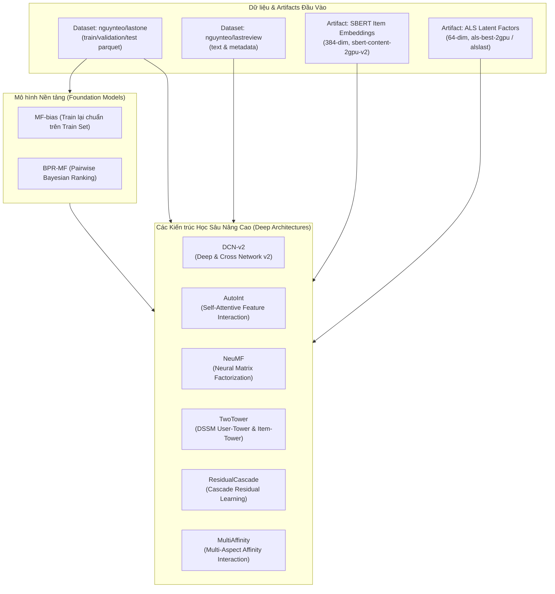
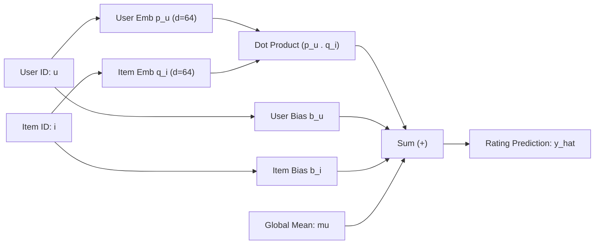
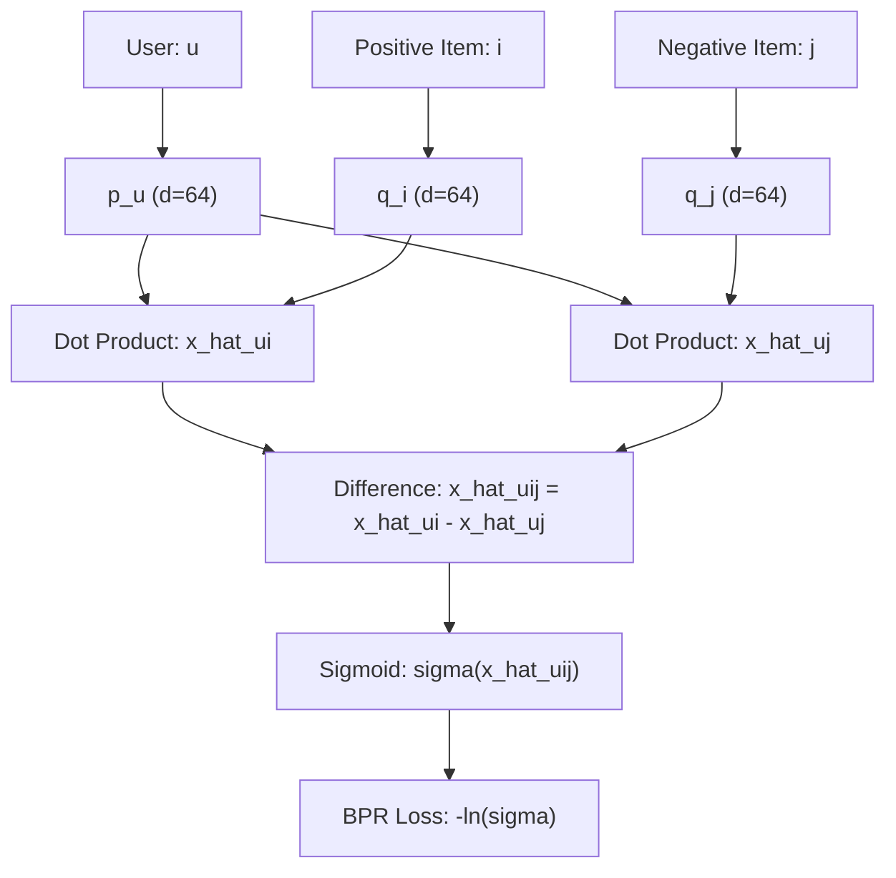
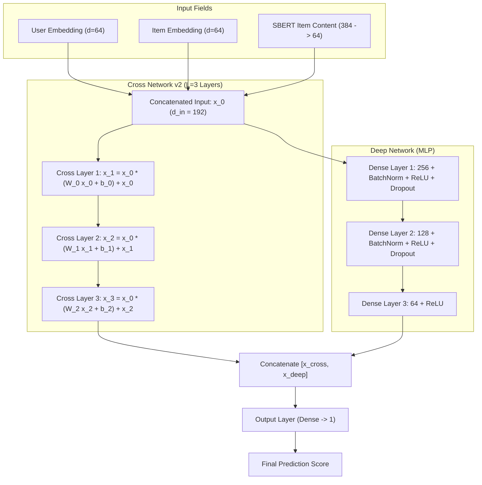
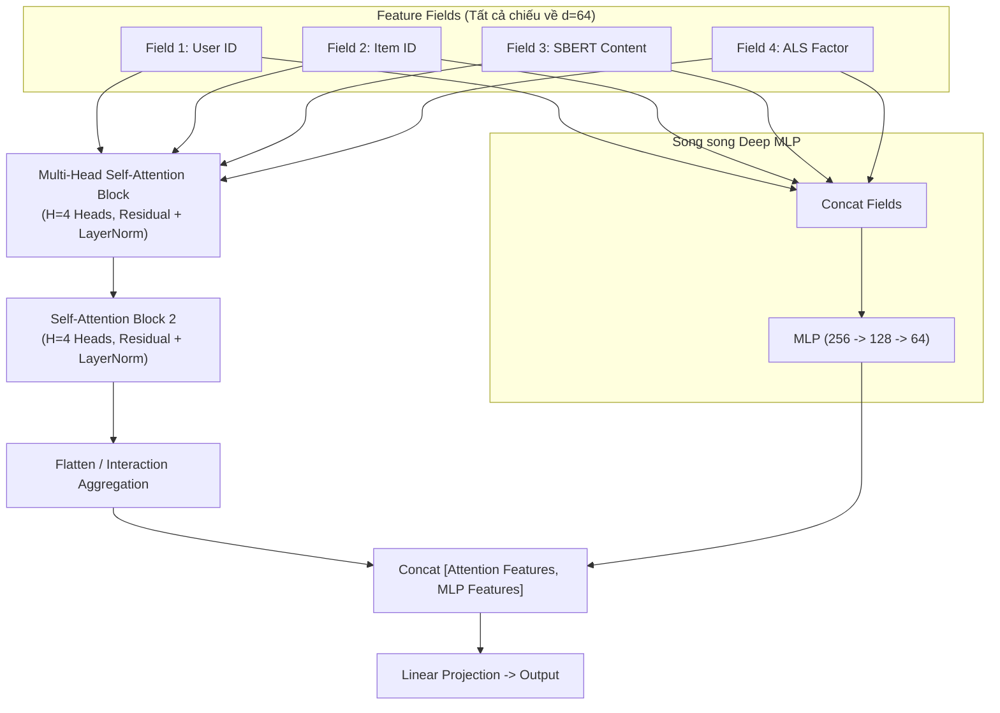
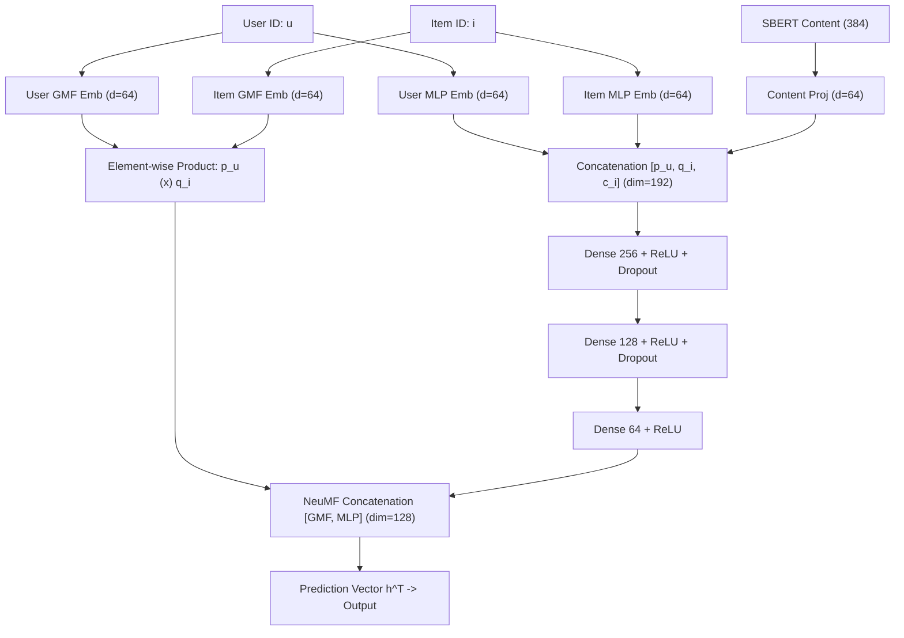
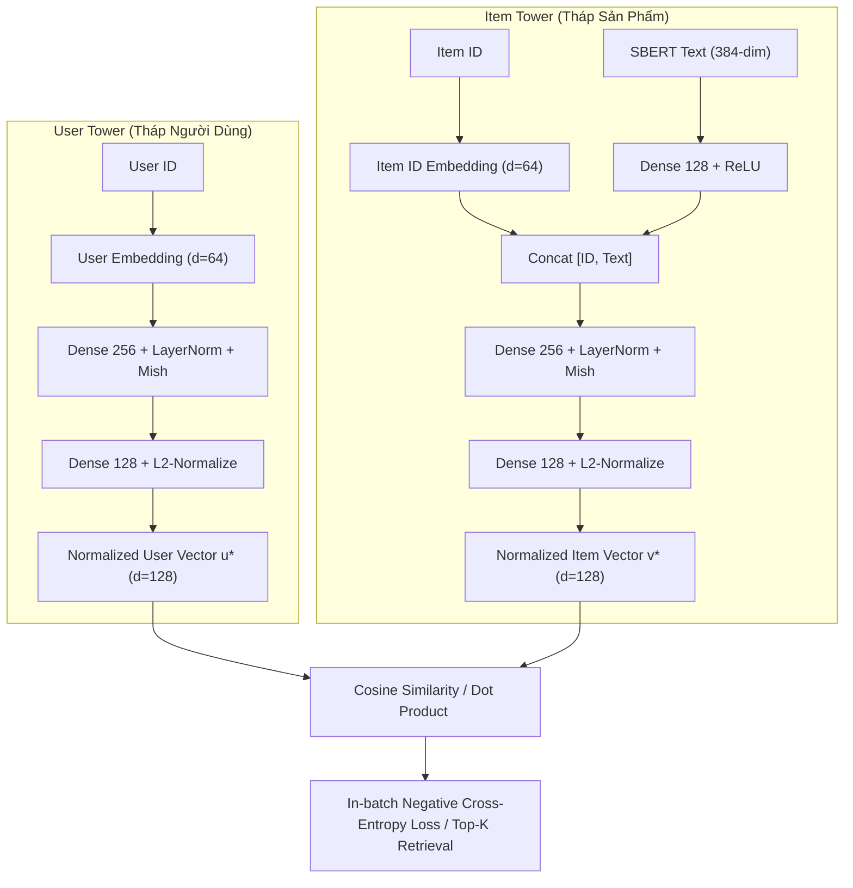
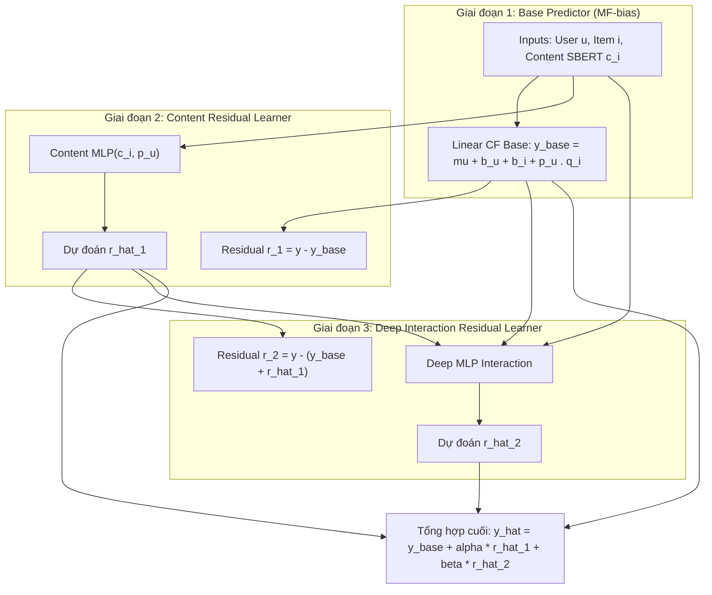
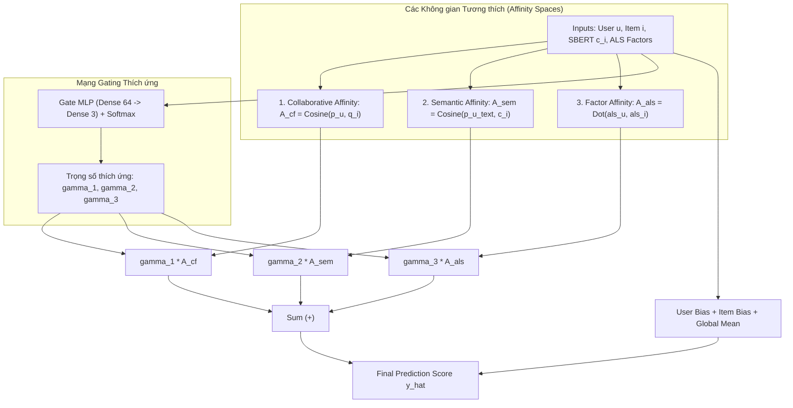

# BÁO CÁO THIẾT KẾ KIẾN TRÚC CÁC MÔ HÌNH GỢI Ý (RECOMMENDER SYSTEM ARCHITECTURES)
## ĐỒ ÁN TỐT NGHIỆP: HỆ THỐNG GỢI Ý LAI GHÉP (HYBRID RECOMMENDER SYSTEM)

---

## 1. TỔNG QUAN HỆ THỐNG VÀ PIPELINE TỔNG THỂ

Hệ thống kết hợp dữ liệu tương tác hành vi và thông tin ngữ nghĩa ngữ cảnh từ hai bộ dữ liệu:
- **`nguynteo/lastone`**: Bộ dữ liệu tương tác quy mô lớn (User-Item ratings, train/val/test splits dạng Parquet, mapping user và item).
- **`nguynteo/lastreview`**: Bộ dữ liệu nội dung đánh giá và thuộc tính sản phẩm (`test_with_text` và review metadata).

### Artifacts đầu vào tái sử dụng:
1. **`sbert-content-2gpu-v2`**: Vector nhúng ngữ nghĩa sản phẩm (SBERT Item Embeddings 384 chiều, được sinh bởi mô hình `all-MiniLM-L6-v2`).
2. **`alslast` / `als-best-2gpu`**: Latent factors trích xuất từ mô hình ALS Matrix Factorization (User & Item factors 64 chiều).
3. **`bpr-mf`**: Mô hình phân hạng cặp (Pairwise Ranking) huấn luyện theo hàm mục tiêu Bayesian Personalized Ranking.
4. **`mf-bias`**: Mô hình Matrix Factorization với User Bias, Item Bias và Global Bias được huấn luyện lại chuẩn xác trên tập `train/*.parquet`.

---

## 2. CHI TIẾT KIẾN TRÚC TỪNG MÔ HÌNH

---

### 2.1. MF-bias (Matrix Factorization with Biases - Train lại chuẩn trên Train Set)

#### Mô tả kiến trúc:
Mô hình mở rộng của phân rã ma trận truyền thống bằng cách kết hợp độ lệch người dùng ($b_u$), độ lệch sản phẩm ($b_i$) và giá trị trung bình toàn cục ($\mu$).

#### Công thức toán học:
$$\hat{y}_{u,i} = \mu + b_u + b_i + \mathbf{p}_u^T \mathbf{q}_i$$
Hàm mất mát hồi quy có điều chuẩn (MSE + $L_2$ Regularization):
$$\mathcal{L}_{MF} = \frac{1}{|\mathcal{D}_{train}|} \sum_{(u,i) \in \mathcal{D}_{train}} \left( y_{u,i} - \hat{y}_{u,i} \right)^2 + \lambda \left( \|\mathbf{p}_u\|_2^2 + \|\mathbf{q}_i\|_2^2 + b_u^2 + b_i^2 \right)$$

---

### 2.2. BPR-MF (Bayesian Personalized Ranking Matrix Factorization)

#### Mô tả kiến trúc:
BPR-MF tối ưu hóa bài toán gợi ý dưới dạng **Top-K Ranking** (xếp hạng danh sách sản phẩm) bằng cách so sánh sở thích tương đối giữa cặp sản phẩm đã tương tác ($i$) và sản phẩm chưa tương tác ($j$).

#### Công thức toán học:
$$\hat{x}_{u,i,j} = \hat{x}_{u,i} - \hat{x}_{u,j} = \mathbf{p}_u^T \mathbf{q}_i - \mathbf{p}_u^T \mathbf{q}_j$$
Hàm mất mát BPR (tối đa hóa xác suất hậu nghiệm log-likelihood):
$$\mathcal{L}_{BPR} = \sum_{(u,i,j) \in \mathcal{D}_{pairs}} -\ln \sigma(\hat{x}_{u,i,j}) + \lambda_\Theta \|\Theta\|_2^2$$
trong đó $\sigma(z) = \frac{1}{1 + e^{-z}}$.

---

### 2.3. DCN-v2 (Deep & Cross Network v2)

#### Mô tả kiến trúc:
DCN-v2 (Wang et al., 2021) kết hợp hai mạng song song:
1. **Cross Network v2**: Tự động học các tương tác đặc trưng bậc cao tường minh qua ma trận trọng số $W_l$.
2. **Deep Network**: Trích xuất đặc trưng phi tuyến tính phức tạp qua nhiều tầng MLP.
3. **Combination**: Ghép nối (Concat) hoặc dùng Mixture of Experts để tạo đầu ra dự đoán.

#### Công thức toán học tầng Cross Network:
$$\mathbf{x}_{l+1} = \mathbf{x}_0 \odot \left( \mathbf{W}_l \mathbf{x}_l + \mathbf{b}_l \right) + \mathbf{x}_l$$
với $\mathbf{x}_0 = [\mathbf{e}_u \,\|\, \mathbf{e}_i \,\|\, \mathbf{c}_i]$ (ghép nối User Embedding, Item Embedding, và SBERT Projection).

---

### 2.4. AutoInt (Automatic Feature Interaction Learning via Self-Attentive Neural Networks)

#### Mô tả kiến trúc:
AutoInt (Song et al., CIKM 2019) sử dụng cơ chế **Multi-Head Self-Attention** để tự động mô hình hóa tương tác giữa các trường đặc trưng (Feature Fields) ở không gian tiềm ẩn mà không cần chỉ định thủ công:
- Field 1: User ID Embedding.
- Field 2: Item ID Embedding.
- Field 3: SBERT Content Projection.
- Field 4: Behavioral Latent Factors (ALS).

#### Công thức toán học tầng Self-Attention:
Với Head thứ $m$:
$$\alpha_{i,j}^{(m)} = \frac{\exp\left( \frac{\langle \mathbf{W}_Q^{(m)} \mathbf{e}_i, \, \mathbf{W}_K^{(m)} \mathbf{e}_j \rangle}{\sqrt{d}} \right)}{\sum_{k=1}^M \exp\left( \frac{\langle \mathbf{W}_Q^{(m)} \mathbf{e}_i, \, \mathbf{W}_K^{(m)} \mathbf{e}_k \rangle}{\sqrt{d}} \right)}$$
$$\mathbf{z}_i^{(m)} = \sum_{j=1}^M \alpha_{i,j}^{(m)} \left( \mathbf{W}_V^{(m)} \mathbf{e}_j \right)$$
$$\mathbf{e}_i^{(l+1)} = \text{ReLU}\left( \mathbf{W}_{res} \mathbf{e}_i^{(l)} + \bigoplus_{m=1}^H \mathbf{z}_i^{(m)} \right)$$

---

### 2.5. NeuMF (Neural Matrix Factorization - He et al., WWW 2017)

#### Mô tả kiến trúc:
NeuMF kết hợp sức mạnh tuyến tính của **Generalized Matrix Factorization (GMF)** và tính phi tuyến tính của **Multi-Layer Perceptron (MLP)**:
- Nhánh GMF: Sử dụng phép nhân vô hướng từng phần tử (Element-wise Product).
- Nhánh MLP: Nối các embedding và truyền qua nhiều lớp phi tuyến tính sâu.
- Lớp NeuMF cuối cùng ghép nối kết quả cả hai nhánh.

#### Công thức toán học:
$$\phi^{GMF} = \mathbf{p}_u^G \odot \mathbf{q}_i^G$$
$$\phi^{MLP} = a_L \left( \mathbf{W}_L^T \left( \dots a_1(\mathbf{W}_1^T [\mathbf{p}_u^M \,\|\, \mathbf{q}_i^M \,\|\, \mathbf{c}_i] + \mathbf{b}_1) \dots \right) + \mathbf{b}_L \right)$$
$$\hat{y}_{u,i} = \sigma \left( \mathbf{h}^T \begin{bmatrix} \phi^{GMF} \\ \phi^{MLP} \end{bmatrix} \right)$$

---

### 2.6. TwoTower (Two-Tower Retrieval DSSM Architecture)

#### Mô tả kiến trúc:
Mô hình hai tháp tách biệt hoàn toàn biểu diễn Người dùng và Sản phẩm:
- **User Tower**: Tiếp nhận User ID, thông tin hồ sơ và lịch sử tương tác để sinh ra vector $u^* \in \mathbb{R}^d$.
- **Item Tower**: Tiếp nhận Item ID và vector ngữ nghĩa SBERT 384 chiều của sản phẩm để sinh ra vector $v^* \in \mathbb{R}^d$.
- **Ưu điểm vượt trội**: Vector sản phẩm có thể được tính trước và index vào các hệ thống tìm kiếm vector tốc độ cao (FAISS / HNSW / Milvus) cho phép phục vụ hàng triệu sản phẩm ở độ trễ dưới $10\text{ms}$.

#### Công thức toán học:
$$\mathbf{u}^* = \frac{f_{User}(\mathbf{x}_u)}{\|f_{User}(\mathbf{x}_u)\|_2}, \quad \mathbf{v}^* = \frac{g_{Item}(\mathbf{x}_i)}{\|g_{Item}(\mathbf{x}_i)\|_2}$$
$$\text{Score}(u, i) = \langle \mathbf{u}^*, \mathbf{v}^* \rangle = \sum_{k=1}^d u_k^* \cdot v_k^*$$

---

### 2.7. ResidualCascade (Cascade Residual Learning Hybrid)

#### Mô tả kiến trúc:
Kiến trúc dạng chuỗi thác dư sai (Residual Cascading) chia quá trình học làm nhiều giai đoạn tiến bộ:
1. **Giai đoạn 1 (Linear Collaborative Filtering Baseline)**: Sử dụng mô hình tuyến tính phân giải nhanh (MF-bias / ALS) dự đoán điểm cơ sở $\hat{y}_{base}$.
2. **Giai đoạn 2 (Content Residual)**: Mạng nơ-ron học dự đoán phần dư thứ nhất $r_1 = y - \hat{y}_{base}$ từ vector nội dung SBERT.
3. **Giai đoạn 3 (Non-linear Interaction Residual)**: MLP sâu học phần dư thứ hai $r_2 = y - (\hat{y}_{base} + \hat{r}_1)$ từ tương tác chéo sâu.

#### Công thức toán học:
$$\hat{y}_{base} = \mu + b_u + b_i + \mathbf{p}_u^T \mathbf{q}_i$$
$$\hat{r}_1 = \text{MLP}_{content}(\mathbf{c}_i, \mathbf{p}_u)$$
$$\hat{r}_2 = \text{MLP}_{deep}([\mathbf{p}_u \,\|\, \mathbf{q}_i \,\|\, \mathbf{c}_i \,\|\, \hat{y}_{base} \,\|\, \hat{r}_1])$$
$$\hat{y}_{final} = \hat{y}_{base} + \alpha \hat{r}_1 + \beta \hat{r}_2$$

---

### 2.8. MultiAffinity (Multi-Aspect Affinity Interaction Hybrid)

#### Mô tả kiến trúc:
Phân rã độ tương đồng giữa người dùng và sản phẩm thành nhiều không gian tương thích độc lập (Multiple Affinity Spaces):
1. **Collaborative Affinity ($A_{cf}$)**: Độ tương thích theo hành vi chung giữa các người dùng tương tự.
2. **Semantic Affinity ($A_{sem}$)**: Độ tương thích giữa sở thích văn bản của người dùng và nội dung SBERT của sản phẩm.
3. **Latent Factor Affinity ($A_{als}$)**: Độ tương thích không gian tiềm ẩn từ phân rã ALS.
4. **Attention Gating Network**: Học trọng số thích nghi $\gamma_k(u, i)$ để tự động cân bằng các nguồn tri thức tùy thuộc vào mức độ phong phú thông tin của từng người dùng và sản phẩm.

#### Công thức toán học:
$$A_{cf}(u, i) = \frac{\mathbf{p}_u^T \mathbf{q}_i}{\|\mathbf{p}_u\|_2 \|\mathbf{q}_i\|_2}, \quad A_{sem}(u, i) = \frac{\mathbf{p}_u^{text} \cdot \mathbf{c}_i}{\|\mathbf{p}_u^{text}\|_2 \|\mathbf{c}_i\|_2}, \quad A_{als}(u, i) = \mathbf{f}_u^{als} \cdot \mathbf{f}_i^{als}$$
$$[\gamma_1, \gamma_2, \gamma_3] = \text{Softmax}\left( \text{GateMLP}([\mathbf{p}_u \,\|\, \mathbf{q}_i \,\|\, \mathbf{c}_i]) \right)$$
$$\hat{y}_{u,i} = \sum_{k=1}^3 \gamma_k \cdot A_k(u, i) + b_u + b_i + \mu$$

---

## 3. BẢNG SO SÁNH TỔNG HỢP CÁC MÔ HÌNH

| Mô hình | Kiểu tương tác | Đặc trưng đầu vào | Mục tiêu chính | Phục vụ Real-time |
| :--- | :--- | :--- | :--- | :---: |
| **MF-bias** | Tuyến tính + Biases | User ID, Item ID | Tối ưu RMSE/MAE | Rất nhanh ($<1\text{ms}$) |
| **BPR-MF** | Phân hạng cặp (Pairwise) | User ID, Item ID | Tối ưu Ranking (HR@10, NDCG@10) | Rất nhanh ($<1\text{ms}$) |
| **DCN-v2** | Explicit Cross + Deep MLP | User ID, Item ID, SBERT Text | Bắt tương tác bậc cao tự động | Nhanh ($<5\text{ms}$) |
| **AutoInt** | Multi-Head Self-Attention | Multi-fields (ID, Text, ALS) | Tương tác giải thích được (Attention weights) | Trung bình ($<15\text{ms}$) |
| **NeuMF** | GMF (Linear) + Deep MLP | User ID, Item ID, SBERT Text | Kết hợp tuyến tính và phi tuyến tính | Nhanh ($<5\text{ms}$) |
| **TwoTower** | Tách tháp User & Item | User features, Item text SBERT | Vector Search quy mô triệu sản phẩm | Siêu nhanh ($<2\text{ms}$ với FAISS) |
| **ResidualCascade** | Học thác phần dư tiến bộ | CF Base + SBERT Residual + Deep | Tránh overfitting, bù trừ sai số từng bước | Nhanh ($<8\text{ms}$) |
| **MultiAffinity** | Multi-space + Adaptive Gating | CF, SBERT, ALS, Metadata | Tự thích nghi người dùng mới / sản phẩm mới | Nhanh ($<8\text{ms}$) |

---

## 4. CHIẾN LƯỢC HUẤN LUYỆN TRÊN KAGGLE (2×T4 GPU)

1. **Chuẩn bị dữ liệu**:
   - Tải `train/*.parquet` từ `nguynteo/lastone/amazon_recs_output` làm tập huấn luyện.
   - Tải `test/*.parquet` chỉ dùng cho bước **Evaluate** (tính RMSE, MAE, HR@10, NDCG@10). Tuyệt đối không để DataLoader huấn luyện chạm vào tập này.
   - Tải `sbert_item_embeddings.npy` từ artifact `sbert-content-2gpu-v2`.
2. **Kỹ thuật tối ưu phần cứng**:
   - `PyTorch DataParallel` hoặc `DistributedDataParallel` trên 2×T4 GPU.
   - `pin_memory=True`, `num_workers=4`, `expandable_segments:True` để tối ưu VRAM.
   - Kỹ thuật Streaming / Chunking mini-batch tránh Out of Memory với 22M users và 3.6M items.
3. **Tiêu chuẩn Log tiến trình**:
   - Sử dụng `tqdm` cho từng epoch.
   - Ghi nhận `Train Loss`, `Batch Loss` định kỳ 100 steps.
   - Đánh giá trên Validation/Test set sau mỗi epoch.
   - Lưu trữ checkpoint model weights (`.pt` / `.pth`) và file metrics (`.json`) vào `/kaggle/working`.
